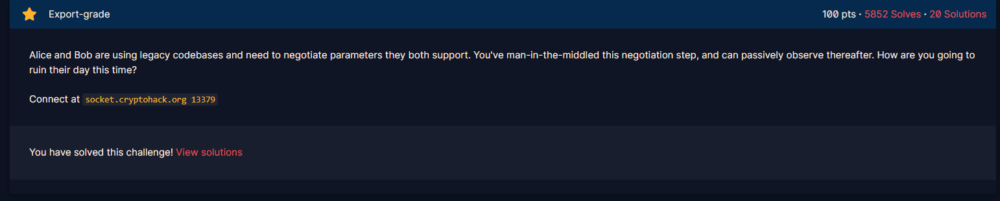
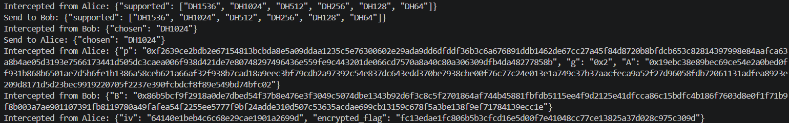

# Export-grade

#### Course: `Public-Key Cryptography` - Cryptohack - Ngày viết: 21/10/2026

#### 1. Overview

* 
* Đây là bài cuối cùng của Course, bài này cho thấy độ dài module p thực sự quan trọng như nào giống với RSA =)))
* `Mục tiêu`: Giải mã ciphertext được Alice gửi thông qua giao thức Diffie Hellman
* `Kỹ thuât`: Brute Force
* `Lỗ hỗng`: Độ dài số nguyên tố p nhỏ 

#### 2. Nền tảng cốt lõi

* Nếu như giao thức Diffie Hellman được triển khai đúng, thì Diffie Hellman bảo vệ được dữ liệu nhờ việc phải phân tích logarit, nếu như phân tích được logarit và lấy được thành phần khóa, giao thức coi như đã bị phá vỡ. Nếu số nguyên tố p quá nhỏ, 128 bit trở xuống, thì Diffie Hellman sẽ bị phá bằng thuật toán `discrete_log`chưa tới 5s.
* Mình tham khảo tại: [Đọc ](https://crypto.stackexchange.com/questions/99519/64-bit-key-size-diffie-hellman)

#### 3. Exploit chain

* 
* Ở bài này, ta không thể can thiệp vào dữ liệu khóa nữa, nhưng ta có thể can thiệp được vào bộ mã hóa.
* Với bộ mã hóa DH64 sẽ sử dụng số nguyên tố p chỉ dài 64 bit. Với bộ mã hóa này, ta sẽ tìm được thành phần khóa `a` và tính được khóa chung `g^ab`chỉ trong vòng 5s
* Script: [Đọc](solve.sage)
* ```
  crypto{d0wn6r4d35_4r3_d4n63r0u5}
  ```
