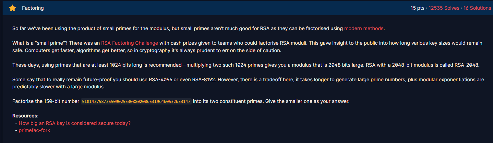

# Factoring

#### Course: `Public-Key Cryptography` - Cryptohack - Ngày viết: 20/10/2026

#### 1. Overview

* 
* Đây là bài sẽ giới thiệu cho chúng ta mức độ an toàn của thuật toán RSA phụ thuộc vào gì. Theo những gì đề bài nói, mức độ an toàn của thuật toán RSA phụ thuộc vào việc độ khó của phân tích thừa số N, nếu như việc phân tích thừa số N gần như bất khả thi thì thuật toán RSA sẽ hoạt động an toàn. Độ dài khuyến nghị của các thừa số nguyên tố N có độ dài khuyến nghị là 1024 bit
* `Mục tiêu`: Phân tích thừa số nguyên tố của số dài 150 bit

#### 2. Exploit chain

* Chúng ta sẽ sử dụng trang web [factordb](https://factordb.com/) để phân tích thừa số nguyên tố N bài này.
* ```
  19704762736204164635843
  ```
