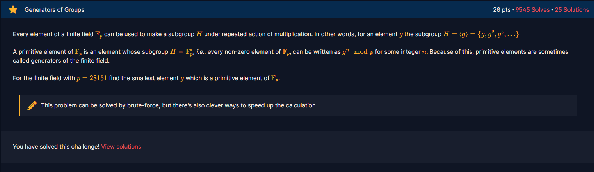

# Generators of Groups

#### Course: `Public-Key Cryptography` - Cryptohack - Ngày viết: 21/10/2026

#### 1. Overview

* 
* Đây là bài chúng ta sẽ tìm hiểu về phần tử nguyên thủy của 1 trường hữu hạn.
* `Mục tiêu`: Tìm phần tử nguyên thủy của trường hữu hạn.

#### 2. Nền tảng cốt lõi

* Nền tảng, các bạn đọc qua **Lũy thừa và căn nguyên thủy trong trường hữu hạn** trước nhé: [Đọc](https://giapppp.notion.site/Mathematic-in-Cryptography-01a27fda51a943d2b04fbe840e5dd26b)
* Cơ bản, thay vì brute force kiểm tra 1 số g là phần tử nguyên thủy bằng cách mũ từ `0` - `p-2`để kiểm tra, ta sử dụng `Định lý Lagrange`để tăng tốc quá trình tìm kiếm phần tử nguyên thủy
* `Định lý Lagrange(Lý thuyết nhóm)`: [Đọc](https://vi.wikipedia.org/wiki/%C4%90%E1%BB%8Bnh_l%C3%BD_Lagrange_(l%C3%BD_thuy%E1%BA%BFt_nh%C3%B3m))

#### 3. Exploit chain

* Quy trình:
  * Phân tích tìm ước số nguyên tố của `p - 1`
  * Tính các giá trị `(p - 1)/q`với `q` là ước nguyên tố của `p - 1`
  * Kiểm tra mọi số g trong trường có phải là phần tử nguyên thủy hay không
* Script: [Đọc](solve.sage)
* ```
  7
  ```
