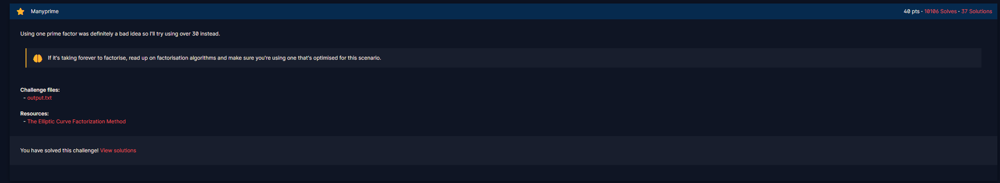
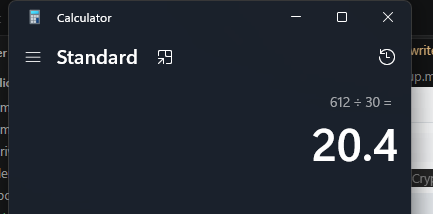
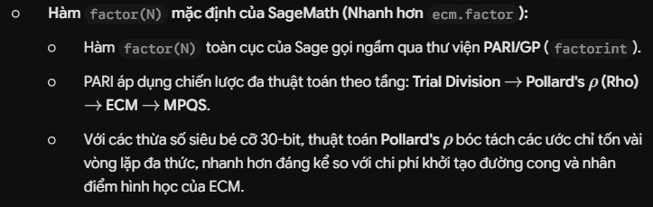
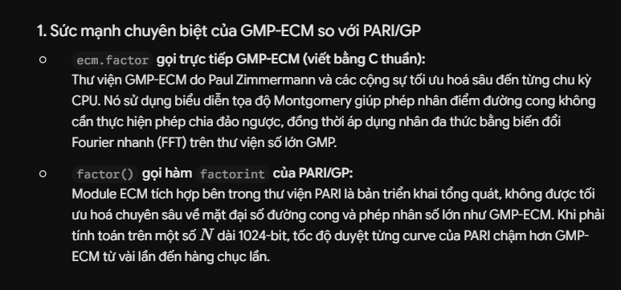
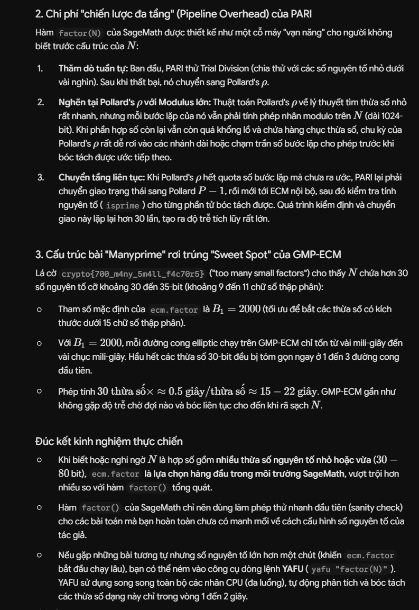

# Manyprime

#### Course: `Public-Key Cryptography` - Cryptohack - Ngày viết: 20/10/2026

#### 1. Overview

* 
* Ở bài này, chúng ta sẽ tiếp tục giải mã ciphertext mã hóa bằng khóa công khai (N,e) nhưng N bị cấu hình sai :v
* `Mục tiêu`: Giải mã ciphertext
* `Lỗ hỗng`: N được cấu thành từ 30 số nguyên tố khác nhau.

#### 2. Nền tảng cốt lõi

* Bài có giới thiệu cho chúng ta về [The Elliptic Curve Factorization Method](https://doc.sagemath.org/html/en/reference/interfaces/sage/interfaces/ecm.html), các bạn nên xem trước khi giải, và mình sẽ có nhắc đến trong bài này.

#### 3. Exploit chain

* Bài này ta sẽ có 2 cách giải.
* Cách 1:

  * Ta sẽ sử dụng [factordb](https://factordb.com/) để phân tích thừa số nguyên tố, rồi nhập tất cả các số vào list python rồi giải mã ciphertext
* Ở cách trên, công đoạn copy-paste sẽ rất cực bởi vì có 30 số nguyên tố, trong khi đó, các hàm sagemath phân tích thừa số nguyên tố độ dài cỡ 20 chữ số khá là nhanh bằng thư viện `ecm =)))`
* Giải thích rõ hơn thì mình tìm thử độ dài `n`, rồi chia cho 30 để tìm độ dài trung bình của 1 thừa số nguyên tố của `n` thì ta có như sau:
* 
* Khi quy đổi sang bit, các thừa số nguyên tố dài khoảng 68 bit. Điều kiện lý tưởng nhất để sử dụng hàm `factor`của sagemath gọi từ class `ecm` thay vì factor thuần túy
* Các bạn có thể đọc thêm:
* 
* 
* 
* Các bạn có thể chạy script để kiểm chứng, nếu như ta đã biết trước cấu hình của N, ta có thể sử dụng thuật toán tương thích để giải mã nhanh nhất :v
* Script: [Đọc](solve.sage)
* Kết quả:
* ```
  ecm factor trong 22.400880336761475 giay
  b'crypto{700_m4ny_5m4ll_f4c70r5}'
  factor trong 134.743510723114 giay
  b'crypto{700_m4ny_5m4ll_f4c70r5}'
  ```
* ```
  crypto{700_m4ny_5m4ll_f4c70r5}
  ```
