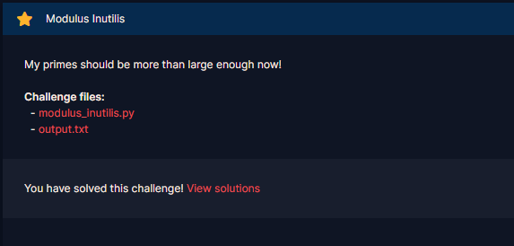
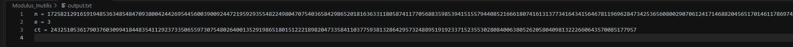

# Modulus Inutilis

#### Course: `Public-Key Cryptography` - Cryptohack - Ngày viết: 20/10/2026

#### 1. Overview

* 
* `Mục tiêu`: Giải mã ciphertextn
* `Lỗ hỗng`: Không đệm cho plaintext và sử dung khóa công khai nhỏ

#### 2. Nền tảng cốt lõi

* Các bạn cần hiểu cơ chế lúc mã hóa plaintext của RSA

#### 3. Exploit chain

* 
* Khi phân tích độ dài ct so với n, ta dễ dàng nhận thấy ct rất nhỏ so với n, điều này chỉ có lý do duy nhất đó là flag chưa được đệm
* Khi đó ,plaintext sẽ không đủ độ lớn và plaintext^3 cũng nhỏ hơn `n`, điều này dẫn đến lúc mã hóa RSA, m^3 vẫn chưa mod `n`
* 
* Script: [Đọc](solve.py)
* ```
  crypto{N33d_m04R_p4dd1ng}
  ```
