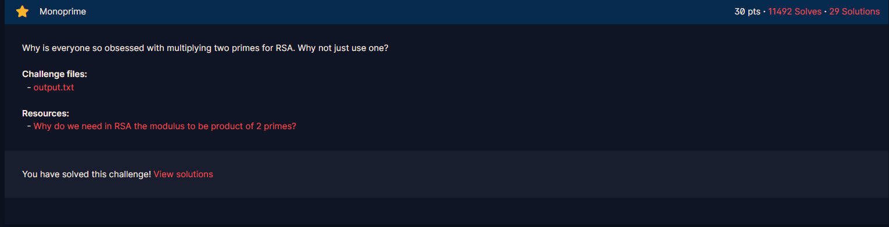

# Monoprime

#### Course: `Public-Key Cryptography` - Cryptohack - Ngày viết: 20/10/2026

#### 1. Overview

* 
* `Mục tiêu`: Giải mã ciphertext
* `Lỗ hỗng`: Sử dụng số nguyên tố làm khóa công khai

#### 2. Nền tảng cốt lõi

* Các bạn cần hiểu được bản chất của RSA là gì
* Công thức tính phi euler N khi thừa số nguyên tố của N là chính nó?

#### 3. Exploit chain

* Bản chất của RSA an toàn, bởi vì giới hạn tốc độ chạy của máy tính ngày nay. Đối với RSA, chỉ cần phân tích thừa số nguyên tố N là ta có thể giải mã được mật thư ngay lập tức, với tốc độ máy tính ngày nay, muốn tìm được thừa số nguyên tố N dài 2048 bit thì sẽ mất thời gian RẤT RẤT RẤT dài.
* Nói chung bản chất lỗ hỗng là thay vì phân tích thừa số nguyên tố N, ta biết chắc chắn và chính xác là N có thừa số là chính nó, ta có thể giải mã RSA ngay bằng cách tính `T = n -1`, tìm khóa `d`, sau đó giải mã.
* Script: [Đọc](solve.py)
* ```
  crypto{0n3_pr1m3_41n7_pr1m3_l0l}
  ```
