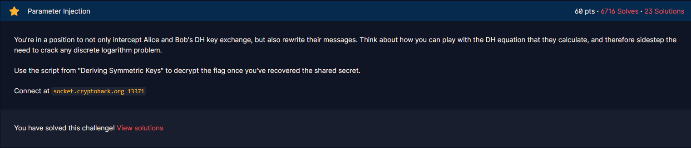
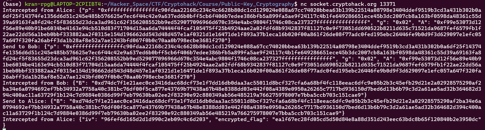

# Parameter Injection

#### Course: `Public-Key Cryptography` - Cryptohack - Ngày viết: 21/10/2026

#### 1. Overview

* 
* `Mục tiêu`: Sửa đổi giá trị khóa để tính toán đc khóa công khai

#### 2. Nền tảng cốt lõi

* Các bạn phải biết cách mà khóa công khai trong giao thức Diffie Hellman tạo như cách nào

#### 3. Exploit chain

* Khi mình thử netcat đến server thì đề đang giả lập chúng ta là người đứng giữa Alice và Bob. Bằng cách sửa đổi giá trị khóa công khai, ta có thể giải mã được ciphertext mà Alice gửi đi
* 
* Ở đây khóa chung được tạo ra bằng cách lấy giá trị `B` của Bob mũ `a` để tạo ra `B^a = g^ab` làm khóa chung, nếu chúng ta sửa đổi giá trị `B` bằng `1`, lúc này, khóa chung sẽ có dạng `1^a = 1`và ta tính được ngay khóa công khai và giải mã ciphertext
* Script: [Đọc](solve.py)
* ```
  crypto{n1c3_0n3_m4ll0ry!!!!!!!!}
  ```
