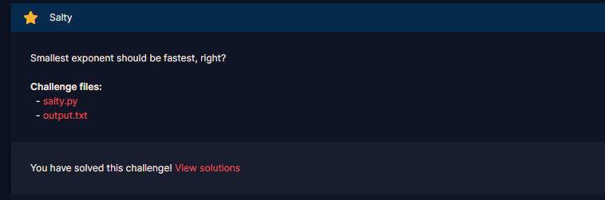

# Salty

#### Course: `Public-Key Cryptography` - Cryptohack - Ngày viết: 20/10/2026

#### 1. Overview

* 
* `Mục tiêu`: Giải mã ciphertext
* `Lỗ hỗng`: Sử dụng khóa e nhỏ

#### 2. Exploit chain

* Lúc đầu tương e =3, nhung không, e = 1 =))))
* Khi đó, khi mã hóa flag, RSA hoạt động như sau:
* 
* Vậy ciphertext chính là plaintext =))))
* Script: [Đọc](solve.py)
* ```
  crypto{saltstack_fell_for_this!}
  ```
