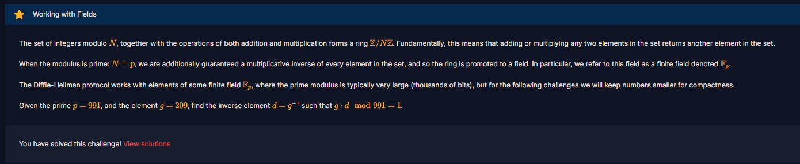

# Working with Fields

#### Course: `Public-Key Cryptography` - Cryptohack - Ngày viết: 20/10/2026

#### 1. Overview

* 
* Đây là bài đầu tiên của khóa học dạy về Diffie-Hellman protocol
* `Mục tiêu`: Tìm nghịch đảo module g trên trường module p

#### 2. Exploit chain

* Tìm giá trị nghịch đảo
* Script: [Đọc](solve.py)
* ```
  569
  ```
