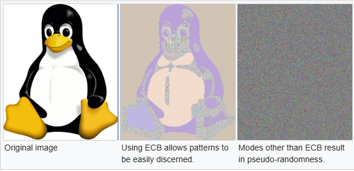
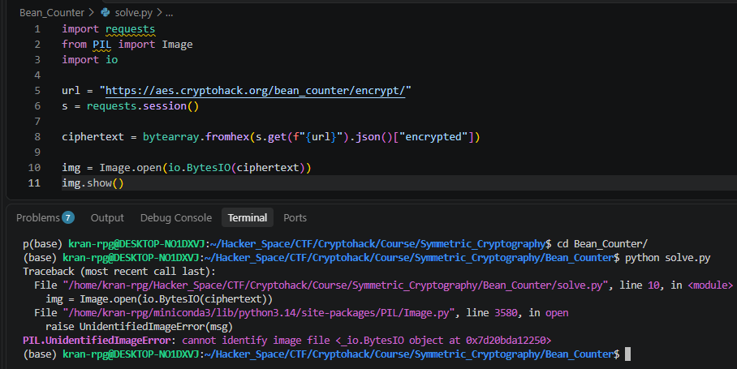
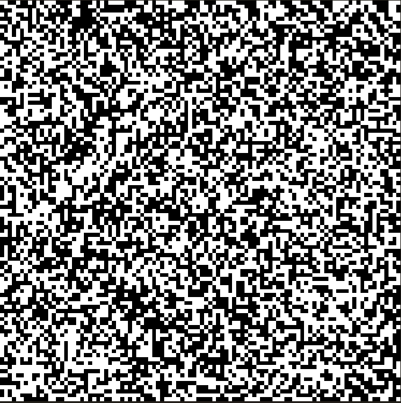
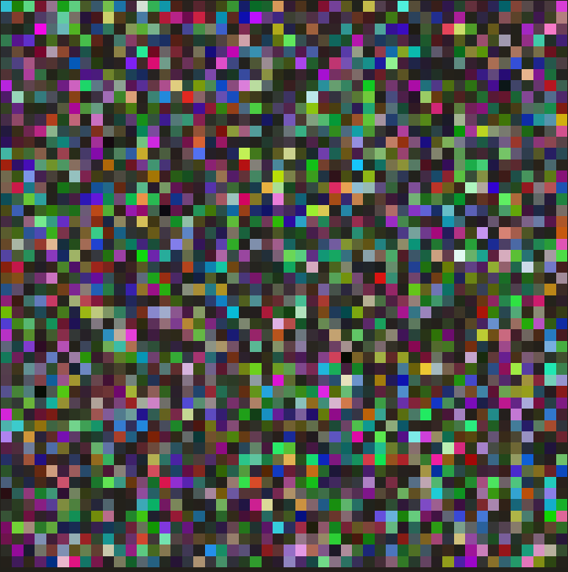
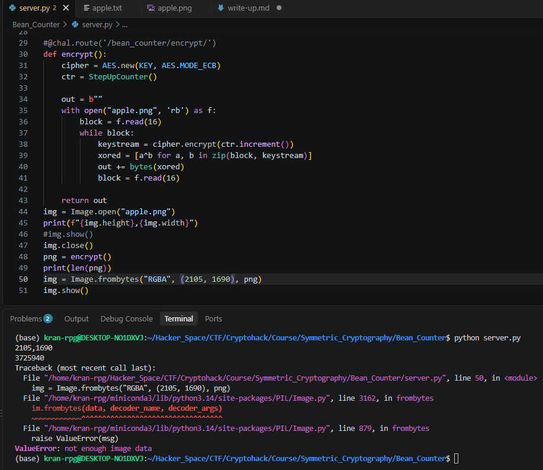
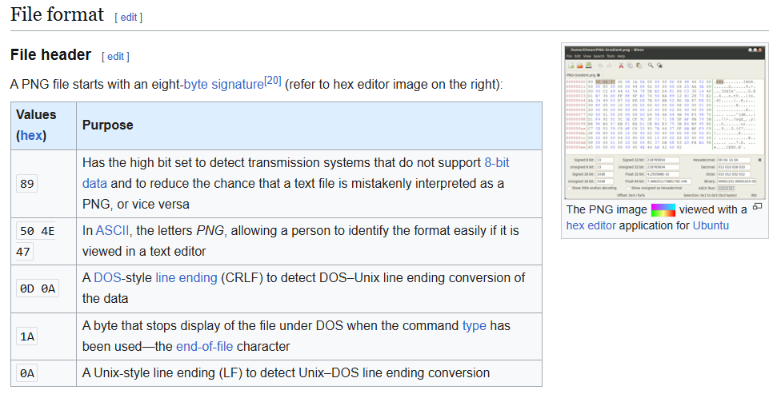
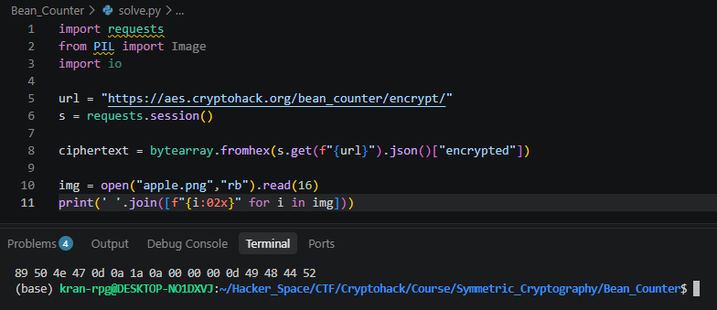
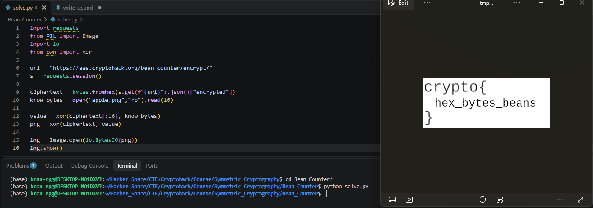

# Bean Counter

#### Course: `Symmetric Cryptography`- Cryptohack

#### 1. Overview

* Đây là bài cuối cùng của Course `Symmetric Cryptography`. Mặc dù bài này về mặt lý thuyết sẽ khá là dễ đối với những người hiểu biết rộng hơn. Nhưng đối với mình, việc research, tìm hiểu bài này để giải cho bằng được giúp mình tiếp thu rất nhiều kiến thức và lúc giải được cũng rất vui =))))
* `Mục tiêu`: Khôi phục `bean_flag.png`để lấy được cờ
* `Kỹ thuật`: Tấn công bản rõ đã biết

#### 2. Nền tảng cốt lõi

* Bài này chủ yếu là research để biết, chứ thật sự có người biết sẵn những kiến thức này ư =))))
* Cách sử dụng thư viện `PIL`. [Đọc](https://pillow.readthedocs.io/en/stable/reference/Image.html)
* ```Shell
  # Tải PIL để sử dụng 
  pip install pillow
  ```
* How to convert byte string to image ?: [Đọc](https://www.reddit.com/r/learnpython/comments/ovv5hq/how_to_convert_byte_string_to_image/)
* Format PNG: [Đọc](https://en.wikipedia.org/wiki/PNG)
* Cách mở ảnh image khi convert từ bytes: [Đọc](https://www.youtube.com/watch?v=xZF6zWLz-vY)

#### 3. Phân tích lỗ hỗng

* Mã nguồn server:
* ```Python
  from Crypto.Cipher import AES
  import os


  KEY = ?


  class StepUpCounter(object):
      def __init__(self, step_up=False):
          self.value = os.urandom(16).hex()
          self.step = 1
          self.stup = step_up

      def increment(self):
          if self.stup:
              self.newIV = hex(int(self.value, 16) + self.step)
          else:
              self.newIV = hex(int(self.value, 16) - self.stup)
          self.value = self.newIV[2:len(self.newIV)]
          return bytes.fromhex(self.value.zfill(32))

      def __repr__(self):
          self.increment()
          return self.value


  @chal.route('/bean_counter/encrypt/')
  def encrypt():
      cipher = AES.new(KEY, AES.MODE_ECB)
      ctr = StepUpCounter()

      out = []
      with open("challenge_files/bean_flag.png", 'rb') as f:
          block = f.read(16)
          while block:
              keystream = cipher.encrypt(ctr.increment())
              xored = [a^b for a, b in zip(block, keystream)]
              out.append(bytes(xored).hex())
              block = f.read(16)

      return {"encrypted": ''.join(out)}
  ```
* Về cơ bản, server đang tái hiện lại mã hóa AES CTR trong thực tế để mã hóa bức ảnh `bean_flag.png`. Với `key`là cố định và `nonce`được sinh ngẫu nhiên có độ dài 16 bytes.
* Nhưng việc tái hiện có vẻ chưa được kiểm tra khi mà giá trị biến `step_up`vẫn còn đang để `False`. Điều này dẫn đến khi gọi hàm `increment()`. Block if else sẽ luôn đi vào luồng else, value trừ giá trị `False` tương đương với trừ `0`, nên cơ bản, value luôn không thay đổi trong cả quá trình, dẫn đến dòng keystream sinh tra từ mã hóa AES ECB luôn giống nhau trong mọi trường hợp và mỗi khối dữ liệu của bức ảnh. Những khối bytes của bức ảnh sẽ được xor với keystream với chu kỳ mỗi khối.
* Ý tưởng giải lúc đầu của mình, mình đã nhầm lẫn với việc mã hóa các điểm ảnh`flag`bằng AES ECB chính là lỗ hỗng. Thì các bạn xem qua ví dụ này tại trang wikipedia. [Đọc](<https://en.wikipedia.org/wiki/Block_cipher_mode_of_operation#:~:text=A%20striking%20example,the%20encrypted%20version.>)
* 
* Nên mình đã cố gắn chuyển đổi dữ liệu ảnh đã mã hóa về lại png để đọc cờ. Nhưng đã thất bại =)))
* Khi mình thử đọc luôn dữ liệu bytes để chuyển sang ảnh giống [video](https://www.youtube.com/watch?v=xZF6zWLz-vY) hướng dẫn thì chương trình đã xuất hiện lỗi
* 
* Sau đó mình có thử nhiều cách khác nhưng vẫn không khả thi
* ```Python
  import requests
  from PIL import Image

  url = "https://aes.cryptohack.org/bean_counter/encrypt/"
  s = requests.session()

  ciphertext = bytearray.fromhex(s.get(f"{url}").json()["encrypted"])

  img = Image.frombytes("1", (100,100), ciphertext) # Image.frombytes(mode, size, data)
  img.show()
  ```
* Mode 1:
* Mode RGBA:

#### 4. Ý tưởng khai thác

* Sau khi sử dụng nhiều cách khác nhau để đọc dữ liệu ciphertext thì mình vẫn không thu được bất cứ thông tin gì về flag.
* Sau đó mình copy mã nguồn về và thử tái tạo lại quá trình encrypt ảnh thì mình đã ngộ nhận ra 1 điều:
* 
* Câu hỏi mình đặt ra là, cùng 1 tấm ảnh, nhưng sau khi encrypt thì không thể đọc được bằng `io.BytesIO(png)`bởi vì không thể nhận diện được ảnh. Nếu đổi qua đọc điểm ảnh bằng bytes thì cùng 1 kích thước nhưng không đủ data điểm xây dựng ảnh.
* Lúc đó mình mới tự hỏi là file ảnh png nó chính xác là gì? Tại sao `io.BytesIO(png)`không thể đọc được. Thì sau đó mình đã search google thì đã tìm ra điều mình cần.
* 
* File ảnh PNG luôn bắt đầu với file header là 8 bytes: `89 50 4e 47 0d 0a 1a 0a`
* 
* Khi đọc thử ảnh phân tích các bytes của 1 file png. Mình còn thấy thêm 8 bytes nữa là `89 50 4e 47 0d 0a 1a 0a`
* Khi mình đọc chi tiết hơn ở phần Critical chunks được nhắc đến trên wiki. Mình nhận ra các bytes `00 00 00 4d`là để ngăn cách với file header, và 4 bytes `49 48 44 52` chính là ký tự `IHDR` trong ảnh. Nên về lý thuyết, 16 bytes đầu của mỗi bức ảnh PNG luôn cố định
* Mình có tải ngẫu nhiên 1 bức ảnh quả táo PNG từ trên mạng về để kiểm tra thì chính xác là nó =))))
* 
* Ta đã biết bản rõ của 1 khối, dòng keystream được sinh ra từ value của class `StepUpCounter` lặp lại sau mỗi khối. Ta chỉ cần lấy khối đầu tiên của encrypted, xor với 16 bytes đầu của 1 bức ảnh png, là ta sẽ thu được dòng keystream. Từ đó ta giải mã toàn bộ file png bằng dòng keystream vừa tìm được.
* 

#### 5. Exploit chain

* Các bạn hoàn toàn có thể ghi sẵn 8 bytes đầu là `89 50 4e 47 0d 0a 1a 0a 89 50 4e 47 0d 0a 1a 0a` rồi xor với khối đầu tiên của bức ảnh mã hóa. Nếu không thì bạn cứ tải 1 bức ảnh `png`bất kỳ rồi đọc 16 bytes đầu để trích xuất dãy bytes cũng được =)))
* Script: [Đọc](solve.py)
* ```Python
  import requests
  from PIL import Image
  import io
  from pwn import xor

  url = "https://aes.cryptohack.org/bean_counter/encrypt/"
  s = requests.session()

  ciphertext = bytes.fromhex(s.get(f"{url}").json()["encrypted"])
  know_bytes = open("apple.png","rb").read(16)

  value = xor(ciphertext[:16], know_bytes)
  png = xor(ciphertext, value)

  img = Image.open(io.BytesIO(png))
  img.show()
  ```

* 
* ```
  crypto{hex_bytes_beans}
  ```

#### 6. Reference

* Cách sử dụng thư viện `PIL`. [Đọc](https://pillow.readthedocs.io/en/stable/reference/Image.html)
* How to convert byte string to image ?: [Đọc](https://www.reddit.com/r/learnpython/comments/ovv5hq/how_to_convert_byte_string_to_image/)
* Format PNG: [Đọc](https://en.wikipedia.org/wiki/PNG)
* Cách mở ảnh image khi convert từ bytes: [Đọc](https://www.youtube.com/watch?v=xZF6zWLz-vY)
