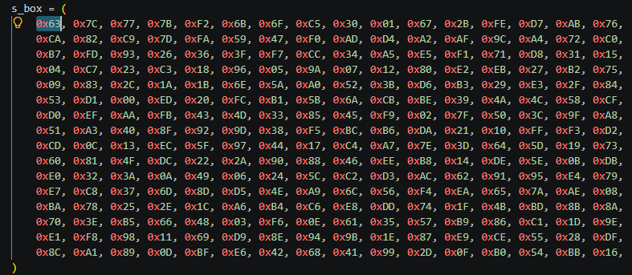
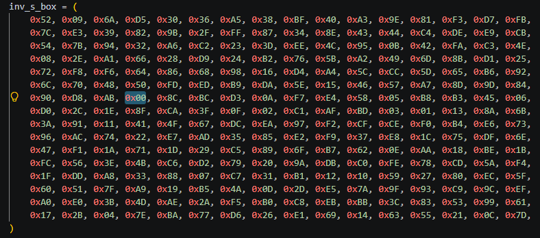

# Confusion through Substitution

#### Course: `Symmetric Cryptography` - Cryptohack

#### 1. Overview

* Đây là bài đầu tiên mà mình được thao tác trên S-box =))), bây giờ mình mới hiểu được cơ chế của nó. đồng thời ở bài này, nó còn cho ta thấy sự phức tạp của thuật toán mã hóa AES một cách rõ ràng hơn

#### 2. Nền tảng cốt lõi

* S-box là 1 list danh sách bytes được dùng làm kết quả của phép ánh xạ từ bytes gốc. Ví dụ ở bytes gốc, ta có ký tự `\x00`, khi ánh xạ qua S-box, nó sẽ trở thành bytes `\x63`
* 
* Và khi ta đã có nghịch đảo của `S-box`, để đảo ngược quá trình mã hóa, ta chỉ cần ánh xạ từ nghịch đảo S-box về lại bytes gốc.
* 
* Đối với bytes `\x63`khi nãy khi được ánh xạ qua S-box, ta chỉ cần tra trên bản nghịch đảo là biết bytes gốc của nó là gì như hình trên. Bytes `\x63` nằm ở hàng thứ 6 cột 3

#### 3. Exploit chain

* Ánh xạ các bytes trong ma trận từ nghịch đảo S-box về bytes gốc
* Script: [Đọc](sbox.py)
* ```
  crypto{l1n34rly}
  ```

#### 4. Ngoài lề

* Mình từ bài Bringing It All Together quay trở về bài này để nhắc nhở những ai đang học Course này, hãy cố gắng làm theo hướng dẫn của bài và đừng tự chế như mình =)))), debug mệt lắm
