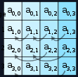
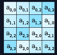

# Diffusion through Permutation

#### Course: `Symmetric Cryptography` - Cryptohack

#### 1. Overview

* Ở bài này, chúng ta đang dần đi sâu hơn vào mã hóa AES khi đến các bước MixColumns và bước ShiftRows

#### 2. Nền tảng cốt lõi

* Bài này chỉ yêu cầu ta đảo ngược quá trình shift_rows thôi, nên  các bạn chỉ cần biết cách thao tác trên ma trận để đảo ngược là được.

#### 3. Exploit chain

* Trạng thái ma trận hiện thại là đã bị dịch các hàng, có nghĩ là ở ma trận trước  khi dịch hàng là nó có dạng như này
* 
* Sau khi dịch hàng thì ma trận thành như này.
* 
* Bây giờ ta chỉ cần đảo ngược quá trình là được

  * Ở hàng 1 không đổi
  * Ở hàng 2 thì bị dịch sang trái 1 phần tử
  * Ở hàng 3 thì bị dịch sang trái 2 phần tử
  * Ở hàng 4 thì bị dịch sang trái 3 phần tử
* Script: [Đọc](diffusion.py)
* ```
  crypto{d1ffUs3R}
  ```

#### 4. Ngoài lề

* Mình từ bài Bringing It All Together quay trở về bài này để nhắc nhở những ai đang học Course này, hãy cố gắng làm theo hướng dẫn của bài và đừng tự chế như mình =)))), debug mệt lắm
