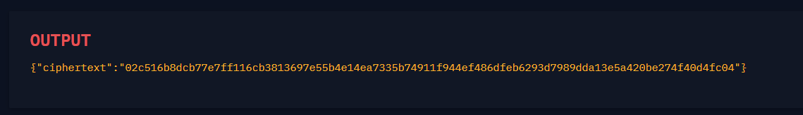

# ECB CBC WTF

#### Course: `Symmetric Cryptography`- Cryptohack

#### 1. Overview

* Đây là 1 bài cho thấy, dù có encrypt AES chế độ nào thì khi có Oracle để derypt thì không khác gì lộ key cho thiên hạ :v
* `Mục tiêu`: Thao tác Oracle để giải mã cờ. Cờ được mã hóa AES bằng chế độ CBC nhưng chỉ có thể encrypt ở chế độ ECB
* `Kỹ thuật`: Đảo ngược phép xor

#### 2. Nền tảng cốt lõi

* Các bạn nên biết chế độ AES CBC là gì. [Đọc](<https://en.wikipedia.org/wiki/Block_cipher_mode_of_operation#:~:text=citation%20needed%5D-,Cipher%20block%20chaining%20(CBC),edit,-CBC>)
* Các chế độ chính của AES:
* 

#### 3. Phân tích lỗ hỗng

* Mã nguồn server:
* ```Python
  from Crypto.Cipher import AES
  import os


  KEY = ?
  FLAG = ?


  @chal.route('/ecbcbcwtf/decrypt/<ciphertext>/')
  def decrypt(ciphertext):
      ciphertext = bytes.fromhex(ciphertext)

      cipher = AES.new(KEY, AES.MODE_ECB)
      try:
          decrypted = cipher.decrypt(ciphertext)
      except ValueError as e:
          return {"error": str(e)}

      return {"plaintext": decrypted.hex()}


  @chal.route('/ecbcbcwtf/encrypt_flag/')
  def encrypt_flag():
      iv = os.urandom(16)

      cipher = AES.new(KEY, AES.MODE_CBC, iv)
      encrypted = cipher.encrypt(FLAG.encode())
      ciphertext = iv.hex() + encrypted.hex()

      return {"ciphertext": ciphertext}
  ```

* Server cho ta ciphertext với 16 bytes đầu là `iv`, phần còn lại là flag đã bị mã hóa
* Khi gửi request lên server, ta nhận được chuỗi bytes có độ dài là 48 bytes
* 
* Cờ không được padding nền ta biết được rằng cờ có độ dài 32 bytes.

#### 4. Ý tưởng khai thác.

* Trên Cryptohack có để quy trình mã hóa AES CBC như sau:
* 
* Khi chúng ta mã hóa cờ ở chế độ ECB, thứ chúng ta nhận được là:
* 
* Ta đã có `iv`, ta đã có `BlockCipher_1`, ta chỉ cần xor thêm lần nữa để triệt tiêu phép xor thôi :v

#### 5. Exploit chain

* Quy trình:
  * Gửi request lên server để nhận ciphertext + iv
  * Lưu lại iv và ciphertext
  * Gửi request lên server để giải mã ciphertext
  * Ta tách kết quả gửi về thành 2 khối 16 bytes.
  * Ta xor khối thứ nhất với iv, khối thứ 2 với khối đầu tiên của ciphertext
  * Nhận cờ
* Script: [Đọc](solve.py)
* ```
  crypto{3cb_5uck5_4v01d_17_!!!!!}
  ```
