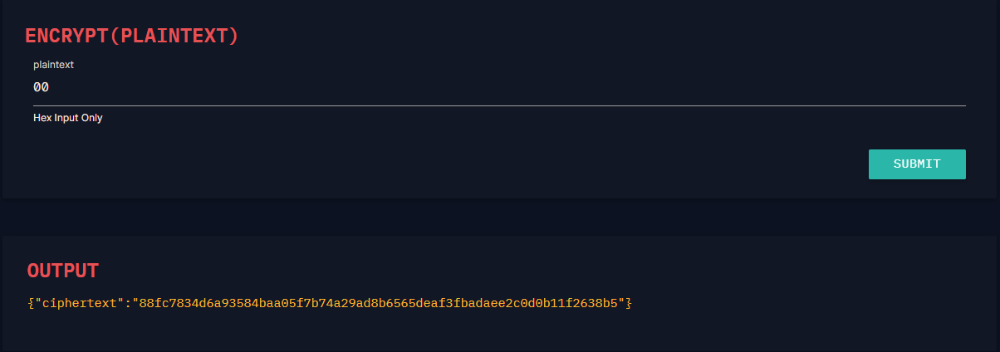
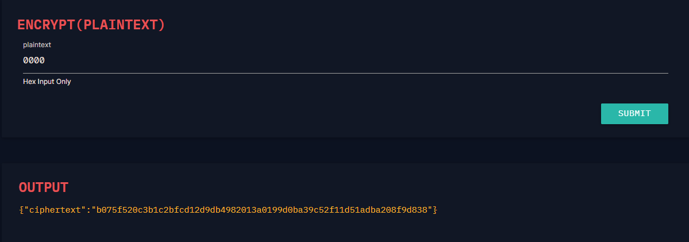
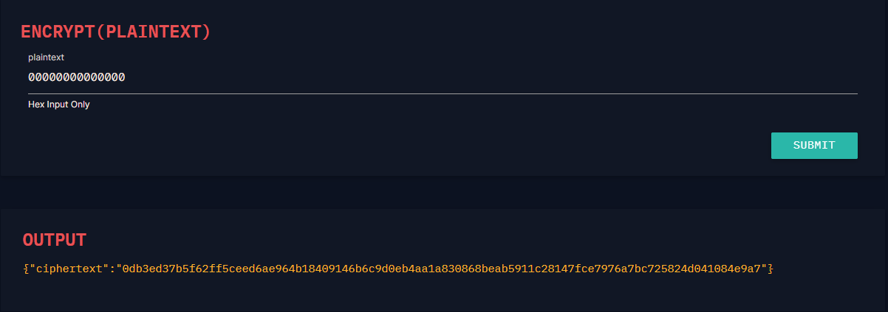
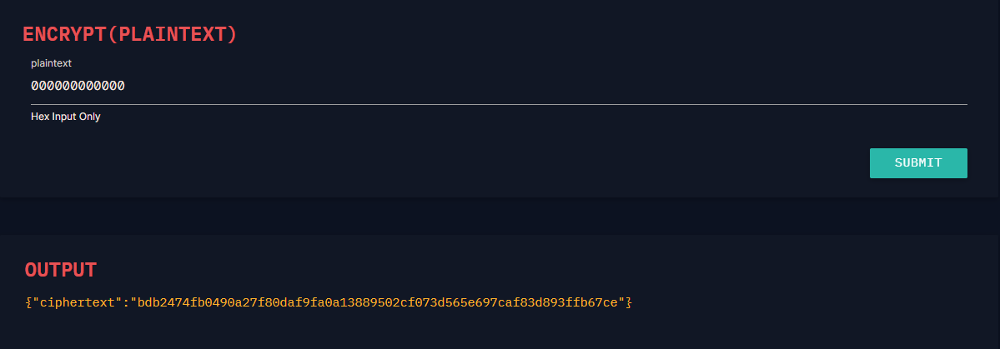
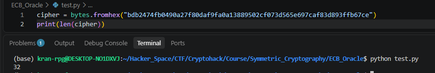

# ECB Oracle

#### Course: `Symmetric Cryptography`- Cryptohack

#### 1. Overview

* Đây là bài đầu tiên mà mình sử dung thủ thuật tấn công `AES ECV Oracle`=)))). Đối với bài này, chúng ta sẽ bắt đầu tìm hiểu lỗ hỗng đầu tiên dễ dính phải nhất của mã hóa AES ECB, và thủ thuật để khai thác nó.
* `Mục tiêu`: Khôi phục flag thông qua `Oracle`
* `Lỗ hỗng`: Mã hóa dữ liệu bằng mã hóa AES ECB nhưng để lộ Oracle
* `Kỹ thuật`: AES-ECB Oracle Attack

#### 2. Nền tảng cốt lõi

* Các bạn nên hoàn thành 5 bài đầu tiên của Course này trước khi làm bài này, bởi vì nó sẽ cho ta cái nhìn rộng hơn đễ dễ dàng hiểu được bài viết này.
* Các bạn nên đọc thêm thông tin chi tiết về tấn công AES ECB tại đây: [Đọc](https://viblo.asia/p/gioi-thieu-ve-ki-thuat-tan-cong-aes-ecb-oracle-r1QLxwppJAw)
* Lỗ hỗng mà mã hóa AES ECB mắc phải, hiểu 1 cách đơn giản là: `Mỗi khối dữ liệu trong plaintext sẽ được mã hóa 1 cách độc lập và ánh xạ đến một khối dữ liệu duy nhất. Có nghĩ là cùng 1 khối plaintext sẽ luôn cho đầu ra cùng 1 khối ciphertext khi sử dụng cùng 1 khóa`
* Và lỗ hỗng này dẫn đến việc ta có thử nhiều mẫu dữ liệu khác nhau để lần mò ra khối dữ liệu gốc bị mã hóa.

#### 3. Phân tích lỗ hỗng

* Mã nguồn server:
* ```Python
  from Crypto.Cipher import AES
  from Crypto.Util.Padding import pad, unpad


  KEY = ?
  FLAG = ?


  @chal.route('/ecb_oracle/encrypt/<plaintext>/')
  def encrypt(plaintext):
      plaintext = bytes.fromhex(plaintext)

      padded = pad(plaintext + FLAG.encode(), 16)
      cipher = AES.new(KEY, AES.MODE_ECB)
      try:
          encrypted = cipher.encrypt(padded)
      except ValueError as e:
          return {"error": str(e)}

      return {"ciphertext": encrypted.hex()}
  ```
* Server chỉ cho ta tương tác `get`với server. Bằng cách gửi các plaintext lên, khối dữ liệu trả về sẽ là ciphertext, và khối dữ liệu có cấu trúc `plaintext + FLAG.encode()`và được padding để đảm bảo độ dài yêu cầu chia hết cho 16, được mã hóa bằng  `KEY`.
* Đây là cấu trúc của 1 Oracle cơ bản với bộ mã hóa là AES ECB

#### 4. Ý tưởng khai thác

* Đây là bài điển hình của việc sử dụng thủ thuật `AES-ECB Oracle Attack`để tấn công, khôi phục plaintext.
* Ý tưởng là ta sẽ tìm độ dài của `flag`, bằng cách gửi các bytes có độ dài tăng dần cho đến khi ciphertext trả ra đã tăng lên thêm 1 khối.
* Như ở bài này ta có:

  * Độ dài 1 bytes:
  * 
  * 2 bytes:
  * 
  * ...
  * 7 bytes
  * 
  * Khi đến bytes thứ 7, độ dài ciphertext đã mở rộng thêm 1 khối mới.
  * Ta lùi lại bytes thứ 6. Copy ciphertext để kiểm tra độ dài bytes:
  * 
  * 
  * Vậy cờ của ta có độ dài là 32 - 6 = 26 bytes.
* Độ dài của cờ chiếm đến 2 khối 16 bytes, khi encrypt AES, khối dữ liệu sẽ có dạng `flag[0][1]...[25]\x08\x08...\x08<Pad dài 8 kí tự>` `(Lưu ý: Chế độ padding cơ bản là chế độ PKCS7)`
* Khi ta gửi payload mẫu dài 31 kí tự lên, độ dài 2 khối lên thành 4 khối, nhưng đó không phải là vấn đề trọng tâm. Khi gửi mẫu lên, khối dữ liệu mã hóa sẽ có dạng:
* Ví dụ payload là chuỗi bytes `00`: `\x00\x00...\x00<Dài 31 kí tự>flag[0][1]...[25]\x09\x09...\x09<Pad dài 9 kí tự>`
* Khi đó ở 2 khối đầu tiên mã hóa là: `\x00\x00...\x00<Dài 31 kí tự>flag[0]` và ta sẽ thu được `ciphertext1`
* Sau đó bằng cách thử mọi bytes nằm trong khoảng bytes in được là từ `0x20`đến `0x7e`, ta gửi các mẫu payload lên server :`\x00\x00...\x00<Dài 31 kí tự>\x20`-> `\x00\x00...\x00<Dài 31 kí tự>\x7e`, thì sẽ có 1 đoạn ciphertext trả về sẽ giống với `ciphertext1` ở trên, khi đó ta sẽ biết được bytes của kí tự cờ
* Ví dụ format cờ là `crypto{...}`, kí tự đầu tiên chắc chắn là `c`. Khi ta thử gửi payload mẫu ở bước đầu là 31 bytes `00`lên, server sẽ mã hóa`\x00\x00...\x00<Dài 31 kí tự>flag[0]`và trả về cho ta 1 `ciphertext1`
* Ở các lượt payload tiếp theo, ta thử từng bytes từ `0x20`đến `0x7e`,và khi gửi đến bytes `0x63` `(chính là bytes của kí tự c)`thì khi ta so sánh ciphertext vừa trả về với `ciphertext1`, cả 2 sẽ giống nhau! Và ta biết được đó là kí tự `c`
* Ở các bước tiếp theo, ta lặp lại như trên để thu được hết các kí tự của cờ
* Vì ta đã biết form cờ là `crypto{...}`, nên ta sẽ bắt đầu kiếm các kí tự sau kí tự `{`

#### 5. Exploit chain

* Quy trình:
  * Gửi một bản mẫu lên sao cho các khối chỉ chứa các kí tự đã biết và chỉ có 1 kí tự là chưa biết
  * Ta thử mọi bytes in ra được ở vị trí kí tự đó cho đến khi server cho ta ciphertext giống với ciphertext của bản mẫu đầu tiên
  * Ta thu được bytes của kí tự chưa biết
  * Ta lặp lại quá trình cho đến khi không còn kí tự nào nữa
* Script: [Đọc](solve.py)
* Kết quả:
* ```
  crypto{p
  crypto{p3
  crypto{p3n
  crypto{p3n6
  crypto{p3n6u
  crypto{p3n6u1
  crypto{p3n6u1n
  crypto{p3n6u1n5
  crypto{p3n6u1n5_
  crypto{p3n6u1n5_h
  crypto{p3n6u1n5_h4
  crypto{p3n6u1n5_h47
  crypto{p3n6u1n5_h473
  crypto{p3n6u1n5_h473_
  crypto{p3n6u1n5_h473_3
  crypto{p3n6u1n5_h473_3c
  crypto{p3n6u1n5_h473_3cb
  crypto{p3n6u1n5_h473_3cb}
  ```

```
crypto{p3n6u1n5_h473_3cb}
```

#### 6. Reference

* Mình tham khảo cách tấn công AES ECB tại đây: [Đọc](https://viblo.asia/p/gioi-thieu-ve-ki-thuat-tan-cong-aes-ecb-oracle-r1QLxwppJAw)

#### 7. Ngoài lề

* Nhìn chung, thủ thuật tấn công `AES-ECB Oracle`chỉ có vậy. Nếu các bạn tự code script có tham khảo cách giải và script của mình ở trên, các bạn sẽ thấy, đễ giải được cờ phải chờ thời gian rất là lâu. Ở dòng ngoài lề này mình đã vừa cập nhập thêm bộ đếm cho `script solve` ở trên. Thì thời gian để giải được cờ chỉ dài 26 kí tự là tốn tận hơn 6p mới xong. Nếu gặp những dữ liệu có hàm trăm kí tự. Thì thời gian để script mình solve được phải tốn rất nhiều tiếng đồng hồ mới xong =)))))
* ```
  crypto{p
  crypto{p3
  crypto{p3n
  crypto{p3n6
  crypto{p3n6u
  crypto{p3n6u1
  crypto{p3n6u1n
  crypto{p3n6u1n5
  crypto{p3n6u1n5_
  crypto{p3n6u1n5_h
  crypto{p3n6u1n5_h4
  crypto{p3n6u1n5_h47
  crypto{p3n6u1n5_h473
  crypto{p3n6u1n5_h473_
  crypto{p3n6u1n5_h473_3
  crypto{p3n6u1n5_h473_3c
  crypto{p3n6u1n5_h473_3cb
  crypto{p3n6u1n5_h473_3cb}
  Thoi gian thuc thi: 671.8649241924286
  ```
* Ở script [solve1](solve1.py), mình đã cải tiến từ script solve. Các bạn có thể xem qua ý tưởng code của mình để hiểu ý tưởng nhé. Nó giảm thời gian từ hơn 6p chỉ còn có cỡ 14s cho 26 kí tự cờ
* ```
  crypto{p
  crypto{p3
  crypto{p3n
  crypto{p3n6
  crypto{p3n6u
  crypto{p3n6u1
  crypto{p3n6u1n
  crypto{p3n6u1n5
  crypto{p3n6u1n5_
  crypto{p3n6u1n5_h
  crypto{p3n6u1n5_h4
  crypto{p3n6u1n5_h47
  crypto{p3n6u1n5_h473
  crypto{p3n6u1n5_h473_
  crypto{p3n6u1n5_h473_3
  crypto{p3n6u1n5_h473_3c
  crypto{p3n6u1n5_h473_3cb
  crypto{p3n6u1n5_h473_3cb}
  Thoi gian thuc thi: 13.498064517974854
  ```
* Ý tưởng nâng cấp như sau:
  * Mình thêm dòng `s = requests.session()`để giữa các đoạn gửi dữ liệu, mình không cần phải kết nối ngắt kết nối nhiều lần. Điều này giảm thời gian client của mình bắt tay với máy chủ nhiều lần để gửi request mà chỉ cần bắt tay đúng 1 lần rồi 2 bên chỉ cần gửi dữ liệu qua lại.
  * Mình đã đổi list_print thành list các ký tự mới và có sự thay đổi có chủ đích. Các ký tự được sắp xếp theo thứ tự giảm dần xác suất xuất hiện trong chữ cái tiếng anh và trong văn bản tiếng anh. Các bạn có thể tham khảo tại đây. [Đọc](https://en.wikipedia.org/wiki/Letter_frequency)
  * Ở các lần gửi payload, thay vì mỗi lần chỉ gửi 1 khối để kiểm tra như code cũ, mình đã sửa lại để gửi nhiều khối nhất có thể cho phép của server thì max là có thể gửi 28 khối cùng lúc. Giúp giảm đến tận 28 lần số lần gửi request lên server.
  * Và khi trong 28 khối trả về kiểm tra có sự xuất hiện ký tự cần tìm. Chúng ta sẽ thoát luôn để đi đến ký tự tiếp theo mà không cần gửi những payload còn lại.
* Script mới: [Đọc](solve1.py)
* Tham khảo:
  * Xác suất ký tự: [Đọc]()
  * ASCII table: [Đọc](https://www.ascii-code.com/)
  * Ý tưởng tham khảo của Retr0id: [Đọc](https://cryptohack.org/challenges/ecb_oracle/solutions/#Retr0id) `(Bạn phải solve được bài mới xem được)`
