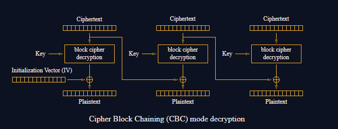

# Flipping Cookie

#### Course: `Symmetric Cryptography` - Cryptohack

#### 1. Overview

* Đây là bài đầu tiên mình sử dụng CBC bitflipping attacks =)))). Trong bài này, chúng ta sẽ thấy được rằng, mặc dù mã hóa khiến chúng ta không thể đọc được plaintext gốc, nhưng chúng ta có thể thay đổi dữ liệu plaintext gốc thành dữ liệu mà ta mong muốn.
* `Mục tiêu`: Đánh lừa hệ thống để set `admin = True`
* `Lỗ hỗng`: Không xác thực tính toàn vẹn
* `Kỹ thuật`: CBC bitflipping attacks

#### 2. Nền tảng cốt lõi

* Các bạn cần hiểu được cơ chế mã hóa AES CBC: [Đọc](<https://en.wikipedia.org/wiki/Block_cipher_mode_of_operation#:~:text=citation%20needed%5D-,Cipher%20block%20chaining%20(CBC),edit,-CBC>)
* Mình tham khảo các tấn công vào AES CBC tại đây: [Đọc](<https://www.linkedin.com/pulse/cbc-bit-flipping-attack-mahmoud-jadaan-nr7ke#:~:text=output%20block%201)-,CBC%20Bit%2DFlipping%20Attack,-Now%20that%20we%27ve>)

#### 3. Phân tích lỗ hỗng.

* Mã nguồn server:
* ```Python
  from Crypto.Cipher import AES
  import os
  from Crypto.Util.Padding import pad, unpad
  from datetime import datetime, timedelta


  KEY = ?
  FLAG = ?


  @chal.route('/flipping_cookie/check_admin/<cookie>/<iv>/')
  def check_admin(cookie, iv):
      cookie = bytes.fromhex(cookie)
      iv = bytes.fromhex(iv)

      try:
          cipher = AES.new(KEY, AES.MODE_CBC, iv)
          decrypted = cipher.decrypt(cookie)
          unpadded = unpad(decrypted, 16)
      except ValueError as e:
          return {"error": str(e)}

      if b"admin=True" in unpadded.split(b";"):
          return {"flag": FLAG}
      else:
          return {"error": "Only admin can read the flag"}


  @chal.route('/flipping_cookie/get_cookie/')
  def get_cookie():
      expires_at = (datetime.today() + timedelta(days=1)).strftime("%s")
      cookie = f"admin=False;expiry={expires_at}".encode()

      iv = os.urandom(16)
      padded = pad(cookie, 16)
      cipher = AES.new(KEY, AES.MODE_CBC, iv)
      encrypted = cipher.encrypt(padded)
      ciphertext = iv.hex() + encrypted.hex()

      return {"cookie": ciphertext}
  ```

* Server cung cấp cho ta cookie được mã hóa bằng AES CBC với plaintext là `admin=False;expiry={expires_at}`. Để lấy được flag, ta cần phải có cookie của admin, có nghĩa là plaintext của cookie trước khi mã hóa là `admin=True;...`

#### 4. Ý tưởng khai thác.

* Ngay từ đầu, chúng ta hoàn toàn không thể động chạm gì đến cookie được, cùng lắm chỉ có thể làm giải cookie, nhưng server lại yêu cầu một cookie đã được mã hóa, ta không có key nên không thể làm được điều này.
* Nhưng thay vì chúng ta làm giả cookie, chúng ta có thể khiến cookie của mình, khi lên đến server mã hóa thành những gì mình muốn.
* Ở đây, AES CBC có cơ chế giải mã như sau:
* 
* Ở khối cuối cùng được giải mã. hay chính là 16 bytes đầu tiên của plaintext của ta chính là ``admin=False;expi``, sau khi giải mã, chúng ta sẽ nhận được `Plaintext` xor `iv`. Và ta đang nắm quyền kiểm soát `iv`. Chúng ta có thể gửi 1 bản `iv`mới để khi xử lý phép xor cuối cùng, ta có thể sửa plaintext gốc thành 1 plaintext mới. Ở đây ta đang muốn trạng thái `admin=False` thành `admin=True`
* Để tạo iv mới:
* 
* Và đây chính là lỗ hỗng của AES CBC. Ngoài ra, không phải mỗi khối đầu tiên ta có thể làm giả, ta có thể làm giả ở bất kỳ khối nào khác bằng cách chỉnh sửa ciphertext + iv

#### 5. Exploit chain

* Quy trình:
  * Nhận cookie
  * Làm giải iv
  * Gửi payload
  * Nhận cờ
* Script: [Đọc](solve.py)
* ```
  crypto{4u7h3n71c4710n_15_3553n714l}
  ```

#### 6. Reference

* Tham khảo cách tấn công CBC: [Đọc](<https://www.linkedin.com/pulse/cbc-bit-flipping-attack-mahmoud-jadaan-nr7ke#:~:text=output%20block%201)-,CBC%20Bit%2DFlipping%20Attack,-Now%20that%20we%27ve>)
