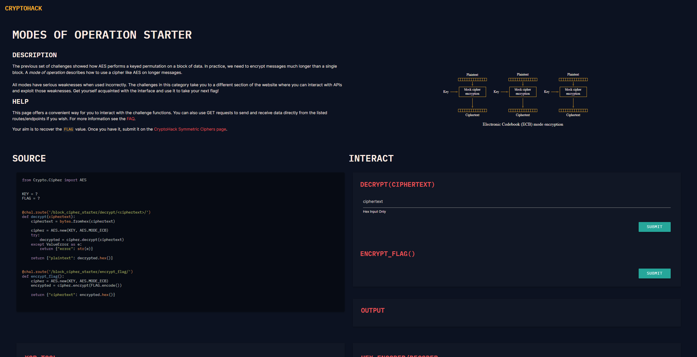
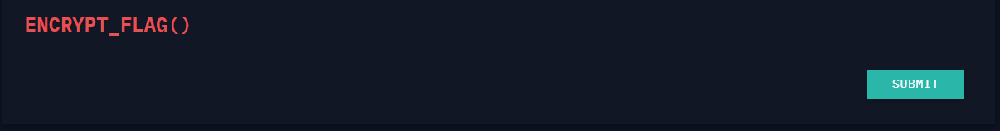
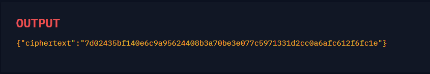
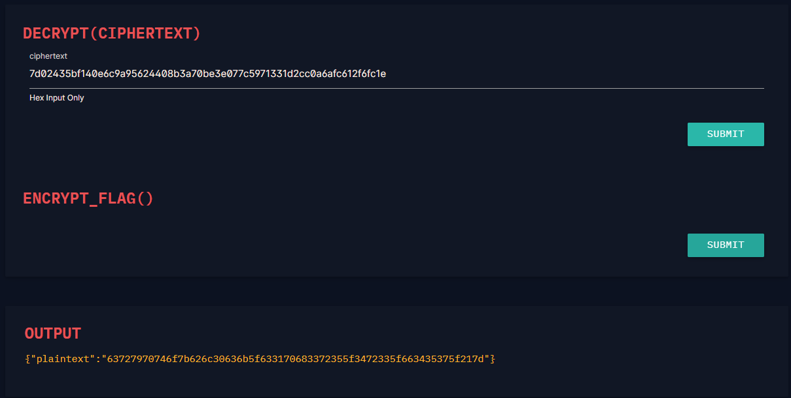
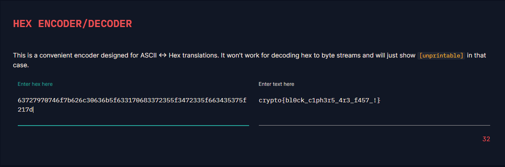

# Modes of Operation Starter

#### Course: `Symmetric Cryptography`- Cryptohack

#### 1. Overview

* Kể từ bài này trở đi, chúng ta sẽ bắt đầu thực chiến các bài mã hóa `AES` bị cấu hình sai!

#### 2. Nền tảng cốt lõi

* Hoàn thành chuỗi 5 bài trước đó trong khóa học này để hiểu được quá trình mã hóa của mã hóa AES

#### 3. Exploit chain

##### 3.1. Cách 1

* Đối với bài này, ta có 2 cách giải, cách giải thứ nhất là dựa theo đường link cryptohack, chúng ta sẽ được dẫn tới 1 trang thao tác tự động
* 
* Quy trình để giải bài này là:
  * Submit encrypt_flag
  * 
  * Copy ciphertext
  * 
  * Bỏ vào ô decrypt rồi summit
  * 
  * Copy plaintext bỏ vào ô hex decoder là ta nhận được cờ
  * 

##### 3.2. Cách 2

* Đối với cách 2, ta sẽ gửi request get lên server bằng code python thuần và sử lý dưới hàm.
* Script: [Đọc](solve.py)
* ```Python
  import requests
  import json

  url = "https://aes.cryptohack.org/block_cipher_starter/"

  ciphertext = json.loads(requests.get(f"{url}encrypt_flag/").text)["ciphertext"]
  flag = bytes.fromhex(json.loads(requests.get(f"{url}decrypt/{ciphertext}/").text)["plaintext"]).decode("utf-8`")
  print(flag)
  ```

```
crypto{bl0ck_c1ph3r5_4r3_f457_!}
```
