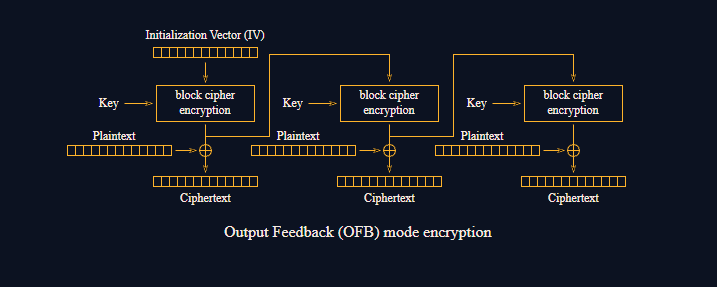

# Symmetry

#### Course: `Symmetric Cryptography`- Cryptohack

#### 1. Overview

* Nếu các bạn đã giải được bài trước, thì đối với bài này các bạn sẽ giải vô cùng nhanh =))), thực sự là nó rất là dễ, mình tốn chưa tới 5p để giải :v.
* `Mục tiêu`: Giải mã `enc_flag`khi sử dụng AES OFB để mã hóa.
* `Kỹ thuật`: Triệt tiêu phép xor, sinh dòng keystream giống nhau

#### 2. Nền tảng cốt lõi

* Các bạn cần hiểu chế độ AES OFB làm gì
* 
* Các bạn phải biết tính chất phép xor

#### 3. Phân tích lỗ hỗng

* Mã nguồn server
* ```Python
  from Crypto.Cipher import AES
  import os


  KEY = ?
  FLAG = ?


  @chal.route('/symmetry/encrypt/<plaintext>/<iv>/')
  def encrypt(plaintext, iv):
      plaintext = bytes.fromhex(plaintext)
      iv = bytes.fromhex(iv)
      if len(iv) != 16:
          return {"error": "IV length must be 16"}

      cipher = AES.new(KEY, AES.MODE_OFB, iv)
      encrypted = cipher.encrypt(plaintext)
      ciphertext = encrypted.hex()

      return {"ciphertext": ciphertext}


  @chal.route('/symmetry/encrypt_flag/')
  def encrypt_flag():
      iv = os.urandom(16)

      cipher = AES.new(KEY, AES.MODE_OFB, iv)
      encrypted = cipher.encrypt(FLAG.encode())
      ciphertext = iv.hex() + encrypted.hex()

      return {"ciphertext": ciphertext}
  ```
* Server cho ta `enc_flag`kèm 1 Oracle cho phép ta encrypt 1 plaintext bất kỳ với iv gửi lên.

#### 4. Ý tưởng khai thác.

* Bản chất của mã hóa AES OFB là sinh ra dòng keystream dựa vào iv để xor với plaintext để tạo ra ciphertext
* 
* Cùng 1 iv và key sẽ tạo ra cùng 1 Keystream. Bằng cách gửi plaintext và iv đã tạo ra keystream. Ta sẽ thu được ciphertext được xor với dòng keystream giống với enc_flag. Bằng cách thực hiện phép xor enc_flag và ciphertext, ta sẽ thu được flag gốc
* 
* Xor lần nữa với Plaintext là được =)))

#### 5. Exploit chain

* Quy trình:
  * Nhận `enc_flag`và `iv`
  * Tạo 1 plaintext bất kỳ có độ dài bytes bằng với `enc_flag`
  * Gửi `plaintext`và `iv`,nhận về `ciphertext`
  * Xor `ciphertext` và `enc_flag`, xor tiếp tục với `plaintext`
* Script: [Đọc](solve.py)
* ```
  crypto{0fb_15_5ymm37r1c4l_!!!11!}
  ```

#### 6. Ngoài lề.

* Khi đọc thử solution trên Cryptohack thì mình nhận ra mình có thể gửi trực tiếp enc_flag lên để trực tiếp xor với Keystream và trả về flag =))))). Các bạn nên sử dụng cách 2 nhé
