# Chess Key

#### Cryptography - Event: Deadface 2026 - Ngày viết: 20/10/2026 - Xem ảnh: [Xem](chesskey.png) - Xem trang web: [Xem](page.html) (nên tải về để xem)

#### 1. Overview

* 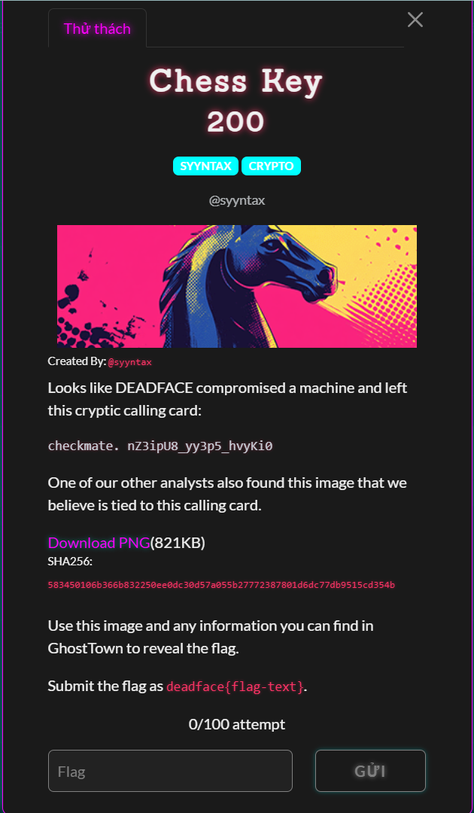
* Đây là bài cuối cùng, bài khó nhất, cũng như là bài hay nhất mảng Crypto theo mình đánh giá trong giải CTF này :v. Bài này là sự kết hợp giữa Crypto và OSINT khi mà key cần tìm lại đang được lữu trữ trên mạng nhưng đã bị ẩn giấu. Bài này mình đã giải tay thử nhưng không giải ra, phải có gợi ý của gemini mình mới có thể tiếp nhận góc nhìn đúng của bài này mới có thể giải được? :v
* `Mục tiêu`: Giải mã ý nghĩa của calling card
* `Kỹ thuật`: Truy tìm thông tin global và suy luận

#### 2. Nền tảng cốt lõi

* Để giải được bài này, các bạn cần phải hiểu cờ vua là gì =)))
  * Cờ vua là 1 trò chơi cờ, bàn cờ có kích thước 8*8. Có 8 hàng từ `1-8(trái sang phải)` và 8 cột từ `a-h(dưới lên trên)`
  * 
  * Khi mỗi quân cờ di chuyển, sẽ có một thứ gọi là tọa độ đích, chính là vị trí mà quân cờ tiến tới.
  * Như ví dụ là:
  * 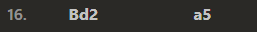
  * Bishop(quân tượng) đi từ ô d2 lên ô a5 trên bàn cờ
* Các bạn cần biết cách giải mã Vigenère Cipher (Caesar đa bảng, các bạn có thể giải [bài](https://learn.cylabacademy.org/library/316?page=3&category=2) này trước để biết)

#### 3. Phân tích lỗ hỗng.

* Trong ngữ cảnh đề bài, trong máy tính của nạn nhân, có 1 danh thiếp viết rằng:
* 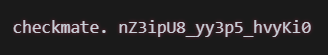
* Phần nội dung được sử dụng để làm cờ chính là sau từ `checkmate`. Đây cơ bản là 1 danh thiếp khiêu khích người điều tra hay chính là chúng ta trong bài này =))))
* Tiếp theo đề cung cấp cho ta 1 tấm ảnh ma trận bàn cờ 8*8 chứa các chữ cái in hoa.
* Ở trang web diễn đàn Ghosttown, sau một lúc điều tra và tìm kiếm thông tin về bài này, mình đã tìm thấy bài viết đó
* 
* Sau 1 hồi đọc hết các bình luận, nội dung của bài viết do chính tác giả ra đề, mình đã có những tổng kết quan trọng, cũng như thuật toán đằng sau đã mã hóa flag trước đó.
  * 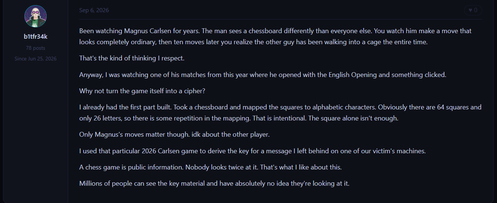
  * Bàn cờ đề cho chính là bàn cờ ánh xạ, cho phép ánh xạ các vị trí đích của các bước đi do `Magnus Carlsen`di chuyển trong 1 trận đấu mà anh ấy thi đấu trong năm 2026, sử dụng khai cuộc Anh trong trận đấu và kết quả của các ánh xạ chính là chuỗi key để giải mã ciphertext đề cho. Thông tin ván đấu của `Magnus Carlsen`là thông tin public.
  * 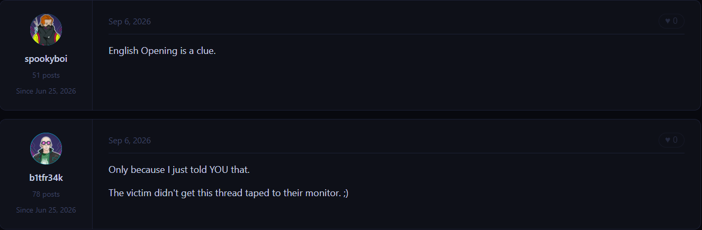
  * Và đây chính là hint về ván đấu được sử dụng để làm key, đó chính là ván đấu mà `Magnus Carlsen`sử dung khai cuộc Anh kinh điển trong giới cờ vua :v, nhấn mạnh là `Magnus Carlsen`sử dụng khai cuộc Anh :v. Khai cuộc Anh là khai cuộc dành cho phe trắng, vậy nên `Magnus Carlsen`phải là người cầm quân trắng.
  * Khai cuộc Anh: [Đọc](https://www.chess.com/vi/openings/English-Opening)
  * Những gì mình phân tích được đến đây là hết, sau đó mình đã hỏi thêm gemini để nhận được nhiều gợi ý hơn:
  * 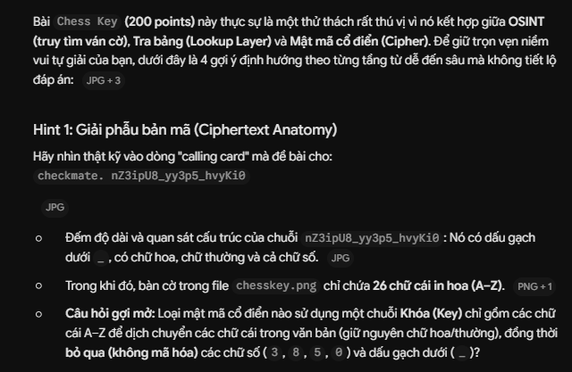
  * Ở hint đầu tiên mà gemini gợi ý cho mình, chính là xác định thuật toán mã hóa flag. Theo kinh nghiệm của chính bản thân mình, loại mã hóa được sử dụng là Caesar đa bảng. Nếu ở bài này, flag chỉ được mã hóa Caesar hoặc là các dạng thay thế ký tự đơn bản, thì ngay từ đầu, ta không cần phải đi tìm kiếm key hay các thứ các kiểu vì chúng ta chỉ cần sử dụng tấn công tần suất kêt hợp với brute force key là có thể giải ngay bài này mà không cần key. Chưa kể key có thể là kết hợp của nhiều bước đi trong ván đấu nên độ dài key sẽ dài hơn 1. Nên thuật toán mã hóa mà mình nghĩ tới ngay khi thấy hint này là mã hóa Vigenère (ai ngờ đoạn này suy luận đúng thật =)))))
  * 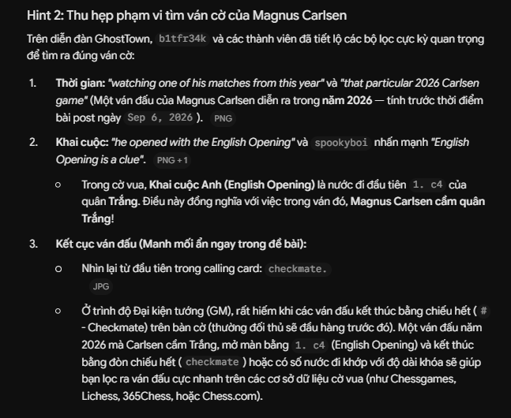
  * Ở hint này thì mình đã phân tích như trên. Khi tìm kiếm các ván đấu mà `Magnus Carlsen`sử dụng khai cuộc Anh, mình đã tìm thấy các ván đấu sau trong năm 2026:
  * 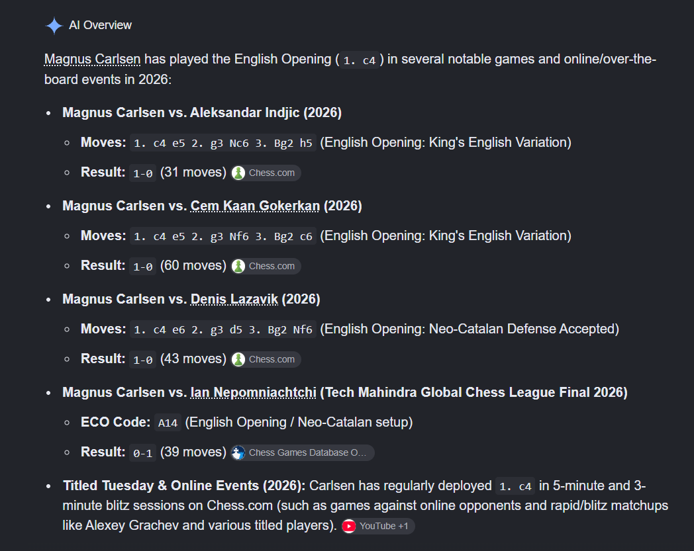
  * 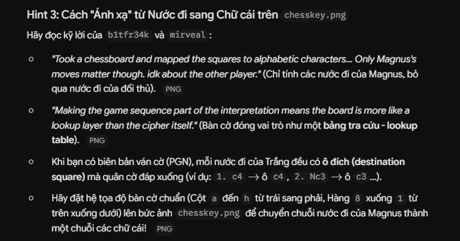
  * Ở hint 3 thì gemini hướng dẫn cách chúng ta khôi phục lại key như mình đã nói ở mục `2`
  * 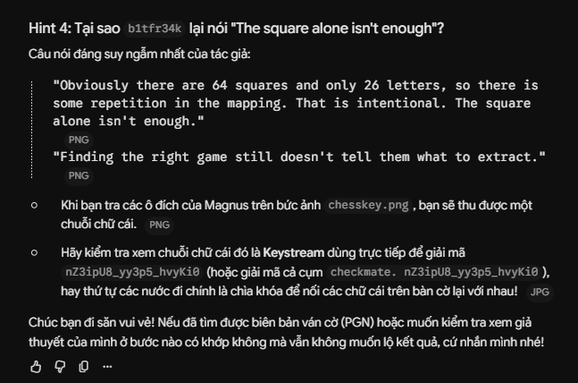
  * Và đây là hint cuối cùng cũng như hint để mình chắc chắn loại mã hóa được sử dụng là Vigenère :v

#### 4. Ý tưởng khai thác.

* Với thông tin đã thu thập cũng như suy luận ở trên, ý tưởng giải bài sẽ là như sau.
* Bước 1: Ta cần phải tìm được đúng ván đấu mà tác giả sử dụng để sinh key. Có 4 ván đấu trong năm 2026 tính đến thời điểm hiện tại `Magnus Carlsen` sử dụng khai cuộc Anh, ta sử thử từng ván đấu để sinh key rồi thử giải mã ciphertext cho đến khi ý nghĩa của nó lộ diện.
* Bước 2: Ta số hóa ma trận để có thể tra cứu bảng `chesskey.png`trong python
* Bước 3: Khôi phục lại key từ ván đấu.
* Bước 4: Giải mã
* Ta sẽ thử cả 4 ván đấu để lần mò ra đúng trận đấu mà tác giả nói tới.

#### 5. Exploit chain

* Mình truy cập nơi đang lưu trữ PGN của ván đấu đầu tiên là ván đấu `Magnus Carlsen vs Aleksandar Indjic`
* 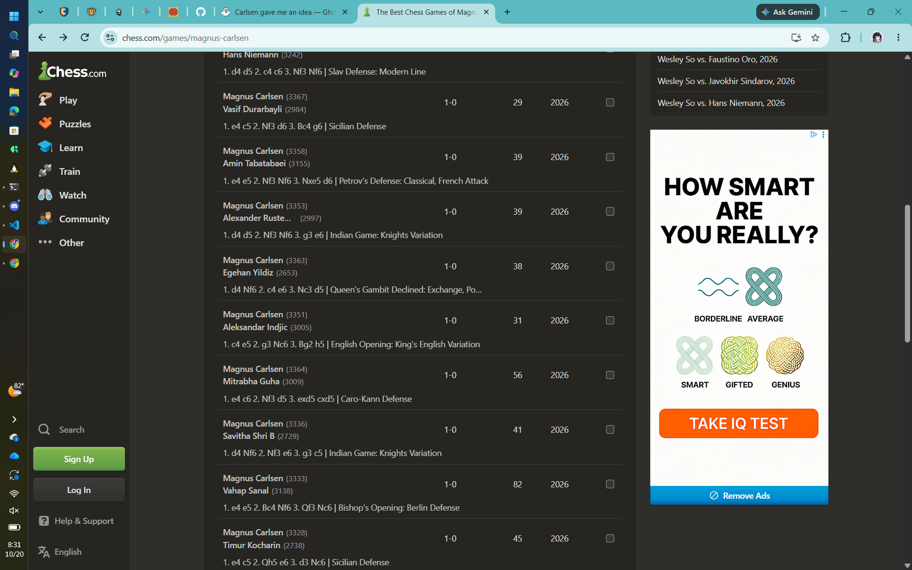
* Ván đấu vào ngày `1/13/2026`, ta tải bản PGN về máy để trích xuất dữ liệu.
* 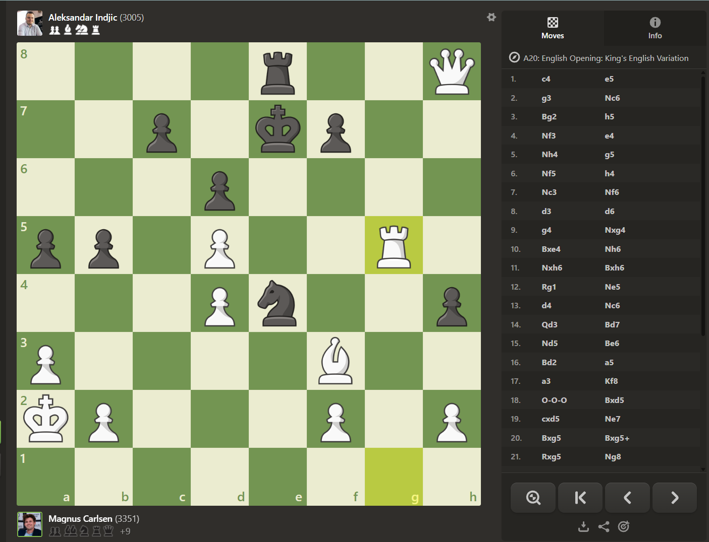
* Ta số hóa bảng `chesskey`để trích xuất thông tin
* Ta dựa vào pgn ván này để khôi phục key, sau đó giải mã ciphertext
* Và điều đáng mừng là ngay ở lần thử đầu tiên, ta đã xác định chính xác ván đấu mà tác giả dùng để sinh khóa, chính là ván đấu này luôn =))))))
* Script: [Đọc](solve.py)
* Kết quả:
* ```
  cH3ckM8_ch3s5_cryPt0
  ```
* ```
  deadface{cH3ckM8_ch3s5_cryPt0}
  ```
