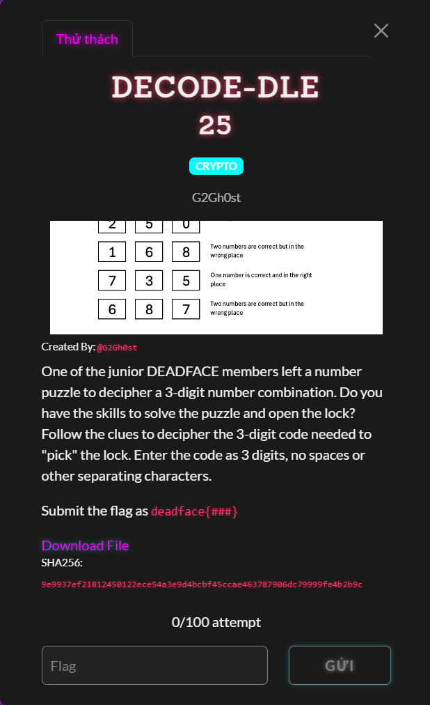
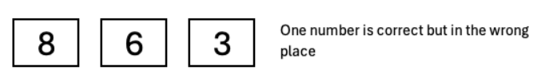
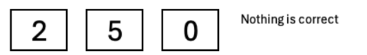
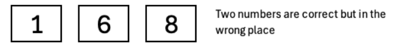
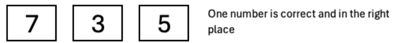
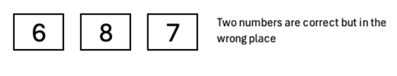

# DECODE-DLE

#### Cryptography - Event: Deadface 2026 - Ngày viết: 19/10/2026 - Xem ảnh: [Đọc](Decoddle.png)

#### 1. Overview

* 

* Đây là một dạng bài tư duy logic toán thông thường. Nếu các bạn đã xem Olympia thì chắc không lạ câu hỏi kiểu này =)))
* `Mục tiêu`: Tìm 3 số thỏa mãn

#### 2. Nền tảng lý thuyết

* Toán rời rạc
* Toán logic

#### 3. Exploit chain

* 
* Ở điều kiện đầu tiên cho ta biết trong 3 số. Có 1 số đúng nhưng ở sai vị trí. Các số đó có thể là `8`,`6` hoặc `3`
* 
* Ở điều kiện này, không có số nào đúng cả. Nên trong danh sách các số có thể chọn. Ta chỉ còn {1,3,4,6,7,8,9}
* 
* Ở điều kiện này, có đến tận 2 số đúng, nhưng cả 2 đều ở sai vị trí. Kết hợp với điều kiện thứ nhất. Giả sử số đúng là `6` và `8` thì mâu thuẫn ở điều kiện đầu tiên, bởi vì ở điều kiện đầu tiên cũng có 2 số là `6`và`8` nhưng chỉ có 1 số đúng. Nên chúng ta sẽ thu hẹp phạm vi lại chỉ còn cặp số `(1,6)`,`(1,8)`và số 3 sẽ bị loại ra khỏi danh sách bởi vì điều kiện 1 chỉ có 1 số đúng. Các cặp số sẽ kết hợp với các số còn lại là {4,7,9}
* 
* Ở trên ta đã biết 1 trong 2 cặp số `(1,6)` và `(1,8)`đúng. Trong các số lẻ còn lại có thể chọn là {4,7,9} thì không có số `3`và`5`. Nên số `7`sẽ là số đúng. Bây giờ chỉ còn thứ tự của cặp số `(1,6)`và` (1,8)`
* 
* Ở điều kiện cuối cùng này, ta lập luận như sau. Ở điều kiện 1,3,5, số `8`đã ở cả 3 vị trí số `1,2,3`nhưng cả 3 điều kiện đều nêu rằng có vị trí của số đúng đang sai. Điều này có nghĩa số đúng không phải là số `8`. Đối với số `6`cũng ở 3 điều kiện 1,3,5 thì số `6`chỉ ở vị trí `1,2`, vị trí số 1 ta đã biết ở điều kiện trên là số `7`, vị trí số 2 có số `6`nhưng sai vị trí. Vậy vị trí còn lại chắc chắn là số `6`
* Và ta kết luận được rằng, số cần tìm là: `716`
* ```
  deadface{716}
  ```
