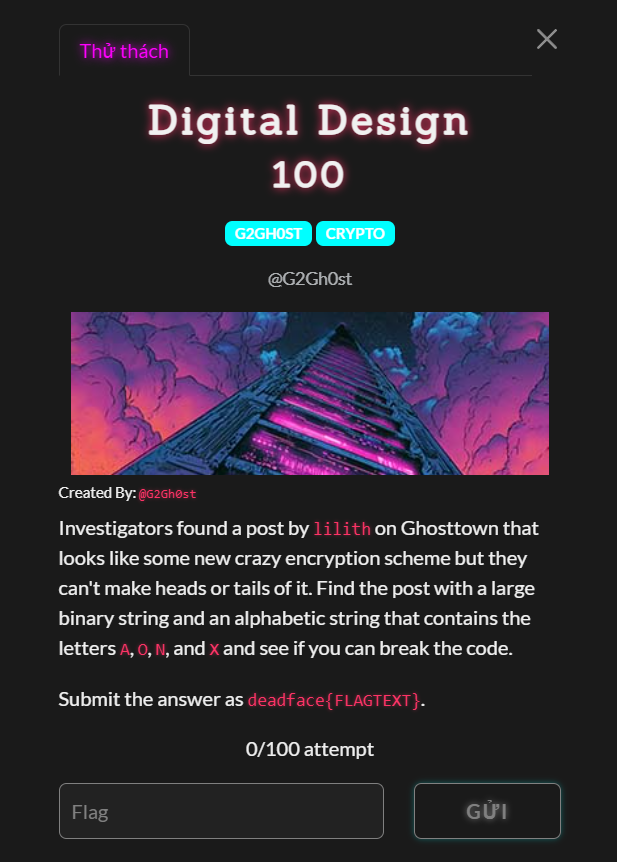
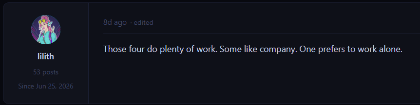
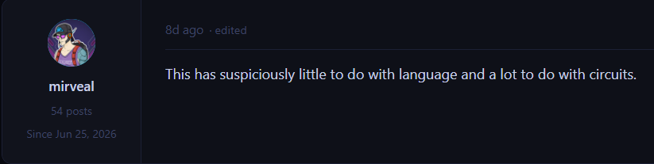
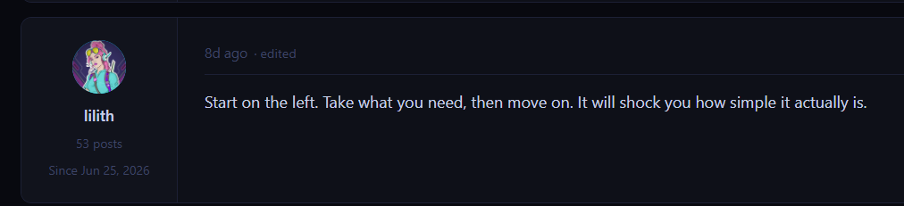
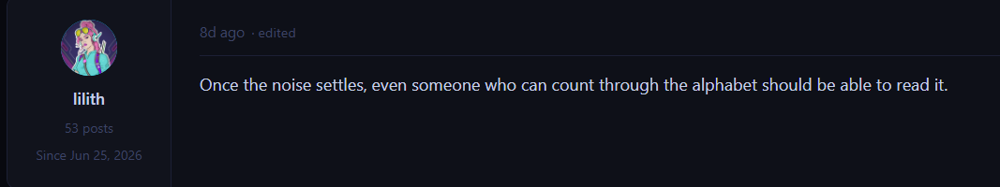
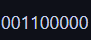

# Digital Design

#### Cryptography - Event: Deadface 2026 - Ngày viết: 19/10/2026 - Xem trang web: [Xem](page.html) (Các bạn nên tải về để xem)

#### 1. Overview

* 
* Đây là thử thách Crypto kết hợp với OSINT, để có thể giải bài này, các bạn cần có kiến thức về mạch số =)))
* `Mục tiêu`: Tìm kiếm thông tin bài viết của `lilith`trên diễn đàn Ghosttown, giải mã ciphertext của bài viết đó
* `Kỹ thuât`: Nhập môn mạch số =)), cổng logic

#### 2. Nền tảng cốt lõi

* Bạn không được bỏ tiết Nhập môn mạch số ~~như tôi~~ để giải bài này.
* Nhận biết được ý nghĩa kết quả

#### 3. Phân tích lỗ hỗng

* Sau một hồi tìm kiếm trên diễn đàn Ghosttown, mình đã tìm được bài viết mà đề bài nhắc đến.
* 
* Hints:
* 
* 
* 
* 

#### 4. Ý tưởng khai thác

* Trong hint có nhắc đến rằng, đoạn ciphertext trên có liên quan đến `circuits(mạch số)`, lúc đầu mình có nghĩ đến `lfsr`nhưng thấy chả liên quan gì hết. Đọc dòng dưới ta có đoạn text chỉ chứa các ký tự `X,O,N,A`. Và mình nhận ra, đó là viết tắt của các ký hiệu logic như `XOR,OR,NOT,AND`
* Để kiểm chứng, mình đã so sánh đoạn đầu tiên là
* 
* 
* Các bước thực hiện là XOR, XOR, OR, NOT, OR và độ dài dãy bit đầu là 9, ta nhận ra ngay là XOR tốn 2 bit, OR tốn 2 bit, NOT tốn 1 bit nên ta có 2 + 2 + 2 + 1 + 2 = 9. Có nghĩa là bằng cách áp dụng các cổng logic và đầu vào tùy thuộc vào cổng, cổng NOT nhận 1 bit và các cổng còn lại nhận 2 bit. Ta sẽ tính toán ra dãy bit mới có ý nghĩa
* Khi thử tính ra thì dãy bit đầu có kết quả là `00010`hay chính là số 2. Ở gợi ý cuối cùng, bằng cách đếm số thứ tự bảng chữ cái, số 2 tương đương với kí tự `B`.
* Mỗi cụm chỉ có 5 cổng logic và đầu ra luôn có độ dài là 5 bits tương đương với 32 giá trị khác nhau, nên đã bao trùm được toàn bộ bảng chữ cái có thể in ra :v

#### 5. Exploit chain

* Quy trình:
  * Sử dụng đoạn text, trích xuất các ký hiệu logic và thực hiện, xong 1 cụm sẽ biến đổi thành kí tự trong bảng chữ cái.
* Script: [Đọc](solve.py)
* ```
  deadface{BINARYLOGIC}
  ```
