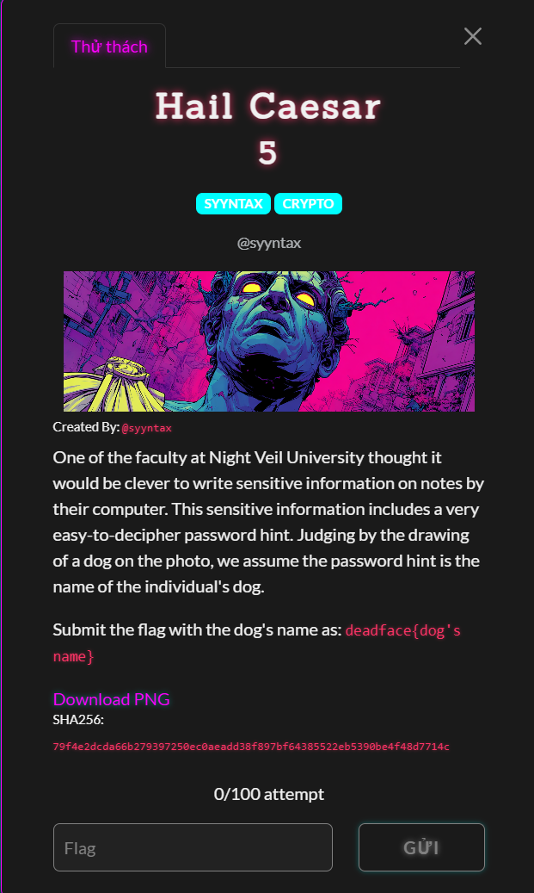
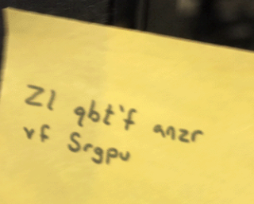
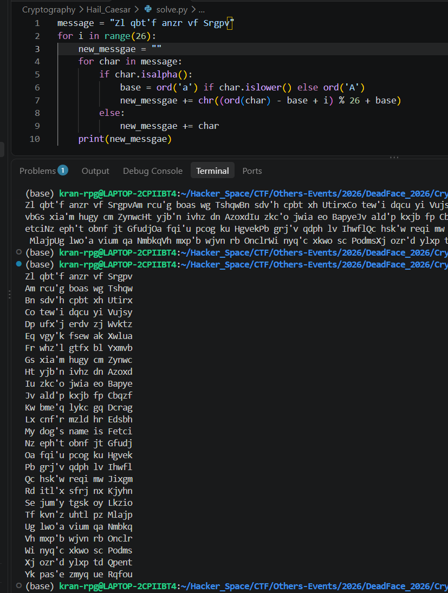

# Hail Caesar

#### Cryptography - Event: Deadface 2026 - Ngày viết: 19/10/2026 - Xem ảnh: [Đọc](pass_hint.png)

#### 1. Overview

* 
* Đây là bài khởi động của giải. Như tiêu đề bài thi thì bài này chắc chắn liên quan đến mã hóa Caesar =)))
* `Mục tiêu`: Tìm tên chú chó từ bức ảnh
* `Kỹ thuật`: Giải mã Caesar

#### 2. Nền tảng cốt lõi

* Cần biết về Caesar cipher
* Rot 13

#### 3. Exploit chain

* Trong ảnh có một đoạn message như sau:
* 
* `Zl qbt'f anzr vf Srgpv`
* Vì tiêu đề bài là caesar nên mình đã nghĩ đến giải mã ngược lại. Bằng cách thử 26 khóa khác nhau. Ta có được như sau:
* 
* Có 1 khóa giải mã ra dòng thứ 13 là `My dog's name is Fetch`
* Script: [Đọc](solve.py)
* ```
  deadface{Fetch}
  ```
