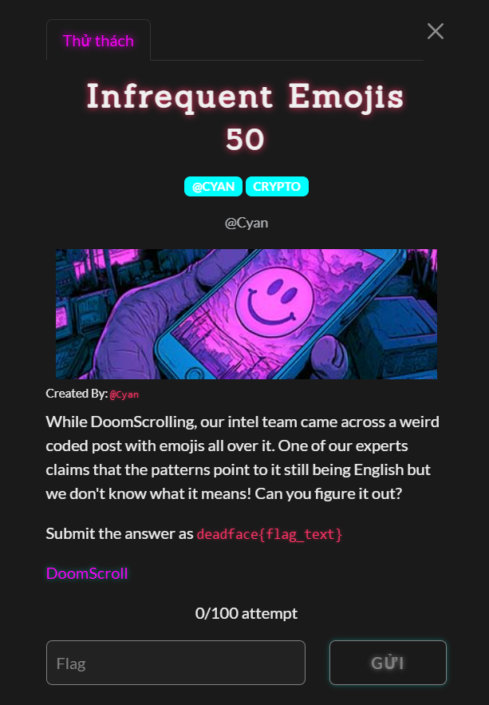
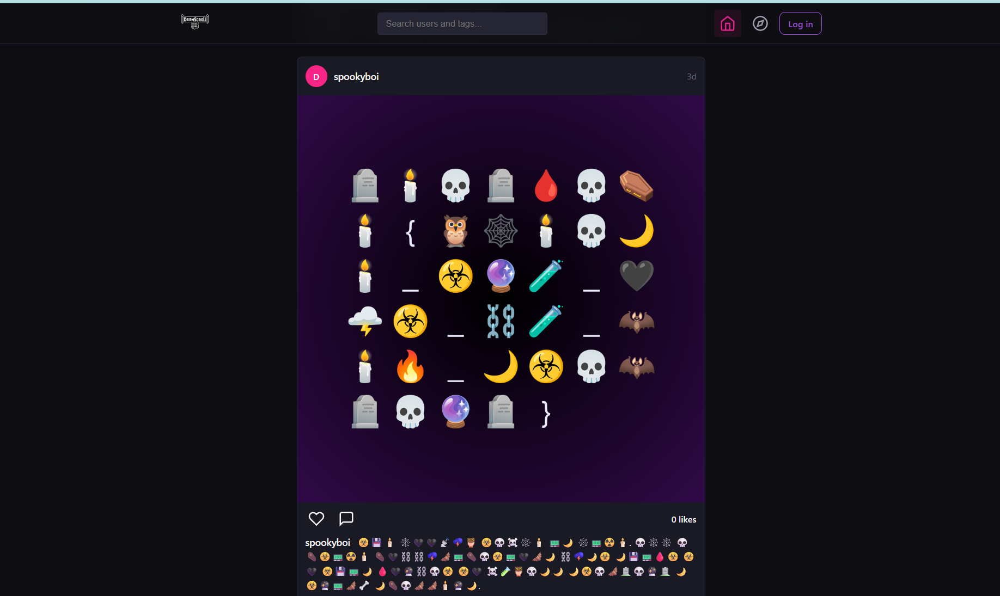
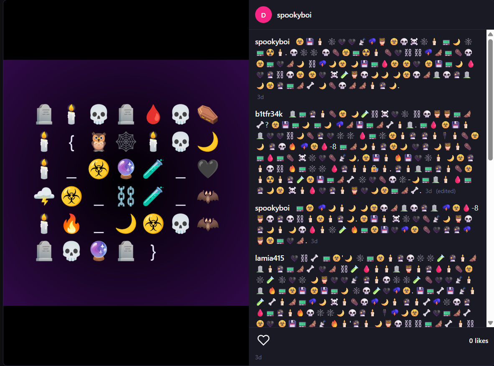
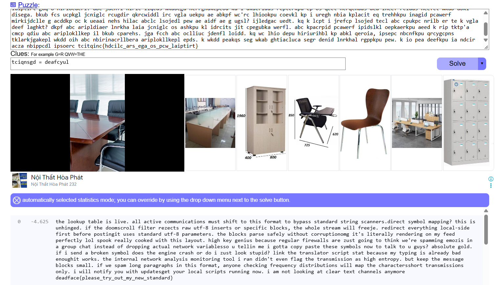

# Infrequent Emojis

#### Cryptography - Event: Deadface 2026 - Ngày viết: 19/10/2026 - Xem trang web: [Xem](page.html) (Các bạn nên tải file html và thư mục page_files về máy để xem nhé)

#### 1. Overview

* 
* Đây là bài đầu tiên mà mình sử dụng tấn công tần suất để giải mã cờ
* `Mục tiêu`: Giải mã ý nghĩa của các emoji
* `Kỹ thuật`: Frequent attack

#### 2. Nền tảng cốt lõi

* Các bạn cần phải biết và cách thực hiện frequent attack

#### 3. Phân tích lỗ hỗng

* Đề bài dẫn dắt ta vào 1 trang web giống mạng xã hội. Khi lướt đủ lâu, ta sẽ bắt gặp một bài đăng chỉ toàn các emoji
* 
* Ta nhận ra ngay, bức ảnh chính là cờ đã bị mã hóa bằng các emoji
* Khi mở rộng bài đăng, ta thấy hoàn loạt các comment chỉ toàn emoji, và trước đó trong trang web, bạn sẽ thấy rằng, đây là trang web sử dụng tiếng anh. Nên gần như chắc chắn, các emoji đang thay thế 1 kí tự trong bảng chữ cái tiếng anh và đoạn mesage full emoji này chắc chắn có ý nghĩa
* 

#### 4. Ý tưởng khai thác

* Bằng cách thay thế các emoji thành 1 kí tự trong bảng chữ cái, ta sẻ tạo ra 1 ciphertext mà ở đó, chữ cái gốc bị ánh xạ đến chữ cái mã hóa. Và ta sử dụng thủ thuật Frequent attack kết hợp với trang web [quipqiup.com](https://quipqiup.com/) để giải mã đoạn được ý nghĩa của từng emoji, sau đó là giải toàn bộ cờ trong ảnh.

#### 5. Exploit chain

* Quy trình:
  * Biến đổi các emoji thành các chữ cái
  * Tấn công frequent, khôi phục message và cờ
* Script biến đổi: [Đọc](solve.py)
* Kết quả:
* ```
  a️bc️ d️eefg️h a️ij️d️c️ kl d️km️c️. id️d️ in️a️km️c️ n️eo️o️g️pkn️ia️kepl o️g️la️ lbkqa️ a️e a️bkl qero️ia️ a️e j️shill la️iptirt la️rkpu ln️ippc️rl.tkrc️n️a️ lso️j️ed️ o️ihhkpu? a️bkl kl g️pbkpuc️t. kq a️bc️ teeo️ln️red️d️ qkd️a️c️r rc️vc️n️a️l riw g️a️q-8 kplc️ra️l er lhc️n️kqkn️ j️d️en️fl, a️bc️ wbed️c️ la️rc️io️ wkd️d️ qrc️c️xc️. rc️tkrc️n️a️ c️m️c️rsa️bkpu d️en️id️-lktc️ qkrla️ j️c️qerc️ hela️kpuka️ g️lc️l la️iptirt g️a️q-8 hirio️c️a️c️rl. a️bc️ j️d️en️fl hirlc️ liqc️d️s wka️beg️a️ n️errg️ha️kepeo️u ka️'l d️ka️c️rid️d️s rc️ptc️rkpu ep o️s qc️c️t hc️rqc️n️a️d️s d️ed️ lheef rc️id️d️s n️eefc️t wka️b a️bkl d️iseg️a️. bkub fc️s uc️pkg️l j️c️n️ig️lc️ rc️ug️d️ir qkrc️wid️d️l irc️ vg️la️ uekpu a️e a️bkpf wc️'rc️ lhio️o️kpu c️o️evkl kp i ureg️h n️bia️ kpla️c️it eq trehhkpu in️a️g️id️ pc️a️werf m️irkij️d️c️lle g️ a️c️d️d️kp o️c️ k uea️a️i n️ehs hila️c️ a️bc️lc️ lso️j️ed️l pew a️e a️id️f a️e g️ ug️sl? ij️led️g️a️c️ ued️t. kq k lc️pt i j️refc️p lso️j️ed️ tec️l a️bc️ c️pukpc️ n️rilb er te k vg️la️ d️eef la️g️hkt? d️kpf a️bc️ a️ripld️ia️er ln️rkha️ la️ia️ j️c️n️ig️lc️ o️s a️shkpu kl id️rc️its j️it c️peg️ubka️ werfl. a️bc️ kpa️c️rpid️ pc️a️werf ipid️slkl o️epka️erkpu a️eed️ k rip tktp'a️ c️m️c️p qd️iu a️bc️ a️riplo️kllkep il bkub c️pa️rehs. j️g️a️ fc️c️h a️bc️ o️c️lliuc️ j️d️en️fl lo️id️d️. kq wc️ lhio️ d️epu hiriurihbl kp a️bkl qero️ia️, ipsepc️ n️bc️n️fkpu qrc️y️g️c️pn️s tkla️rkj️g️a️kepl wkd️d️ o️ih a️bc️ n️birin️a️c️rllbera️ a️riplo️kllkepl epd️s. k wkd️d️ pea️kqs seg️ wka️b g️htia️c️luc️a️ seg️r d️en️id️ ln️rkha️l rg️ppkpu pew. k io️ pea️ d️eefkpu ia️ n️d️c️ir a️c️za️ n️bippc️d️l ipso️erc️ tc️itqin️c️{hd️c️ilc️_a️rs_eg️a️_o️s_pc️w_la️iptirt}
  ```

* Ta đưa lên trang web để tiến hành giải mã, ta đã biết format cờ là `deadface{}`nên các emoji như bia mộ,nến,đầu lâu,giọt máu,quan tài ta đã biết từ trước.
* 
* Ta giải mã thêm 1 vài ký tự nữa để message có ý nghĩa và ta giải được cờ.
* 
* ```
  de️adfac️e️{pl️e️ase️_t️ry_ou️t️_m️y_ne️w_st️andard}
  ```
