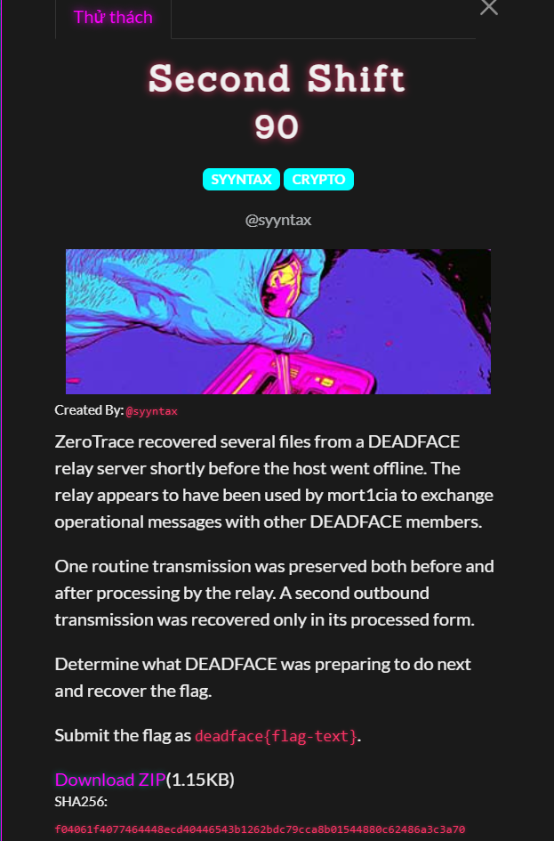
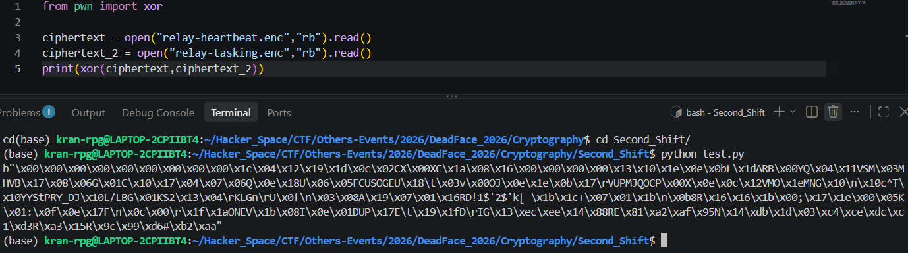
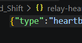
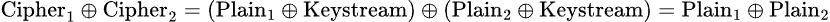

# Second Shift

#### Cryptography - Event: Deadface 2026 - Ngày viết: 19/10/2026

#### 1. Overview

* 
* Bài này thành thật mà nói, nếu đọc kỹ đề thì mình đã có thể giải nhanh hơn =))), nhưng lúc thi thì mình đọc không hiểu gì, mình tự phân tích rồi đưa ra giả thuyết rồi giải đúng luôn mặc dù khá tốn thời gian =)))
* `Mục tiêu`: Giải mã ciphertext dựa vào bản rõ và ciphertext tương ứng khác
* `Lỗ hỗng`: Mã hóa bằng AES CTR nhưng sài chung key và nonce
* `Kỹ thuật:`xor

#### 2. Nền tảng cốt lõi

* Nhận biết được các bài sử dụng stream cipher

#### 3. Phân tích lỗ hỗng/Exploit chain

* Lúc đầu mình phân tích, mình nhận thấy các ciphertext đang ở dạng bytes, mình thử xor 2 ciphertext với nhau thử xem có nhận được điều gì không.
* 
* Khi xor 2 ciphertext với nhau, ta nhận được hoàn loạt các byte`0`, và điều đó có nghĩa ciphertext thứ nhất và ciphertext thứ 2 có cấu trúc phần lớn giống nhau. Ở đoạn đầu kết quả, có 9 bytes 0 liên tục
* Khi xem thử cấu trúc, plaintext, mình đã nhận ra, 9 byets đầu giống nhau chính là cấu trúc json của plaintext.
* 
* 9 ký tự đầu là `{"type":"`
* Bởi vì 2 ciphertext xor với nhau tạo nên các bytes `0` ở đầu có nghĩa là có thể ciphertext đã được mã hóa chung 1 keystream.
* Và chúng ta sẽ khôi phục plaintext như sau:
* 
* Ta lấy kết quả tiếp tục xor với Plain_1, ta sẽ thu được Plain_2.
* Script: [Đọc](solve.py)
* Kết quả:
* ```
  b'{"type":"tasking","target":"aurora-vpn","action":"stage-access","window":"00:30Z","operator":"mort1cia","note":"Use the backup tunnel. Archive bundle under DEADFACE{ctr_nonce_reuse_breaks_confidentiality} before exfil."}\x98\xc3\'\xa6jk\xb0\x96\x8d\xb9lf\xbezj\xab\xa0\xfe\xfb\xf1\'\xd08!\xf3\xec\xa2K\x90\xd7\n'
  ```
* ```
  deadface{ctr_nonce_reuse_breaks_confidentiality}
  ```
*
