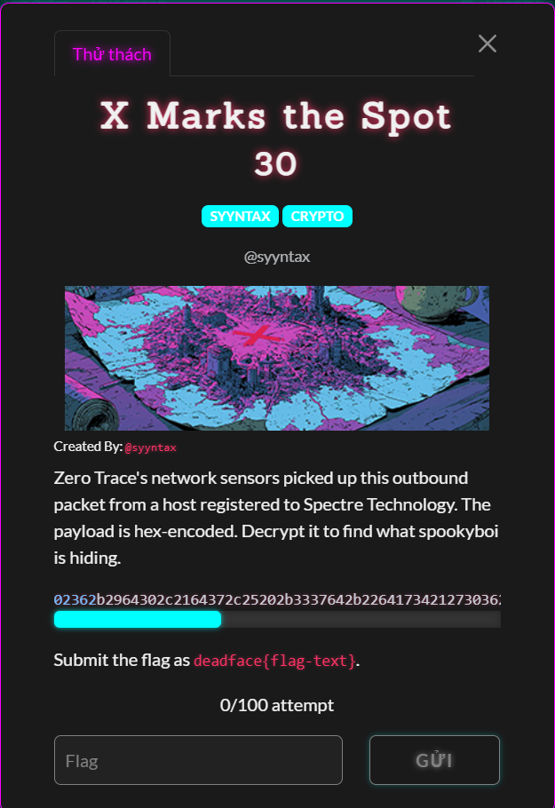
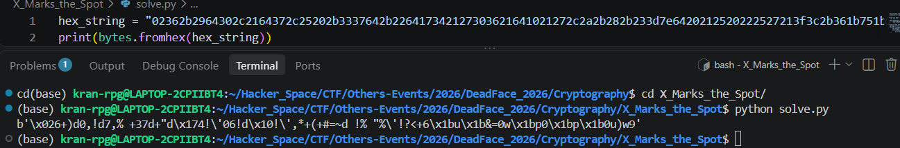

# X Marks the Spot (sau giải)

#### Cryptography - Event: Deadface 2026 - Ngày viết: 19/10/2026

#### 1. Overview

* 
* Đây là bài mình giải sau giải bởi vì bài này ở wave cuối cùng và nó ở nửa đêm =))))
* `Mục tiêu`: Giải mã đoạn hex string
* `Kỹ thuât`: Brute Force key

#### 2. Nền tảng cốt lõi

* Phép xor
* Tìm gợi ý từ đề bài.

#### 3. Phân tích lỗ hỗng

* Đề bài cho ta 1 đoạn hex string và ta cần phải giải mã nó.
* Khi chuyển hex string sang bytes. Ta không nhận được bất kỳ thông tin gì từ nó mà là chỉ là đống bytes rác.
* 
* Tiêu đề bài là `X Marks the Spot`, Marks the Spot thì mình có thể hiểu như X ở đây có ý nghĩa là gì?
* Nếu nghĩ nó như 1 danh từ riêng. Ta có thể nghĩ ngay đến toán tử bit XOR =))))

#### 4. Ý tưởng khai thác

* Mình giả định rằng flag đã bị xor với 1 bytes bất kỳ để ẩn dữ liệu `(tại sao là 1 bytes bởi vì trong ảnh đề bài có hint 1 dấu X rất to, có thể nó vừa có nghĩa là xor, vừa có nghĩa là x như kiểu 'fxfai là game rác', chữ a trong câu đã bị ẩn bằng chữ x =)))))`
* Khi thử brute force không gian khóa là 256 bytes khác nhau thì thực sự mình đã tìm được đoạn có nghĩa =))))

#### 5. Exploit chain

* Quy trình:

  * Thử xor ciphertext với mọi khóa từ 0-255
  * Tìm đoạn có ý nghĩa
* Script: [Đọc](solve.py)
* Kết quả:
* ```
  Cwjh%qm`%vmdajrv%jc%Vu`fqw`%Q`fmkjijb|?%a`dacdf`~}jwZ4Zg|q6Z1qZ1Zq4h6x
  From the shadows of Spectre Technology: deadface{xor_1_byt3_4t_4_t1m3}
  Gsnl!uid!ri`envr!ng!Rqdbusd!Udbionmnfx;!ed`eg`bdzyns^0^cxu2^5u^5^u0l2|
  Eqln#wkf#pkbgltp#le#Psf`wqf#Wf`kmloldz9#gfbgeb`fx{lq\2\azw0\7w\7\w2n0~
  H|ac.zfk.}fojay}.ah.]~kmz|k.Zkmf`abaiw4.jkojhomkuva|Q?Qlwz=Q:zQ:Qz?c=s
  O{fd)}al)zahmf~z)fo)Zylj}{l)]ljagfefnp3)mlhmohjlrqf{V8Vkp}:V=}V=V}8d:t
  Lxeg*~bo*ybkne}y*el*Yzoi~xo*^oibdefems0*noknlkioqrexU;Uhs~9U>~U>U~;g9w
  Rf{y4`|q4g|up{cg4{r4Gdqw`fq4@qw|z{x{sm.4pqupruwqol{fK%Kvm`'K `K K`%y'i
  Sgzx5a}p5f}tqzbf5zs5Fepvagp5Apv}{zyzrl/5qptqstvpnmzgJ$Jwla&J!aJ!Ja$x&h
  Pdy{6b~s6e~wryae6yp6Efsubds6Bsu~xyzyqo,6rswrpwusmnydI'Itob%I"bI"Ib'{%k
  Ympr?kwz?lw~{phl?py?Loz|kmz?Kz|wqpspxf%?{z~{y~|zdgpm@.@}fk,@+k@+@k.r,b
  ```
* ```
  deadface{xor_1_byt3_4t_4_t1m3}
  ```
