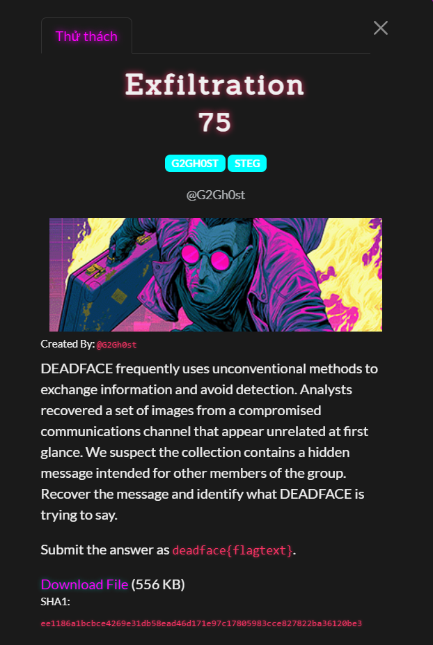
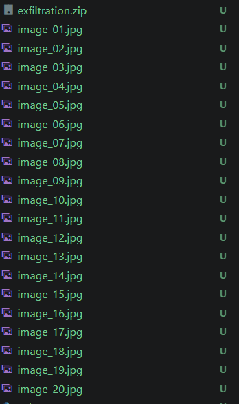
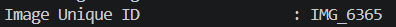
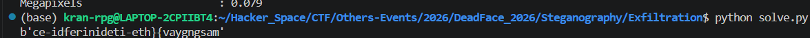
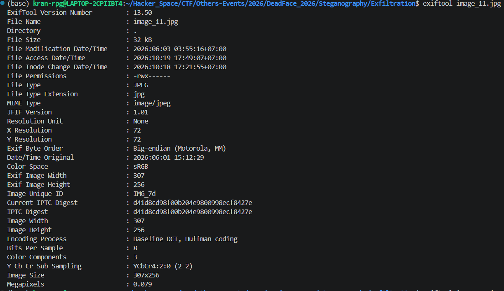
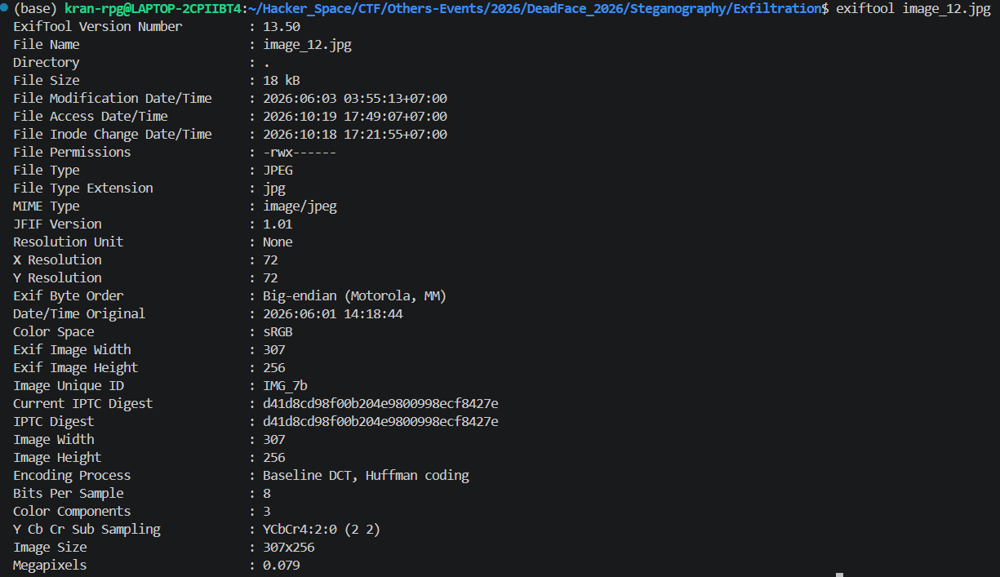

# Exfiltration

#### Steganography - Event: Deadface 2026 - Ngày viết: 19/10/2026

#### 1. Overview

* 
* Từ bài này trở đi đã bắt đầu khó lên nhiều, bởi vì khó lên nhiều nên bài này là bài cuối cùng mình giải được ở mảng steg này trong giải =)))
* `Mục tiêu`: Truy tìm đoạn messgae ẩn chứa trong file

#### 2. Nền tảng cốt lõi

* Biết sử dụng công cụ exiftool
* Nhận biết hex bytes

#### 3. Phân tích lỗ hỗng/Exploit chain

* Khi giải nén file zip, ta thu được 20 bức ảnh khác nhau.
* 
* Khi kiểm tra sơ lượt nội dung các bức ảnh hiển thị thì không thu thập được gì hết.
* Dựa vào tiêu đề bài thi là `Exfiltration`, mình nghĩ là flag sẽ được dấu trong metadata của các bức ảnh.
* Khi exiftool cả 20 bức ảnh bằng tay và quét mắt nhanh các thông tin thì mình nhận ra rằng các ID của các bức ảnh có dạng hex string và các bytes hex đó đều nằm trong khoảng [20,7e] là khoảng hex có thể in được của bytes.
* 

> ID của ảnh thứ nhất
> ...

* Sau đó mình thử chiết xuất toàn bộ id của các bức ảnh, ghép lại với nhau để xem nội dung là gì.
* 
* Mình chụp vậy thôi chứ lúc giải là mình viết tay ra hoàn toàn và chiết xuất exiftool bằng tay =))))
* Sau khi đã có đoạn text trên, ta vẫn chưa giải được hoàn toàn bởi vì thứ tự của flag đã bị đảo lộn, 1 lần nữa, mình tiếp tục kiểm tra exiftool  của 20 bức ảnh để xem, còn dữ liệu nào của cả 20 bức ảnh cho phép biết thứ tự in flag hay không. Thì mình đã tìm được
* 
* 7d khi đổi từ hex bytes sang ký tự chính là `}`
* 
* 7b đổi từ hex bytes sang ký tự là `{`
* Bởi vì `{`luôn được in trước `}`, môi quan hệ mình tìm được để xác định được vị trí các ký tự trong flag đó chính là dòng `Date/Time Original`. Các ký tự in trước sẽ có `Date/Time Original`sớm hơn so và các ký tự in sau. Và mình đã kiểm tra thì tấm ảnh thứ 11 là tấm ảnh được in ra cuối cùng của flag.
* Bằng cách thêm `Date/Time Original`cho từng bộ gán là hex bytes, ta sắp xếp lại `Date/Time Original`theo thứ tự từ bé đến lớn rồi in ra theo bộ gán hex string, ta sẽ thu được cờ.
* Script: [Đọc](solve.py)
* ```
  deadface{timing-is-everything}
  ```
