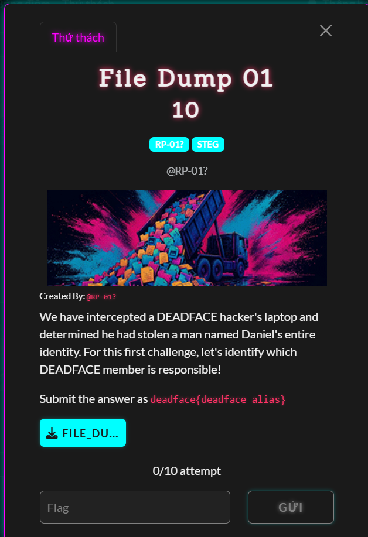
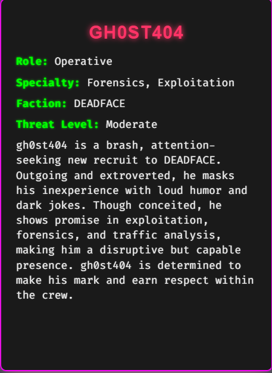

# File Dump 01

#### Steganography - Event: Deadface 2026 - Ngày viết: 19/10/2026

#### 1. Overview/Exploit chain

* 
* `Mục tiêu`: Tìm kẻ chịu trách nhiệm tấn công máy tính nạn nhân
* Bài này thực sự mình không biết giải như thế nào =)))), danh tính của các thành viên ban tổ chức chỉ có 13 thành viên và ta có 10 lượt thử. Thử ngẫu nhiên 10 tên trong 13 tên, xác suất không tìm ra kẻ chủ mưu khá là thấp nên mình nhập ngẫu nhiên từng người vào thì đã thành công qua bài này.
* 
* ```
  deadface{gh0st404}
  ```
