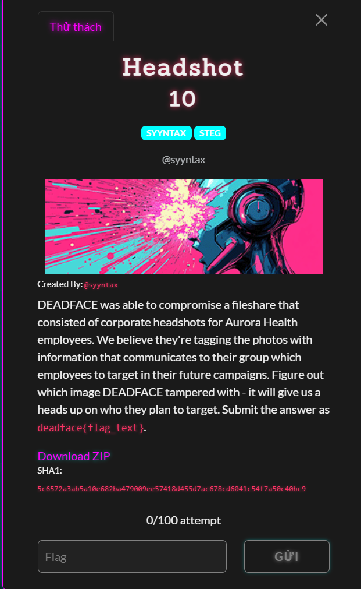
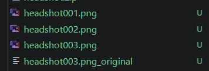
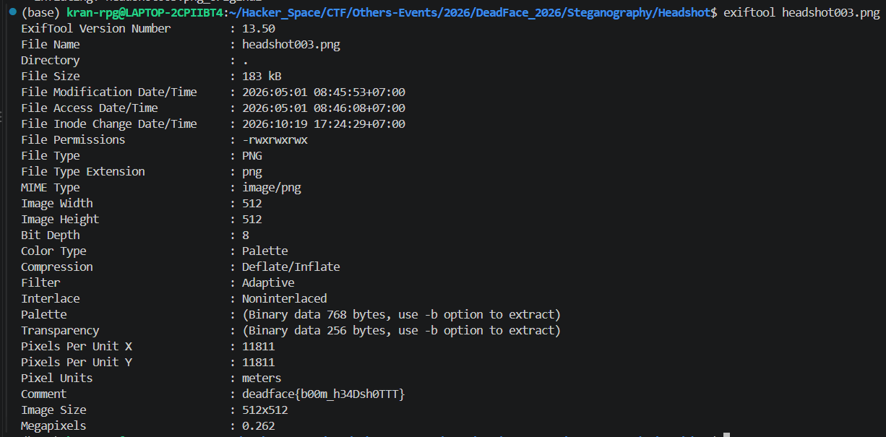

# Headshot

#### Steganography - Event: Deadface 2026 - Ngày viết: 19/10/2026

#### 1. Overview

* 
* Đây là bài đầu tiên của mục Steganography của giải :v
* `Mục tiêu`: Tìm kiếm thông tin flag từ tệp ảnh đã cho

#### 2. Exploit chain

* Khi giải nén tài liệu zip của bài, ta nhận được 4 bức ảnh với bức thứ 3 được chia ra original và bình thường.
* 
* Mình thử chiết xuất metadata để xem có dữ liệu gì không. Thì khi đến ảnh `headshot003.png`thì ta được như sau:
* 
* ```
  deadface{b00m_h34Dsh0TTT}
  ```
