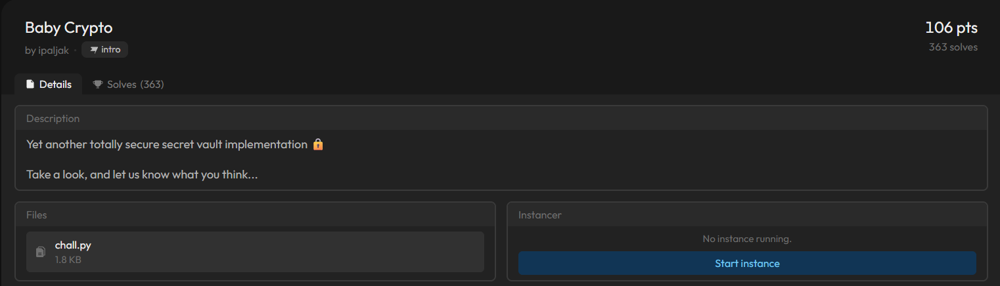
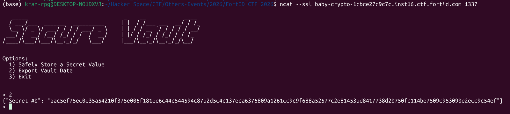
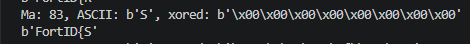

# Baby Crypto

#### Category: Intro - Event: FortID CTF 2026 - Ngày viết: 11/10/2026 - Đọc challenges: [Đọc](chall.py)

#### 1. Overview



* Đây là bài đầu tiên mình giải trong giải này :v, bài này đối với mình khá là dễ mà chả hiểu sao code để giải khá là lâu =))). Một phần là mình code sai nên mất thời gian để debug nhưng không quá lâu thì mình đã giải được :v
* `Mục tiêu`: Flag đã bị mã hóa `AES` chế độ `CTR` , giải mã ciphertext
* `Lỗ hỗng`: Sử dụng chung khóa và nouce cho bản rõ làm cho kẻ tấn công có thể khai thác lỗ hỗng `Keystream reuse/Two time pad`
* `Kỹ thuật`: Tấn công oracle, tấn công brute force kết hợp với đã biết 1 phần bản rõ của cờ

#### 2. Nền tảng cốt lõi

* Các bạn cần hiểu cơ chế mã hóa `AES` chế độ `CTR` trước khi giải bài này.
* Biết code python để chống lại code của server (giải thích sau)

#### 3. Phân tích lỗ hỗng

* Đề bài cho ta source code chính là source của oracle khi netcat đến server
* Trong challenges này, có 2 mục ta cần tập trung chính là 2 class mã hóa của server.
* ```Python
  import json
  import signal
  import sys

  from Crypto.Cipher import AES
  from Crypto.Random import get_random_bytes
  from secret import FLAG
  class Cipher:
      def __init__(self):
          self.key = get_random_bytes(16)

      def encrypt(self, plaintext):
          cipher = AES.new(self.key, AES.MODE_CTR, nonce=plaintext[:8])
          return cipher.encrypt(plaintext)

  class Vault:
      def __init__(self):
          self.cipher = Cipher()
          self.entries = {}

      def insert(self, secret_value):
          ciphertext = self.cipher.encrypt(secret_value.encode("utf-8"))
          self.entries[f"Secret #{len(self.entries)}"] = ciphertext.hex()

      def export(self):
          return json.dumps(self.entries)
  ```
* Trong hàm `main`, đối tượng `vault` được khai báo class `Vault`. khi đó trong class `Vault`sẽ khởi tạo đối tượng `cipher` bằng class `Cipher` và khi gọi class `Cipher`, class `Cipher` tiếp tục tạo riêng cho đối tượng `cipher` 1 khóa ngẫu nhiên dài 16 bytes
* Và vấn đề là khóa ngẫu nhiên này được sử dụng cho tất cả các bản rõ mà ta gửi lên server!
* Thứ khác biệt là trong hàm `encrypt` của class `Cipher` là sử dụng mã hóa AES bằng chế độ `CTR`có thêm `nonce` là 8 kí tự đầu của bản rõ

#### 4. Ý tưởng khai thác.

* Lỗ hỗng của bài này là chỉ sử dụng 1 khóa cho tất cả các bản rõ mà ta gửi lên `oracle`, thứ khác duy nhất là `nonce`.
* Thuật toán mã hóa `AES` chế độ `CTR` khá là đặc biệt so với các chế độ khác đó là thay vì mã hóa trực tiếp trên bản rõ thì nó sẽ mã hóa các chuỗi dài 16 bytes được sinh ra phụ thuộc vào `nonce` rồi tạo ra các `keystream` rồi `xor` với các khối của bản rõ. Chế độ này chuyển`AES`từ mã hóa`Block cipher`sang mã hóa`Stream cipher`
* Các chế độ `CBC`, `ECB`,`CTR` của `AES` mã hóa trực tiếp trên bản rõ:

$$
\text{ECB mode: } AES(plaintext, key)
$$

$$
\text{CBC mode: } AES(plaintext, key, iv)
$$

$$
\text{CTR mode: } AES(\text{nonce đã được thêm bytes dài 16 bytes}, key) = Keysrteam \to Keystream \oplus plaintext = ciphertext
$$

* Vậy thì về bản chất, bản rõ cờ chỉ xor với các keystream sinh ra từ mã hóa `AES nonce`và`key`. Nếu như 2 bản rõ được mã hóa chung 1 `key` và 1 `nonce`, thì có nghĩa rằng dòng keystream sinh ra và xor với 2 bản rõ là giống nhau, ta có thể xor 2 ciphertext của 2 bản rõ với nhau để triệt tiêu đi keystream bằng tính chất của phép xor!

$$
C_1 \oplus C_2 = (P_1 \oplus Keystream) \oplus (P_2 \oplus Keystream) = P_1 \oplus P_2
$$

* Key đã giống nhau trong mọi lần mã hóa, `nonce` lấy 8 kí tự đầu của bản rõ. Như ta đã biết là cờ có dạng `FortID{...}`. Ta đã biết đến tận `7 KÍ TỰ!`và các kí tự của cờ đều có thể in được, có nghĩa là kí tự thứ 8 phải có mã hex nằm trong khoảng `[20 , 7e]`. Và ta có thể bruteforce kí tự thứ 8 để sinh ra 1 bản rõ có 8 kí tự đầu giống với 8 kí tự của cờ gốc
* Khi ta biết được kí tự thứ 8 của cờ, ví dụ là "`FortID{?`". Khi đó cờ gốc sẽ có dạng `FortID{?...}`. Cờ được mã hóa AES bằng key ngẫu nhiên và nonce là `FortID{?`. Khi ta gửi 1 bản rõ khác chỉ dài 8 kí tự và trùng hoàn toàn với cờ là `FortID{?`. Bản rõ ta gửi lên cũng bị mã hóa bằng chính key ngẫu nhiên và nonce cũng chính là `FortID{?`. Lúc này ciphertext của bản rõ ta gửi lên sẽ giống hoàn toàn với ciphertext cờ gốc mà ở phiên oracle đó cho chúng ta ở 8 bytes hex đầu.
* Để có thể lấy được phần đuôi cờ còn lại, ta sẽ gửi lên bản rõ gồm 8 kí tự đầu của cờ đã biết là `FortID{?` cộng thêm các bytes `\x00` sau cho tổng độ dài của bản rõ bằng độ dài của bản rõ cờ. Khi ta nhận về ciphertext của bản rõ và ciphertext của bản rõ cờ. Ta đem 2 ciphertext xor bytes với nhau, khi đó những bytes ở bản rõ cờ khi xor với bytes `\x00` sẽ bằng chính nó:

$$
X \oplus 0 = X
$$

$$
\text{Giả sử rằng độ dài cờ là 12 và cờ là } FortID \lbrace ?abc\rbrace
$$

$$
C_1 \oplus C_2 = (FortID \lbrace ?\backslash\texttt{x00}\backslash\texttt{x00}\backslash\texttt{x00}\rbrace \oplus Keystream) \oplus (FortID \lbrace ?abc\rbrace \oplus Keystream)
$$

$$
= FortID \lbrace ?\backslash\texttt{x00}\backslash\texttt{x00}\backslash\texttt{x00}\rbrace \oplus FortID \lbrace ?abc\rbrace
$$

$$
= \backslash\texttt{x00}\backslash\texttt{x00}\backslash\texttt{x00}\backslash\texttt{x00}\backslash\texttt{x00}\backslash\texttt{x00}\backslash\texttt{x00}\backslash\texttt{x00}abc\backslash\texttt{x00}
$$

* Ta thu được phần còn lại của cờ!

#### 5. Exploit chain

* Đầu tiên ta phải xác định được độ dài của cờ là bao nhiêu.
* Khi netcat đến server, ta chỉ có 15s trước khi server tắt nên ta phải cần kết nối đến server khá là nhiều lần :v
* 
* Ta copy ciphertext của cờ, đưa về bytes rồi tính độ dài. Thì mình tính ra được độ dài cờ là 70
* Sau đó ta viết code, thử từng bytes trong khoảng `[20 , 7e]`có cái nào mà khi xor với ciphertext của cờ, toàn các bytes `\x00` hay không!
* Script Brute Force: [Đọc](solve.py)

> Chỗ này cần khá là tư duy chia nhỏ để giải quyết khi nãy mình đã nói ở mục 2 :v, các bạn cần chia nhỏ quá trình netcat đến server bởi vì server chỉ cho chúng ta 15s để thao tác

* Và đây là kí tự cần tìm:
* 
* Ta viết 1 script mới, gửi payload lên server gồm phần đầu là 8 kí tự cờ ta đã biết và phần còn lại là các bytes `\x00`
* Script payload: [Đọc](newsol.py)
* Kết quả:
* ```
  [+] Opening connection to baby-crypto-1cbce27c9c7c.inst16.ctf.fortid.com on port 1337: Done

     _____                              _    __            ____
    / ___/___  _______  __________     | |  / /___ ___  __/ / /_
    \__ \/ _ \/ ___/ / / / ___/ _ \    | | / / __ `/ / / / / __/
   ___/ /  __/ /__/ /_/ / /  /  __/    | |/ / /_/ / /_/ / / /_
  /____/\___/\___/\__,_/_/   \___/     |___/\__,_/\__,_/_/\__/

  Options:
    1) Safely Store a Secret Value
    2) Export Vault Data
    3) Exit

  >
  b'1'
   Enter secret:
  b'FortID{S\x00\x00\x00\x00\x00\x00\x00\x00\x00\x00\x00\x00\x00\x00\x00\x00\x00\x00\x00\x00\x00\x00\x00\x00\x00\x00\x00\x00\x00\x00\x00\x00\x00\x00\x00\x00\x00\x00\x00\x00\x00\x00\x00\x00\x00\x00\x00\x00\x00\x00\x00\x00\x00\x00\x00\x00\x00\x00\x00\x00\x00\x00'
   >
  b'2'
  {'Secret #0': 'cbae7a60cf4d6b5174d191d7fac3696bc05bf2a5214e5f985fc637d5ce44aa5ed79e1eaaa89acd20d1be5eb00041a48afc9e8d4d3439f76ea1d5ab6fb6a5e4d5fdf55e0cf729', 'Secret #1': 'cbae7a60cf4d6b5100e1e188b8f05805a704b1d7122f2ba929f56882a730c20199ae70c99be99210a3e107df7566c8e6a3ccbe2a465cc03190e2f4098e9cd0b1cac06e3ec354'}
  b"\x00\x00\x00\x00\x00\x00\x00\x00t0p_B31ng_Cr3at1v3_With_N0nc3s_0r_You'll_R3gre7_17_f894d75024}"
  [*] Closed connection to baby-crypto-1cbce27c9c7c.inst16.ctf.fortid.com port 1337
  ```
* ```
  Flag: FortID{St0p_B31ng_Cr3at1v3_With_N0nc3s_0r_You'll_R3gre7_17_f894d75024}}
  ```

#### 6. Reference

* AES CRT mode: [Đọc](https://pycryptodome.readthedocs.io/en/latest/src/cipher/classic.html#ctr-mode)
