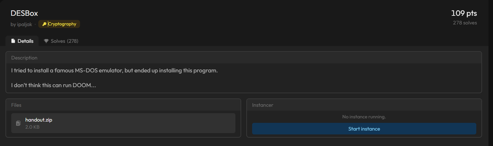
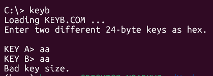
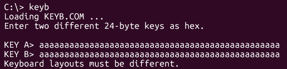
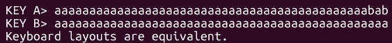
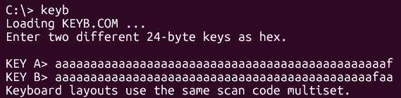
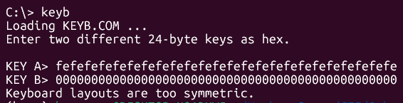
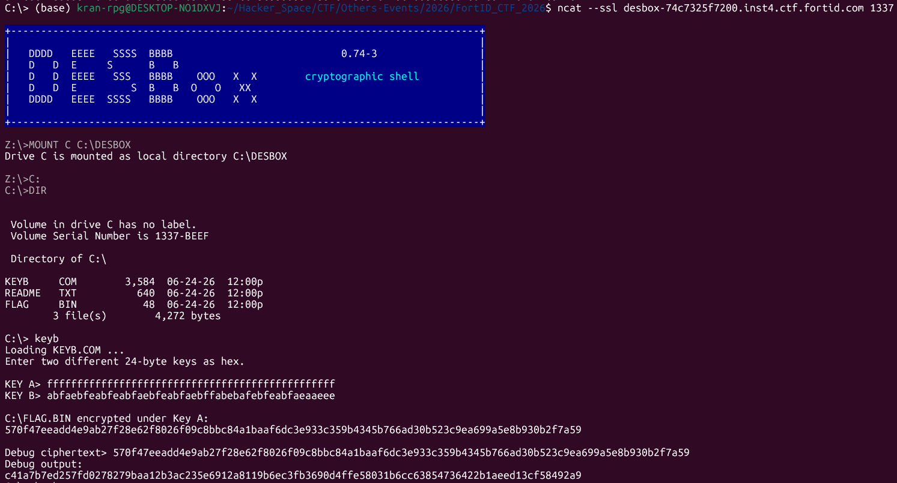
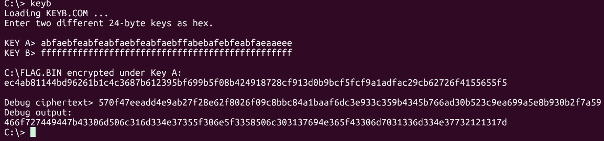
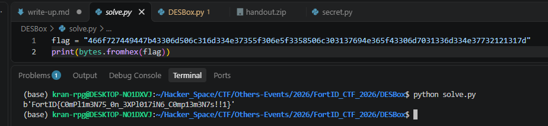

# DESBox

#### Category: Crypto - Event: FortID CTF 2026 - Ngày viết: 11/10/2026 - Đọc challenges: [Đọc](DESBox.py), đọc secret: [Đọc](secret.py)

#### 1. Overview

* 
* Đây là bài mình đánh giá là dễ nhất trong giải, bởi vì mình đã nghĩ ra cách giải trong lúc nấu ăn tối =))))), giải bài này khá là chill~.~
* `Mục tiêu`: Đánh lừa quá trình mã hóa để lấy được flag
* `Kỹ thuật`: Tấn công giao thức mã hóa

#### 2. Nền tảng cốt lõi

* Các bạn cần khả năng đọc hiểu code python khá là cao bởi vì code khá là dài

#### 3. Phân tích lỗ hỗng

* Bài này, chúng ta chỉ cần quan tâm ở mục focus thôi:
* ```Python
  def shell():
      print(BANNER)
      print(DIRECTORY)

      while True:
          line = input(PROMPT).strip()
          if not line:
              continue

          cmd, _, arg = line.partition(" ")
          cmd = cmd.upper()
          arg = arg.strip()

          if cmd == "DIR":
              print(DIRECTORY)
          elif cmd == "TYPE":# Ke me
              type_file(arg)
          elif cmd in {"KEYB", "KEYB.COM"}: # focus
              run_keyb()
          elif cmd == "DOOM": # Ke me
              print("This program cannot be run in DESBox mode.")
          elif cmd in {"EXIT", "QUIT"}: # ke me
              return
          else: # ke me
              print("Bad command or file name.")
  ```

* Khi chạy command `KEYB`, nó bắt mình nhập 2 key bytes `A,B` dài 24 bytes, các key sẽ được qua quá trình kiểm tra 5 bước. Sau đó, 2 key sẽ được qua hàm `load_key`. Hàm `load_key`có chức năng là xor key với mask là các bytes của flag, sau đó xáo trộn các bytes của key. Sau đó key A sẽ được sử dụng để mã hóa flag và in ra, đối với key B sẽ được dùng để giải mã ciphertext ta gửi lên
* ```Python
  def permute(a):
      p = list(range(len(a)))
      RNG.shuffle(p)
      return bytes(a[i] for i in p)
  def load_key(user_key):
      key = xor(permute(user_key), MASK)
      return DES3.adjust_key_parity(key)
  def read_keys():
      key_a = bytes.fromhex(input("KEY A> ").strip())
      key_b = bytes.fromhex(input("KEY B> ").strip())

      if len(key_a) != 24 or len(key_b) != 24:
          print("Bad key size.")
          exit()

      if key_a == key_b:
          print("Keyboard layouts must be different.")
          exit()

      if effective_bytes(key_a) == effective_bytes(key_b):
          print("Keyboard layouts are equivalent.")
          exit()

      if sorted(effective_bytes(key_a)) == sorted(effective_bytes(key_b)):
          print("Keyboard layouts use the same scan code multiset.")
          exit()

      if is_effective_complement(key_a, key_b):
          print("Keyboard layouts are too symmetric.")
          exit()

      return load_key(key_a), load_key(key_b)


  def run_keyb():
      print("Loading KEYB.COM ...")
      print("Enter two different 24-byte keys as hex.\n")

      key_a, key_b = read_keys()

      print("\nC:\\FLAG.BIN encrypted under Key A:")
      print(DES3.new(key_a, DES3.MODE_ECB).encrypt(FLAG).hex())

      ct = bytes.fromhex(input("\nDebug ciphertext> ").strip())
      if len(ct) == 0 or len(ct) % BLOCK_SIZE != 0:
          print("Bad ciphertext size.")
          sys.exit(1)

      print("Debug output:")
      print(DES3.new(key_b, DES3.MODE_ECB).decrypt(ct).hex())
  ```
* 2 key A,B được kiểm tra qua 5 bước bao gồm:
  * Cả 2 key phải có độ dài là 24 bytes
  * 
  * Cả 2 key phải khác nhau
  * 
  * Cả 2 key đều không tương đương `(Đây là kiểm tra đặc thù khi nhập key cho mã hóa 3DES, nói một cách đơn giản bước này kiểm tra 7 bit đầu và 1 bit cuối, nếu 7 bit đầu giống nhau và bit cuối giống nhau ở tất cả các bytes thì rơi vào trường hợp trên, nếu như 7 bit đầu giống nhau nhưng bit cuối lại khác nhau thì sẽ rơi vào trường hợp này)`
  * 
  * Cả 2 key có số lượng bytes các loại khác nhau
  * 
  * Cả 2 key đều có các bytes không phải phần bù của nhau
  * 

#### 4. Ý tưởng khai thác

* Các bước kiểm tra ở trên đã ngăn chặn hoàn toàn các lỗ hỗng mà mã hóa đời cũ `3DES` mắc phải như thoái hóa thành mã hóa `DES`, lật bytes cuối của key để tạo key giả, cấm trùng lặp key để dùng giải mã chính cờ đã bị mã hóa
* Ở câu hỏi đầu tiên mình tự đặt ra là `mask` có dự đoán được không? Có cách nào chống lại không?
* Câu trả lời của bản thân mình là ko thể dự đoán mask, nhưng cũng không cần quan tâm đến nó, bởi vì ta có thể tái sử mask trên 1 phiên sử dụng server, nên các key sẽ xor chung 1 mask
* Tới đây, khi suy luận thì mình lại có thêm 2 câu hỏi như thế này:

  * Nếu như mình mã hóa cờ ở phase 1 rồi qua phase 2 mình dùng chính key mã hóa ở phase 1 để giải mã ở phase 2 được không?
  * Có cách nào chống lại sự xáo trộn khóa không?
* Và câu trả lời cho 2 câu hỏi trên chính là lời giải của bài này
* Đối với câu hỏi thứ 1 thì hoàn toàn được.
* Thứ chúng ta còn thiếu là ví dụ khi ta nhập key `A` là `abcd`, key `A` sẽ được xáo trộn lên thành bất kỳ cái key nào và có `4!` cách mà key có thể biểu diễn, đối với bài của ta key dài 24 bytes tương đương với 48 kí tự thì có đến `48!` cách biểu diễn key khác nhau, xác suất để server chọn ngẫu nhiên dính lại key mà đã từng sử dụng mã hóa trước đó là bằng 0, vì vậy ta cần 1 key có thể chống lại sự xáo trộn.
* Và câu trả lời cho câu hỏi thứ 2 của mình là key sử dụng tất cả các ký tự giống nhau!

#### 5. Exploit chain

* Phase 1, mình netcat đến server rồi mã hóa cờ bằng key `A` là `ffffffffffffffffffffffffffffffffffffffffffffffff`, key `B` có thể là bất cứ thứ gì nhưng đảm bảo ko dính các điều kiện kiểm tra ở phần phân tích
* 
* Mình lưu lại ciphertext đã mã hóa bằng key `A`
* Phần debug ciphertext mình nhập lại chính ciphertext để bỏ qua
* Ở phase 2, mình đảo lại key `A` và key `B`
* Ở mục debug ciphertext, ta dán phần ciphertext đã lưu ở phase 1
* 
* Ở mục Debug output, ta lưu lại dãy hex và đưa nó sang bytes:
* 
* ```
  FortID{C0mPl1m3N75_0n_3XPl017iN6_C0mp13m3N7s!!1}
  ```
