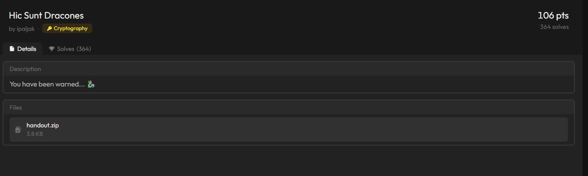
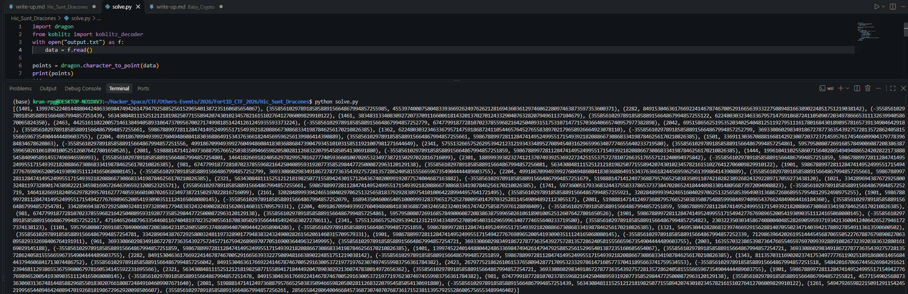

# Hic Sunt Dracones

#### Category: Crypto - Event: FortID CTF 2026 - Ngày viết: 11/10/2026 - Đọc challenges: [Đọc](handout)

#### 1. Overview

* 
* Đây là 1 dạng bài Crypto/Misc. Mình mất khá nhiều thời gian để research cũng như tư duy để giải bài này. Mà thế quái nào người ta first solve bài này trong vòng 3p ?????
* `Mục tiêu`: Khôi phục cờ từ file output.txt
* `Kỹ thuật`: Toán, Toán, Toán

#### 2. Nền tảng cốt lõi

* Cần có kỹ năng research
* Toán
* Các bạn có thể đọc thêm về đường cong Rồng: [Đọc](https://en.wikipedia.org/wiki/Dragon_curve)

#### 3. Phân tích lỗ hỗng

* Bài này thật sự rất là dài. Mình sẽ đi nhanh qua tất cả các nội dung của source code như sau
* Đầu tiên là file `Docker`, nó cho bạn nguồn github chứa thêm 2 source code nữa là `dragon.py và koblitz.py`được sử dụng trong `chall.py`
* Tiếp theo là file `output.txt`, chứa các tọa độ diểm eliptic curve đã bị mã hóa
* File `chall.py`, `dragon.py và koblitz.py` là file bài chính của chúng ta
* File `patch.py`cần được chạy sau khi tải file `koblitz.py`để thay đổi mã nguồn, theo hướng dẫn của file `Docker`
* Phân tích file `chall.py` trước thì đây là main code của source:
* ```Python
  dragon.ob = HeadlessTurtle()
  flag = open("flag.txt").read().strip()

  while True:
      p = getPrime(256, randfunc=get_random_bytes)
      if p % 4 != 3:
          continue

      a = random.randrange(1 << 255, p)
      b = random.randrange(1 << 255, p)
      if (4 * pow(a, 3, p) + 27 * pow(b, 2, p)) % p == 0:
          continue

      points = koblitz_encoder(flag, a, b, p)
      if len(points) == len(flag):
          break

  private_key = (
      random.randrange(1 << 127, 1 << 128),
      random.randrange(10, 15),
      random.randrange(2) * 180,
      a,
      b,
  )

  encrypted = [dragon.dragon_render(point, private_key) for point in points]
  print(dragon.point_to_character(encrypted))
  ```
* Class `HeadlessTurtle()`là class được viết lại để không hiển thị màn hình con rùa, Nói một cách đơn giản, thay vì khi chạy hàm vẽ đường cong rồng trong file `dragon.py`gốc sẽ hiển thị lên màn hình, tác giả bài này thay đổi lại và chỉ cho phép vẽ đường cong rồng dưới tầng ram, chạy ngầm file `dragon.py`
* Trong vòng lặp while, số `p` được lặp lại ngẫu nhiên cho đến khi nó chia 4 dư 3, đây là 1 dạng số nguyên tố khi đặt làm trường hữu hạn sẽ khiến cho các phần tử trong trường khi tính thặng dư bậc 2 vô cùng nhau khi mà chỉ cần 1 công thức nhỏ rút ra từ đính lý fermat. Nếu các bạn chưa biết thì nên học về thặng dư bậc 2 để hiểu hơn. Nói chung là tìm 1 số nguyên tố p chia 4 dư 3
* Tìm 2 số a,b sau cho khi khởi tạo đường cong eliptic sẽ không bị rơi vào trường hợp suy biến
* Hàm `koblitz_encoder`mã hóa các kí tự `flag` thành các điểm tọa độ trên đường cong eliptic
* Tạo 1 khóa bí mật
* Sau đó mã hóa các tọa độ thành các tọa độ mới thêm hàm `dragon_render`
* Cuối cùng là in ra các tọa độ điểm đã bị mã hóa
* Trong file `koblitz.py`, các kí tự được mã hóa bằng cách:
* ```Python
  def koblitz_encoder(plainText, elliptic_a, elliptic_b, p):
      ord_lst = [ord(ch) for ch in plainText]
      k = 20

      x_coords = []
      y_coords = []
      encoded_points = []

      for m in ord_lst:
          for j in range(1, k):
              x_m = m*k+j
              n = pow(x_m, 3) + elliptic_a * x_m + elliptic_b
              y_m = sq_root_mod_n(n, p)
              if (y_m != 0):
                  x_coords.append(x_m)
                  y_coords.append(y_m)
                  encoded_points.append((x_m, y_m))
                  break

      encoded = []
      for i in range(len(x_coords)):
          encoded.append((x_coords[i], y_coords[i]))
          #print('{},{}'.format(x_coords[i], y_coords[i]))
      return encoded
  ```
* Các kí tự chuyển thành số, sau đó tọa độ x tính bằng cách nhân số với `k = 20`rồi cộng với 1 sai số `j` từ 1 đến 20 để đảm bảo rằng khi tính `n` thì  `n` là số có thặng dư bậc 2.
* Trong hàm `dragon_render`:
* ```Python
  def dragon_render(starting_point, private_key):
      size = private_key[0]

      x_start = starting_point[0]
      y_start = starting_point[1]
      angle = private_key[2]

      #print('Starting Point : (' + str(x_start) + ', ' + str(y_start) + ')')

      ob.penup()
      ob.goto(x_start, y_start)
      ob.pendown()

      ob.left(angle)

      steps = turn_sequence_generator(private_key)
      steps = steps[:-1]
      ob.pencolor('green')
      for i in steps:
          if i == 'f':
              ob.forward(size)
          elif i == 'r':
              ob.right(90)
          elif i == 'l':
              ob.left(90)

      x_end = round(ob.xcor())
      y_end = round(ob.ycor())

      #print('Ending Point : (' + str(x_end) + ', ' + str(y_end) + ')')
      return (x_end,y_end)
  ```
* Với mỗi tọa độ eliptic curve, con rùa sẽ bắt đầu tại tọa độ đó, hoàn thành tất cả các bước trong list `steps` để vẽ ra 1 đường cong rồng rồi trả lại tọa độ mới.

#### 4. Ý tưởng khai thác

* Khi mình thử chuyển đổi file output.txt sang các tọa độ điểm `x,y`, mình nhận thấy có vấn đề sau:
* 
* Giá trị tọa độ `x` tuân theo 1 chu kỳ là `(1 số nhỏ, số cực lớn, 1 số nhỏ, số âm cực nhỏ)`
* Kí tự `F`trong format cờ `FortID{...}`có mã ASCII là 70, khi đưa vào hàm encoder thì tọa độ điểm x = 20* 70 +j = 1400 + j =))))
* Có nghĩa là các các kí tự ở vị trí chẵn thì tọa độ x của nó không bị mã hóa mà chỉ mã hóa theo tọa độ y `(Điều này khá khó giải thích, trong khuôn khổ bài này, ta chỉ cần biết được mấu chốt ý tưởng là được, còn lý do xuất hiện lỗ hỗng này thì các bạn phải tìm hiểu về đường cong rồng và cách mà class khai báo ở dòng 48 của chall gây ra lỗ hỗng)`
* Mình nhận thấy khi xét trị tuyệt đối của các tọa độ x ở vị trí kí tự lẻ thì độ lớn khá là tương đương, có thể là tọa độ x đã bị mã hóa và cộng thêm 1 `noise giống nhau cho tất cả các kí tự ở vị trí lẻ`
* Mình lấy kí tự cuối cùng cuối dãy đã biết là `}` để tínhg giá trị `noise`, sau đó thì ở các bước check ở các kí tự lẻ, nếu tọa độ x quá lớn thì - noise, tọa độ x là số âm thì cộng `noise`

#### 5. Exploit chain

* Quy trình giải:
  * Brute force `j`
  * Tính toán giá trị noise
  * Giải mã các tọa độ về lại kí tự
  * Chọn flag phù hợp
* Script: [Đọc](solve.py)
* ```
  Flag: FortID{1f_D0n_Knu7h_H4s_1t_0n_th3_W4ll_Th3n_17_Mu57_B3_G00d_F0r_Crypt0_r1ght?}
  ```
