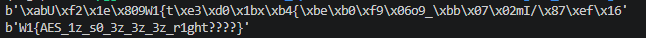

# ECB

#### Category: Crypto - Event: Training 2026 - Ngày viết: 10/12/2026 - Đọc challenges: [Đọc](ecb.py)

#### 1. Overview

* Tiếp tục bài thứ 2 của các anh lớn thì sau khi giải bài `RSA` thì qua bài này mình viết code đúng 1 lần là giải ra =)))))
* `Mục tiêu`: Giải mã Ciphertext đã bị mã hóa `AES`
* `Kỹ thuật`: Brute Force key

#### 2. Nền tảng cốt lõi

* Mục tiêu chủ yếu của bài này mà mấy anh giao là tìm hiểu chế độ mã hóa`ECB`của `AES`. Theo mình hiểu thì chế độ mã hóa chỉ sử dụng key làm đối số cho việc mã hóa. Nhưng mã hóa này có 1 lỗ hỗng là dễ bị các phương pháp tấn công như AES-ECB Oracle :v

#### 3. Phân tích lỗ hỗng

* Trong source code, flag được mã hóa bằng cách sinh ra 1 khóa ngẫu nhiên dưới `1.000.000`, sau đó chuyển qua bytes độ dài 16 kí tự và hiển thị theo Big Endien bytes.

#### 4. Ý tưởng khai thác

* Không gian khóa rất nhỏ, chỉ có `1.000.000`khóa khác nhau có thể được dùng để mã hóa cờ, ta sẽ thử hết các khóa để giải mã ngược lại cờ. Bài này có thể là do clb ra nên mình nghĩ là flag có dạng `W1{}`, nên mình chỉ in ra các cờ mà có các bytes `W1{` trong chuỗi, nếu không sẽ bỏ qua

#### 5. Exploit chain

* Thử mọi loại khóa cho đến khi ra cờ
* Script: [Đọc](solve.py)
* 
* ```
  W1{AES_1z_s0_3z_3z_3z_r1ght????}
  ```
