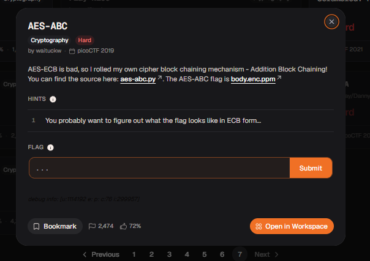
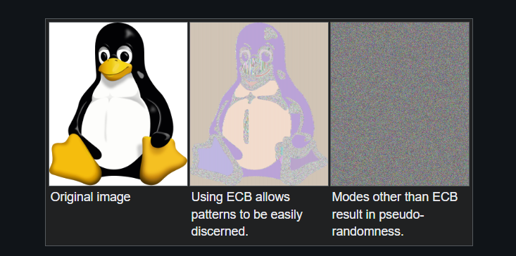
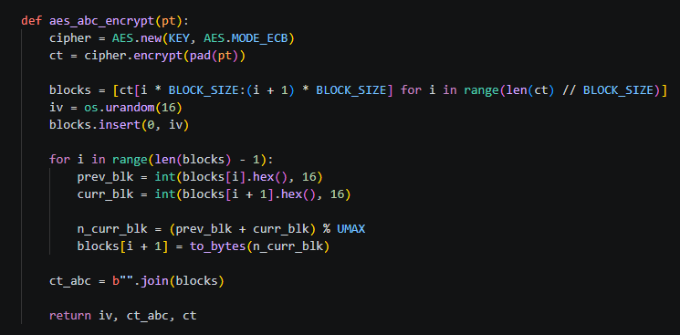
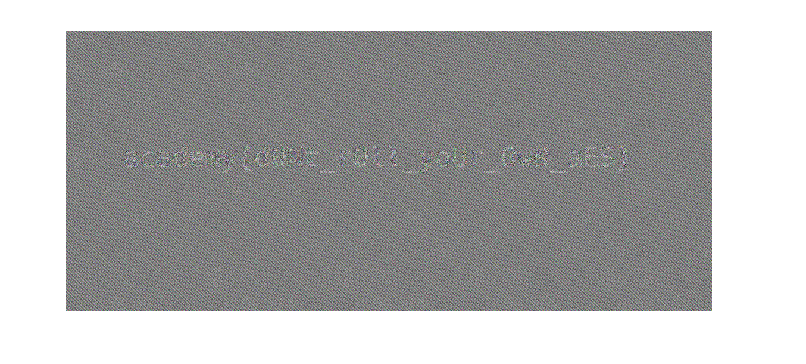

# AES-ABC

#### Category: Cryptography - Difficulty: Hard - Ngày viết: 11/16/2026

#### 1. Overview

* 
* Đây là lỗ hỗng liên quan đến mã hóa AES-ECB. Khi mà cùng 1 key, khối ciphertext sẽ song ánh với 1 khối plaintext duy nhất
* `Mục tiêu`: Khôi phục lại trạng thái bức ảnh vừa mới encrypt AES-ECB, xem ảnh và lấy cờ
* `Lỗ hỗng`: Tính song ánh của AES-ECB, đối với dữ liệu có tính lặp lại và có cấu trúc lớn sẽ làm lộ thông tin của dữ liệu mặc dù đã mã hóa

#### 2. Nền tảng cốt lõi

* Các bạn cần biết lỗ hỗng này nó sẽ trông như nào trong thực tế :v
* AES-ECB : [Đọc](<https://en.wikipedia.org/wiki/Block_cipher_mode_of_operation#:~:text=R%20%3D%20IV-,Electronic%20codebook%20(ECB),-edit>)
* 

#### 3. Exploit chain

* 
* Ở phần `aes_abc_encrypt`, ta chỉ cần đưa trạng thái blocks quay về lại đúng ban đầu, sau đó tạo 1 file ppm mới và load ảnh là được.
* Script khôi phục ảnh: [Đọc](solve.py)
* Ta lên trang web để load file ảnh ppm: [Truy cập](https://imagetostl.com/vn/xem-ppm-truc-tuyen)
* 
* ```
  academy{d0Nt_r0ll_yoUr_0wN_aES}
  ```
