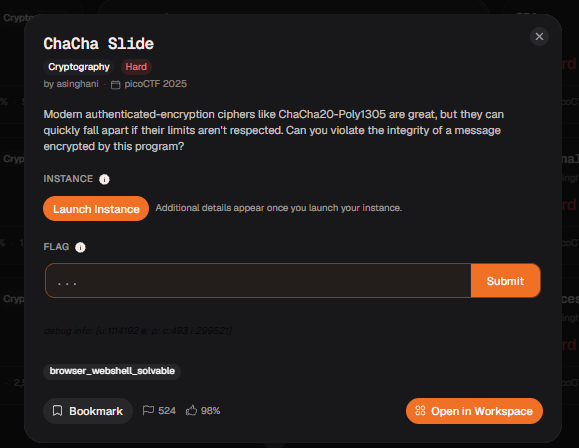
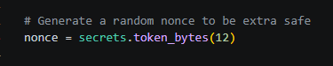
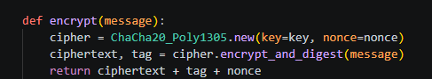

# ChaCha Slide

#### Category: Cryptography - Difficulty: Hard - Ngày viết: 11/19/2026

#### 1. Overview

* 
* Đây là 1 bài tấn công trên loại mã hóa xác thực `AEAD sử dụng Polynomial MAC` - ở đây là ChaCha20-Poly1305
* `Mục tiêu`: Giả mạo thẻ xác thực (Authentication Tag) để gửi $C_{goal}$ lên server
* `Lỗ hỗng`: Nonce reuse
* `Kỹ thuật`: Nonce-Reuse Forgery Attack

#### 2. Nền tảng cốt lõi

* Hầu hết các chuẩn mã hóa AEAD theo kiến trúc Carter–Wegman MAC đều bị lỗ hổng khi có 2 bản tin nonce reuse
* Sơ đồ mã hóa và tạo tag của ChaCha20-Poly1305: [Đọc](https://en.wikipedia.org/wiki/ChaCha20-Poly1305)
* ChaCha20: [Đọc](https://datatracker.ietf.org/doc/html/rfc8439#section-2.4)
* Poly1305: [Đọc](https://datatracker.ietf.org/doc/html/rfc8439#section-2.5)
* Tài liệu RFC 8439: [Đọc](https://datatracker.ietf.org/doc/html/rfc8439#autoid-1)
* Các bạn nên đọc kỹ thuật toán Poly1305 trước khi giải bài này - `(cần hiểu cách quy đổi c, cách cặp khóa xác thực (r, s) sinh ra)`
* **Cơ chế hoạt động của ChaCha20-Poly1305:**

  1. **Sinh khóa xác thực một lần (`Poly1305_Key_Gen`):** Chạy khối ChaCha20 đầu tiên tại $\text{Counter} = 0$, lấy 32 bytes đầu chia đôi thành cặp khóa $(r, s)$ theo định dạng *little-endian* (trong đó $r$ được xóa 22 bit cố định bằng phép *clamping*: `r &= 0x0ffffffc0ffffffc0ffffffc0fffffff`).
  2. **Mã hóa dữ liệu:** Chạy ChaCha20 từ $\text{Counter} = 1, 2, \dots$ để sinh dòng khóa `Keystream` và thực hiện $C = P \oplus \text{Keystream}$.
  3. **Đóng gói dữ liệu đầu vào Poly1305:** Nối các thành phần theo đúng thứ tự, sau đó cắt $\text{Data}$ thành từng khối 16 bytes, đọc theo *little-endian* rồi cộng thêm $2^{128}$ (`1 << 128`) vào mỗi khối để tạo thành dãy hệ số nguyên $c_1, c_2, \dots, c_n$.

$$
\text{Data} = \text{AAD} \parallel \text{pad}_{16}(\text{AAD}) \parallel C \parallel \text{pad}_{16}(C) \parallel \text{len}_{64,\text{LE}}(\text{AAD}) \parallel \text{len}_{64,\text{LE}}(C)
$$

4. **Tính thẻ xác thực:** Đánh giá đa thức trên trường nguyên tố $\mathbb{F}_{2^{130}-5}$ rồi cộng mặt nạ $s$ theo modulo $2^{128}$:

$$
\text{Tag} = \Big(\big((c_1 r^n + c_2 r^{n-1} + \dots + c_n r) \bmod (2^{130}-5)\big) + s\Big) \bmod 2^{128}
$$

#### 3. Phân tích lỗ hỗng

* Mã nguồn server: [Đọc](challenge.py)
* Có 1 điểm chính gây ra lỗ hỗng ở bài này.
* 
* Server sử dụng cùng 1 nonce cho cả 2 msg gửi lúc đầu cho chúng ta. Bằng cách lấy 2 tag của 2 msg trừ đi cho nhau, ta thu được 1 phương trình bậc $\max(n, m)$ ẩn $r$ với các hệ số $c$ chính là các khối 16 bytes của AEAD

#### 4. Ý tưởng khai thác/Exploit chain

* Như đã giải thích ở trên, khi đó ta có 2 tag của server như sau:

$$
\begin{aligned}
\text{Tag}_1 &= \Big( \big( (c_{1,1}r^n + c_{1,2}r^{n-1} + \dots + c_{1,n}r) \bmod (2^{130}-5) \big) + s \Big) \bmod 2^{128} \\
\text{Tag}_2 &= \Big( \big( (c_{2,1}r^m + c_{2,2}r^{m-1} + \dots + c_{2,m}r) \bmod (2^{130}-5) \big) + s \Big) \bmod 2^{128}
\end{aligned}
$$

* Đặt $g_1(r) = \left(\sum_{i=1}^{n} c_{1,i} r^{n+1-i}\right) \bmod (2^{130}-5)$ và $g_2(r) = \left(\sum_{j=1}^{m} c_{2,j} r^{m+1-j}\right) \bmod (2^{130}-5)$.
* Do cả hai bản tin dùng chung một $\texttt{nonce}$ nên cặp khóa xác thực $(r, s)$ sinh ra từ khối $\text{Counter} = 0$ là giống hệt nhau. Lấy hiệu hai thẻ xác thực theo modulo $2^{128}$ để triệt tiêu ẩn $s$:

$$
\text{Tag}_1 - \text{Tag}_2 \equiv g_1(r) - g_2(r) \pmod{2^{128}}
$$

* Vì $g_1(r), g_2(r) \in [0, 2^{130}-6]$, hiệu $g_1(r) - g_2(r)$ trên số nguyên chỉ lệch so với $`(\text{Tag}_1 - \text{Tag}_2) \bmod 2^{128}`$ một bội số nhỏ của $`2^{128}`$. Đưa phương trình về trường nguyên tố $`\mathbb{F}_{2^{130}-5}`$:

$$
g_1(r) - g_2(r) - \big((\text{Tag}_1 - \text{Tag}_2) \bmod 2^{128} + k \cdot 2^{128}\big) \equiv 0 \pmod{2^{130}-5}, \quad k \in \{-4, -3, \dots, 4\}
$$

* Ta thử lần lượt $k \in \{-4, -3, \dots, 4\}$ và giải phương trình bậc $n$ ẩn $r$ trên trường hữu hạn, với mỗi $k$, ta sẽ giải ra được tối đa $n$ nghiệm $r$ khác nhau, ta kiểm tra nghiệm $r$ với mask theo chuẩn Poly1305, nếu $r$ & mask bằng chính $r$ thì đó là $r$ cần tìm.
* Sau đó ta khôi phục $s = Tag_1 - g_1(r_{found}) \pmod {2^{128}}$
* Để tạo ra $C_{goal}$ , ta cần khôi phục dòng keystream bằng cách: $Keystream = C_1 \oplus P_1$, khi đó $C_{goal} = Keystream \oplus P_{goal}$
* Ta bắt đầu tạo Tag giả cho $C_{goal}$, gửi lên server kèm với nonce là ta thu được cờ.
* Script: [Đọc](solve.py)
* ```
  academy{7urn_17_84ck_n0w_aff831e1}
  ```
