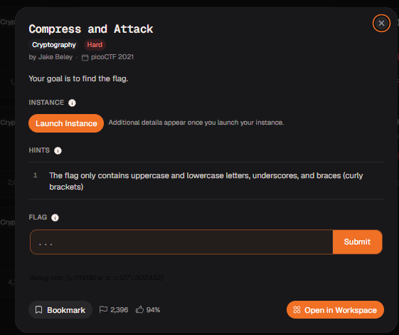
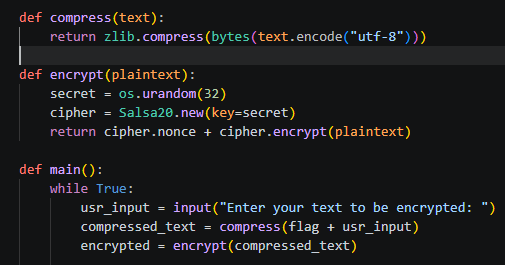

# Compress and Attack

#### Category: Cryptography - Difficulty: Hard - Ngày viết: 11/16/2026

#### 1. Overview

* 
* Đây là 1 bài dạng tấn công rò rỉ độ dài secret khi cấu trúc plaintext là `secret | pt`với `pt` là do ta gửi lên. Trước khi mã hóa thì plaintext bị nén rồi mới được mã hóa
* `Mục tiêu`: Khôi phục secret - flag
* `Lỗ hỗng`: Nén dữ liệu trước khi mã hóa, làm rò rỉ độ dài khóa - CRIME
* `Kỹ thuật`: Backtracking, tận dụng độ dài plaintext sau nén không đổi để tìm ra các ký tự secret

#### 2. Nền tảng cốt lõi

* Lỗ hỗng này xuất hiện trên bất cứ loại hình thức mã hóa nào khi mà dữ liệu bị nén trước mã hóa và ta có thể ghép `pt` bất kỳ với dữ liệu
* Các bạn tham khảo write-up bài CRIME của mình trên Cryptohack: [Đọc](https://github.com/KranBoring/CTF-Solutions/blob/02c9b03ef1d265b2b59ae5a1c3dd396e89c766eb/Cryptohack/Challenges/Symmetric_Ciphers/CTRIME/write-up.md)
* Thuật toán mình sử dụng gần như copy hoàn toàn từ bài CRIME qua để giải bài này nên các bạn có thể lấy source gốc bài của mình, sửa lại để bypass bài này nhé

#### 3. Phân tích lỗ hỗng

* Mã nguồn server: [Đọc](compress_and_attack.py)
* 
* Dữ liệu bị nén trước khi mã hóa dữ liệu.

#### 4. Ý tưởng khai thác/Exploit chain

* Bằng cách gửi `usr_input`có cấu trúc gần giống với `flag`. Hàm nén sẽ nén xuống kích thước nhỏ nhất, bằng cách brute force mọi giá trị khả dĩ `(bình thường là các ký tự in được)`, ta lấy ký tự cho ra độ dài nhỏ nhất.
* Ví dụ

  * academya -> 49
  * academyb -> 49
  * ...
  * academy{ -> 48
  * academy. -> 49
  * ...
  * Và ta xác định được ký tự tiếp theo là `{`, ghép ký tự `{` với chuỗi flag đã biết và tiếp tục lặp lại.
* Bởi vì có khả năng sau khi nén, có tỷ lệ các bits cuối cùng không đủ để lưu trữ các thông số nén, khi bit thông số nén bị tràn sang bytes mới làm cho độ dài của mọi `usr_input`ta gửi lên bằng nhau và dẫn đến ta chọn sai ký tự cộng vào chuỗi đã biết, ta dùng kỹ thuật padding và backtracking để đảm bảo không bị tràn bit và tạo ra các ngõ đi nếu như có nhiều ký tự cho ra độ dài bằng nhau, quay đầu lại nếu ngõ cụt và chọn ký tự đúng thay vì chọn các ký tự sai
* Script: [Đọc](solve.py) - `Sử dụng tool cá nhân, thuật toán lõi nằm ở write-up bài CRIME Cryptohack`
* ```
  academy{sheriff_you_solved_the_crime}
  ```
