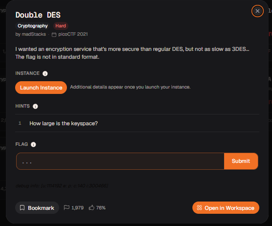
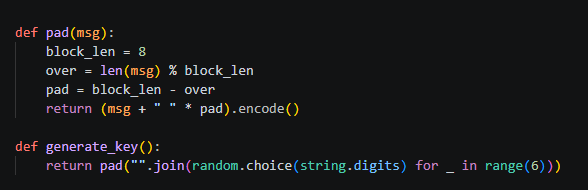

# Double DES

#### Category: Cryptography - Difficulty: Hard - Ngày viết: 11/18/2026

#### 1. Overview

* 
* Đây là 1 bài sử dụng kỹ thuật tân công Meet-in-the-middle + Brute Force. Và bài này cũng đã cho ta thấy, tại sao thế giới lại chỉ có DES và 3DES chứ không có 2DES =)))))
* `Mục tiêu`:Khôi phục KEY1 và KEY2 để giải mã ciphertext
* `Lỗ hỗng`: Trạng thái độc lập ở giữa quá trình mã hóa
* `Kỹ thuật`:Meet-in-the-middle + Brute Force

#### 2. Nền tảng cốt lõi

* Các bạn cần biết về kỹ thuật Meet-in-the-middle xử lý các dạng bài kiểu 2DES như này: [Đọc](https://medium.com/@snowwhites/meet-in-the-middle-algorithm-from-cryptographic-attacks-to-leetcode-problems-3fa62abeb7f2)

#### 3. Phân tích lỗ hỗng

* Mã nguồn server: [Đọc](ddes.py)
* Server mã hóa 2 lần bản rõ với 2 key khác nhau.
* Không gian khóa nhỏ

#### 4. Ý tưởng khai thác

* Trong mã hóa DES, key 64 bits luôn bị cắt bớt 1 bit cuối cùng của byte. Nên thực tế key chỉ có độ bảo mật 56 bits.
* 
* Khóa trong bài này được sinh ra bằng cách lấy ngẫu nhiên 6 số từ `(0...9)`và pad thêm 2 ô space -
* Lúc này, cặp ký tự `(0,1)`,`(2,3)`,`(4,5)`,`(6,7)`,`(8,9)`sinh ra byte khóa giống hệt nhau.
* Ví dụ:

  * Khóa `123456`tương đương `022446` tương đương `023446`...
* Vì thế, ta chỉ cần brute force khóa có cấu trúc chỉ từ các ký tự `(02468)` cộng thêm 2 ô space là đủ để tái tạo lại không gian khóa.
* Nếu như thông thường, ta gửi 1 bản rõ đã biết để thu về 1 bản mã, sau đó ta vét cạn không gian khóa key1 và key2 cho đến khi mã hóa bản rõ thu được bản mã giống với server để thu được khóa.
* Nếu không gian khóa là $N$ thì độ phức tạp của thuật toán trên là $O(N^2)$.
* Với không gian khóa là $5^6 = 15,625$, ta có tổng số bước thực hiện là $N^2 = 15,625^2 = 244,140,625$. Rất lâu...
* Khi đó, ta sử dụng kỹ thuật Meet-in-the-middle để giảm số bước brute force. Và cũng chính kỹ thuật tấn công này mà đã khiến cho 2DES không được sinh ra và phải sinh ra 3DES để khắc chế lại cuộc tấn công này.
* Lúc này đây, ta hoàn toàn có thể tính trạng thái trung gian của mã hóa.
* Có nghĩa là thực tế server đang mã hóa như sau:
* $C = E_{K_2}(E_{K_1}(P))$, ta tách ra và lưu lại trạng thái $X = E_{K_1}(P)$ và $X$ cũng bằng $X = D_{K_2}(C)$
* Khi đó ta chỉ cần mã hóa bản rõ và lưu lại toàn bộ trạng thái $X$ thành 1 bảng để tra, tiếp theo, ta giải mã bản mã cho đến khi tồn tại một trạng thái $X$ nằm trong bảng. Khi đó, ta đã khôi phục được cả KEY1 và KEY2
* Độ phức tạp thuật toán: $O(N + N) = O(2N)$, số bước cần để khôi phục 2 khóa KEY1 và KEY2 nếu áp dụng Meet-in-the-middle thực tế chỉ có $15,625 \cdot 2 = 31,250$

#### 5. Exploit chain

* Quy trình:
  * Ta lưu lại ciphertext của flag
  * Ta gửi 1 plaintext để thu được cặp $(P_1, C_1)$
  * Ta áp dụng Meet-in-the-middle, khôi phục KEY1 và KEY2.
  * Giải mã ciphertext
* Script: [Đọc](solve.py)
* ```
  b8877408ec959ddfda7726f4986b52f5
  ```
