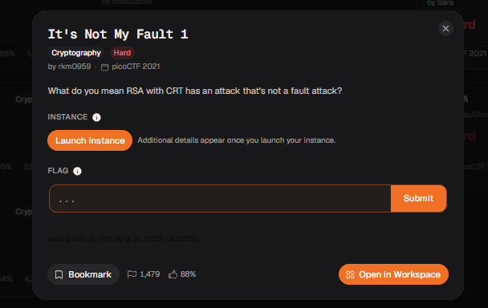

# It's Not My Fault 1

#### Category: Cryptography - Difficulty: Hard - Ngày viết: 11/16/2026

#### 1. Overview

* 
* Đây là bài đầu tiên mình exploit trên RSA-CRT khi $d_p$ nhỏ :v
* `Mục tiêu`: Phân tích thừa số nguyên tố $N$
* `Lỗ hỗng`: khi biết khóa bí mật con $d_p$ nhỏ
* `Kỹ thuật`: Brute Force

#### 2. Nền tảng cốt lõi

* Các bạn cần biết RSA khi kết hợp với CRT nó trông như thế nào. [Đọc](https://di-mgt.com.au/crt_rsa.html)

#### 3. Phân tích lỗ hỗng

* Mã nguồn server: [Đọc](not_my_fault.py)
* Server câu giờ chúng ta bằng cách bắt chúng ta nhập 1 chuỗi string sao cho sau khi hash md5 nhả ra 3 bytes cuối giống như yêu cầu.
* Ở bước sinh khóa, $d_p$ được chọn có độ lớn xấp sĩ 20 bits - $2^{20}$
* $e$ được tính bằng cách lấy nghịch đảo $d$, và $d$ được tính bằng cách lấy `crt` của 2 phương trình đồng dư

#### 4. Ý tưởng khai thác

* Ta có mối liên hệ như sau:

$$
e \cdot d \equiv 1 \bmod {\phi(N)} \to e \cdot d \equiv 1 \bmod {(q - 1)(p -1)} \\
\to e \cdot d \equiv 1 \bmod {(p -1)} \\ 
\text{Ta có:} d \equiv d_p \bmod (p - 1) \\ 
\to e \cdot d_p \equiv 1 \bmod {(p -1)} \\ 
\to e \cdot d_p = 1 + k(p -1) \\
\text{Xét: } m^{e \cdot d_p} = m^{1 + k(p -1)} = (m^{p - 1})^k \cdot m \equiv 1 \cdot m \bmod p \\ 
\to m^{e \cdot d_p} - m = kp
$$

* Ta chỉ cần brute force giá trị $d_p$ khoảng $2^{20}$ giá trị khác nhau và ta sẽ thu được $kp$, ta lấy $\gcd(kp, N)$ để thu được $p$

#### 5. Exploit chain

* Quy trình:
  * Vượt qua vòng đầu tiên bằng cách brute force chuỗi string
  * Brute force giá trị $d_p$ để tính $cur = m^{e \cdot d_p} - m$, nếu $\gcd(cur, N)$ khác 1, thì ta đã tách $p$ khỏi modulus $N$ thành công.
  * Gửi $q + p$ lên server để lấy cờ
* Script: [Đọc](solve.py)
* ```
  academy{1_c4n'7_b3l13v3_17'5_n07_f4ul7_4774ck!!!}
  ```
