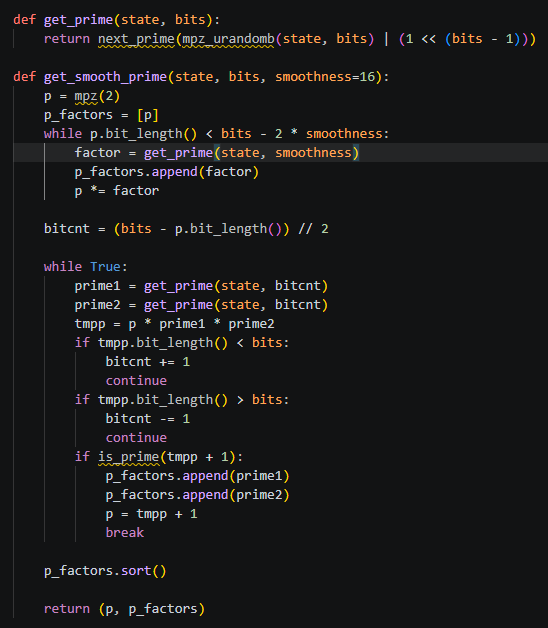
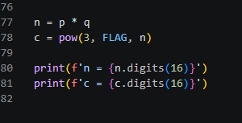

# NSA_Backdoor

#### Category: Cryptography - Difficulty: Hard - Ngày viết: 11/18/2026

#### 1. Overview

* 
* `Mục tiêu`: Tìm ra backdoor để giải mã flag
* `Lỗ hỗng`: $N$ có $p$ và $q$ là các số nguyên tố có $p -1, q - 1$ là các số trơn

#### 2. Nền tảng cốt lõi

* Các bạn cần biết thuật toán phân tích $N$ khi cấu trúc $N$ gồm các số nguyên tố lớn nhưng trơn
* Thuật toán `pollard p - 1` để phân tích $N$: [Đọc](https://en.wikipedia.org/wiki/Pollard%27s_p_%E2%88%92_1_algorithm)
* Thuật toán `pohlig hellman`để giải phương trình $g^x = h \bmod p$ tìm $x$ khi $p$ là 1 số nguyên tố trơn, hoặc không, các bạn có thể sử dụng trực tiếp sagemath để tìm $x$ (sagemath có hỗ trợ thuật toán `pohlig_hellman`để tìm $x$ nếu $p$ là số nguyên tố trơn)

#### 3. Phân tích lỗ hỗng

* Mã nguồn server: [Đọc](gen.py)
* 
* Các ước nguyên tố của $p - 1$ chỉ chứa các số nguyên tố dài 16 bits - $2^{16} = 65,536$ và các ước nguyên tố của $q - 1$ chỉ chứa các số dài 17 bits - $2^{17} = 131,072$
* 
* Để tìm lại Flag, ta cần phải giải phương trình đồng dư: $3 ^ x \equiv c \pmod n$ với nghiệm $x = FLAG$

#### 4. Ý tưởng khai thác.

* Ta sẽ sử dụng thuật toán `pollard p - 1`để phân tích $N$ bởi vì $N$ được cấu thành từ 2 số nguyên tố trơn. Ta đặt ngưỡng trơn là $2^{16}$ để phân tích được $p$, hoặc để đảm bảo hơn, bạn có thể đặt ngưỡng trơn $2^{17}$ để bao quát cả $q$
* Khi đó, để tìm $x$, thay vì tìm trực tiếp trên phương trình $3 ^ x = c \bmod N$ gần như bất khả thi bởi vì modulus $N$ chỉ là vành và sagemath thì không tìm được nghiệm $x$
* Ta chiếu phương trình đồng dư trên xuống 2 trường hữu hạn là $\mathbb{F}_p$ và  $\mathbb{F}_q$ rồi giải phương trình bằng sagemath để tìm $x_p$ và $x_q$, sau đó ghép nghiệm lại bằng crt
* Lưu ý rằng nghiệm $x = FLAG$ tìm được trên 2 trường hữu hạn có chu kỳ là cấp nhân của cơ số 3 trên 2 trường đó. Có nghĩa là:
* $FLAG \equiv x_p \bmod \text{ord}_p(3) \\ FLAG \equiv x_q \bmod \text{ord}_q(3)$
* Ta ghép nghiệm bằng crt là ta thu được cờ

#### 5. Exploit chain

* Quy trình:
  * Phân tích $q, p$ của $N$
  * Tìm $x_p, x_q$ trên 2 trường hữu hạn $\mathbb{F}_p$ và  $\mathbb{F}_q$
  * Tính cấp nhân của cơ số 3 trên 2 trường con
  * Lập hệ phương trình đồng dư, tìm nghiệm $x = FLAG$ bằng crt
* Script: [Đọc](solve.py) - `Sử dụng toolkit cá nhân, thuật toán pollard p - 1 đã được hướng dẫn đầy đủ trên wikipedia`
* ```
  academy{b3w4r3_0f_c0mp0s1t3_m0dul1_975c2a44}
  ```
