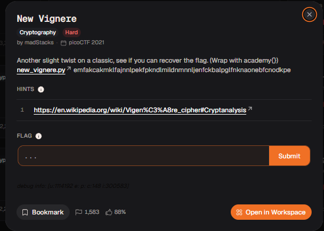
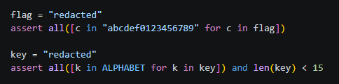

# New Vignere

#### Category: Cryptography - Difficulty: Hard - Ngày viết: 11/18/2026

#### 1. Overview

* 
* `Mục tiêu`: Phá mã hóa tùy biến kết hợp giữa base16 và Vigenère cipher.
* `Lỗ hỗng`: Không gian khóa nhỏ, flag chỉ chứa các ký tự hex.
* `Kỹ thuật`: Brute force + phân rã không gian khóa, giảm không gian tìm kiếm

#### 2. Nền tảng cốt lõi

* Đọc hiểu code python
* Nên làm bài New_caesar ở độ khó Medium trước khi giải bài này.
* Cần biết Vigenère cipher là gì

#### 3. Phân tích lỗ hỗng

* Mã nguồn server: [Đọc](new_vignere.py)
* Ta chú ý điều kiện của source code: 
* Flag bị cố định là các ký tự hex và các ký tự key cũng chỉ nằm trong ALPHABET. và độ dài key tối đa là 14
* Nếu như ta thử brute force toàn bộ không gian khóa có thể xảy ra thì số trường hợp lên đến $16^{14} ≈ 7.2 × 10^{16}$, hoàn toàn bất khả thi với máy tính của tui :v
* Ta có thể để thấy rằng, bởi vì flag chỉ là các ký tự hex
* Ở hàm `b16_encode`của source code, với mỗi ký tự `c` trong flag, `c` được biểu diễn dưới dạng bits, tách làm 2 phần bit là 4 bits đầu và 4 bits cuối.
* Ta xét mã nhị phân 8-bit của toàn bộ tập ký tự hex "0123456789abcdef":
  * Nhóm chữ số `0` – `9` (mã ASCII từ 0x30 đến 0x39 / thập phân 48 – 57):
    * Nhị phân: 0011 0000 đến 0011 1001
    * 4 bit đầu luôn cố định là 0011 (3 → ALPHABET[3] = `d`)
    * 4 bit sau chạy từ 0000 đến 1001 (0 → 9 ⟹ ALPHABET[0 … 9] = `a` – `j`)
  * Nhóm chữ cái `a` – `f` (mã ASCII từ 0x61 đến 0x66 / thập phân 97 – 102):
    * Nhị phân: 0110 0001 đến 0110 0110
    * 4 bit đầu luôn cố định là 0110 (6 → ALPHABET[6] = `g`)
    * 4 bit sau chạy từ 0001 đến 0110 (1 → 6 ⟹ ALPHABET[1 … 6] = `b` – `g`)

> [!IMPORTANT]
> Hệ quả là sau khi encode b16, flag bị khóa cứng theo cặp ký tự ở các ví trị chẵn lẻ:
>
> * Mọi vị trí chẵn (i (mod 2) == 0) đại diện cho 4 bit đầu của ký tự hex, do đó chỉ có thể là 'd' hoặc 'g' (chỉ có 2/16 = 12.5% khả năng)
> * Mọi vị trí lẻ (i (mod 2) == 1) đại diện cho 4 bit sau, do đó chỉ có thể nằm trong tập {'a', 'b', 'c', 'd', 'e', 'f', 'g', 'h', 'i', 'j'} (tối đa 10/16 = 62.5% khả năng)

#### 4. Ý tưởng khai thác

* Ta sẽ brute force không gian khóa, tuy nhiên, sẽ có điều kiện để gần như loại hết các trường hợp khóa rác và chỉ giữ lại các khóa thực sự có khả năng đúng.
* Với mỗi độ dài khóa $L \in [1, 14]$
* Với mỗi vị trí ký tự khóa $p \in [0, L - 1]$, thử lần lượt các ứng viên $k \in ALPHABET$
  * Giả sử ký tự khóa tại vị trí $p$ là $k$.
  * Giải mã ngược các vị trí tương ứng trong ciphertext với bước nhảy là $L$
  * $b16[i] = \text{unshift}(ciphertext[i], k),   ∀i ∈ {p, p + L, p + 2L, …}$
* Khi giải mã, ta kiểm tra 2 điều kiện:
  * Tại ví trị ký tự mã hóa $i$ là số chẵn, ký tự sau khi giải mã phải là `d` hoặc `g`
  * Tại ví trị ký tự mã hóa $i$ là số lẻ, ký tự sau khi giải mã phải nằm trong `abcdefghij`
* Nếu $k$ thỏa mãn điều kiện tại tất cả các vị trí $i$ này, ta giữ $k$ lại làm ứng viên cho key[p]. Ngược lại, loại bỏ ngay lập tức.

#### 5. Exploit chain

* Quy trình:
  * Viết hàm ngược với b16_encode và shift
  * Brute force và kiểm tra điều kiện như đã giải thích ở mục 4
  * Thử các cờ mà code trả ra
* Script: [Đọc](sovle.py)
* ```
  Key (9): bickhknij -> academy{468293b06253c715005873e333d98dbc}
  Key (9): bipkhknij -> academy{4f8296b062e3c745005h73e633d9hdbc}
  ```

* Và cờ chính là:
* ```
  academy{468293b06253c715005873e333d98dbc}
  ```
