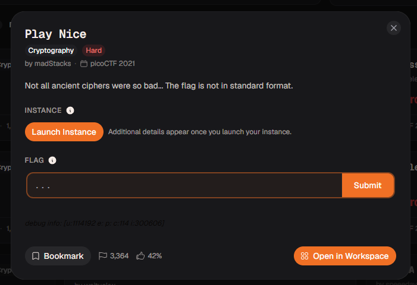

# Play Nice

#### Category: Cryptography - Difficulty: Hard - Ngày viết: 11/16/2026

#### 1. Overview

* 
* **Bối cảnh**: Thử thách triển khai một biến thể mở rộng của mật mã cổ điển Playfair Cipher trên bảng ma trận kích thước $6 \times 6$ (chứa 36 ký tự gồm chữ cái và chữ số, thay vì ma trận $5 \times 5$ truyền thống gồm 25 chữ cái). Server mã hóa một thông điệp bí mật `msg`, cung cấp cho người chơi chuỗi bảng chữ cái (`alphabet`) tạo ma trận cùng chuỗi bản mã (`ciphertext`), và yêu cầu người chơi giải mã rồi gửi lại bản rõ trong vòng 18 giây (`signal.alarm(18)`).
* **Mục tiêu**: Lập trình thuật toán giải mã Playfair trên ma trận kích thước $6 \times 6$ để tự động giải mã ciphertext và tương tác với server lấy flag trước khi hết thời gian chờ.
* **Lỗ hổng**: Mật mã Playfair là hệ mật mã đối xứng hoàn toàn khả nghịch nếu biết bảng ma trận khóa. Do server công khai chuỗi `alphabet` cấu tạo nên ma trận $6 \times 6$, kẻ tấn công có đầy đủ thông tin để đảo ngược từng bước mã hóa.
* **Kỹ thuật**: Đảo ngược thuật toán mã hóa Playfair Cipher (Playfair Decryption).

#### 2. Nền tảng cốt lõi

* **Cấu trúc ma trận Playfair $6 \times 6$**:
  Khác với bảng $5 \times 5$ truyền thống phải gộp hai chữ cái $I$ và $J$ vào chung một ô, bảng $6 \times 6$ có tổng cộng 36 ô, cho phép chứa trọn vẹn 26 chữ cái tiếng Anh và 10 chữ số từ $0$ đến $9$. Bảng được sinh tuần tự bằng cách điền lần lượt 36 ký tự của `alphabet` theo từng hàng.
* **Quy tắc phân tích cặp ký tự (Digraphs)**:
  Bản rõ / bản mã được chia thành các khối 2 ký tự liên tiếp $(P_1, P_2)$. Tọa độ của từng ký tự trên ma trận được xác định bởi $(r_1, c_1)$ và $(r_2, c_2)$ với $r, c \in [0, 5]$.
* **Quy tắc đối ngẫu giữa Mã hóa (Encrypt) và Giải mã (Decrypt)**:

  1. **Cùng hàng ($r_1 = r_2$)**:

     * Mã hóa: Dịch từng ký tự sang phải 1 cột: $c' = (c + 1) \pmod 6$.
     * Giải mã: Dịch từng ký tự sang trái 1 cột: $c = (c' - 1) \pmod 6$.
  2. **Cùng cột ($c_1 = c_2$)**:

     * Mã hóa: Dịch từng ký tự xuống dưới 1 hàng: $r' = (r + 1) \pmod 6$.
     * Giải mã: Dịch từng ký tự lên trên 1 hàng: $r = (r' - 1) \pmod 6$.
  3. **Khác hàng, khác cột (Quy tắc hình chữ nhật - Rectangle Rule)**:
     Hai ký tự tạo thành hai góc đối diện của một hình chữ nhật trên ma trận. Mỗi ký tự sẽ được thay thế bằng ký tự nằm trên cùng hàng với nó nhưng ở cột của ký tự còn lại:

     $$
     (C_1, C_2) = (\text{matrix}[r_1][c_2], \text{matrix}[r_2][c_1])
     $$

     Vì phép hoán vị này có tính chất tự nghịch đảo (involution), tức $f(f(P)) = P$, nên **công thức giải mã cho trường hợp hình chữ nhật giống hệt công thức mã hóa**.

#### 3. Phân tích lỗ hổng

* **Lộ hoàn toàn không gian khóa**: Trong bài toán này, server không giữ bí mật cấu trúc ma trận mà gửi thẳng chuỗi `alphabet` 36 ký tự cho client. Do đó, bài toán không phải là phá mã thống kê tần suất hay thám mã không khóa, mà chỉ đơn thuần là viết chương trình giải mã chính xác.
* **Thời gian giới hạn không ngăn cản được tự động hóa**: Cơ chế `signal.alarm(18)` chỉ làm khó người chơi nếu giải mã thủ công bằng tay trên giấy. Khi sử dụng script Python kết nối socket (qua `pwntools`), toàn bộ quá trình nhận dữ liệu, tính toán ma trận và giải mã diễn ra chỉ trong vài mili-giây.

#### 4. Ý tưởng khai thác

1. Sử dụng thư viện `pwntools` để kết nối tới server, bắt các chuỗi đầu ra `Here is the alphabet: ...` và `Here is the encrypted message: ...`.
2. Tạo ma trận kích thước $6 \times 6$ từ chuỗi `alphabet`.
3. Xây dựng hàm giải mã `decrypt_pair(pair, matrix)` đảo ngược 3 trường hợp của `encrypt_pair`:
   * Nếu cùng hàng: `(col - 1) % 6`.
   * Nếu cùng cột: `(row - 1) % 6`.
   * Nếu khác hàng, khác cột: `matrix[p1[0]][p2[1]] + matrix[p2[0]][p1[1]]`.
4. Duyệt qua từng cặp 2 ký tự trong chuỗi bản mã `ciphertext`, gọi hàm giải mã và ghép lại thành bản rõ `plaintext`.
5. Gửi bản rõ lên server để vượt qua kiểm tra `resp == msg` và nhận flag.

#### 5. Exploit chain

* **Bước 1 (Cài đặt hàm giải mã - [solve.py](solve.py))**:

  ```python
  def decrypt_pair(pair, matrix):
      p1 = get_index(pair[0], matrix)
      p2 = get_index(pair[1], matrix)

      if p1[0] == p2[0]:
          return matrix[p1[0]][(p1[1] - 1) % SQUARE_SIZE] + matrix[p2[0]][(p2[1] - 1) % SQUARE_SIZE]
      elif p1[1] == p2[1]:
          return matrix[(p1[0] - 1) % SQUARE_SIZE][p1[1]] + matrix[(p2[0] - 1) % SQUARE_SIZE][p2[1]]
      else:
          return matrix[p1[0]][p2[1]] + matrix[p2[0]][p1[1]]

  def decrypt_string(ciphertext, matrix):
      result = ""
      for i in range(0, len(ciphertext), 2):
          result += decrypt_pair(ciphertext[i:i+2], matrix)
      return result
  ```
* **Bước 2 (Tương tác tự động với socket server - [solve.py](solve.py))**:

  ```python
  from pwn import *

  io = remote("xebec.cylabacademy.net", 15300)

  io.recvuntil(b"Here is the alphabet: ")
  alphabet = io.recvline().strip().decode()

  io.recvuntil(b"Here is the encrypted message: ")
  ciphertext = io.recvline().strip().decode()

  # Sinh ma trận và giải mã
  matrix = generate_square(alphabet)
  plaintext = decrypt_string(ciphertext, matrix)

  # Gửi trả bản rõ cho server
  io.recvuntil(b"What is the plaintext message? ")
  io.sendline(plaintext.encode())

  # Nhận flag
  io.recvuntil(b"Congratulations! Here's the flag: ")
  flag = io.recvline().strip().decode()
  print("Flag:", flag)
  ```
* **Bước 3 (Kết quả)**:
  Server xác nhận bản rõ chính xác và trả về flag hoàn tất thử thách.
* ```
  Flag: f38327f8eebdf7d17f91be58ffa27cf7
  ```
