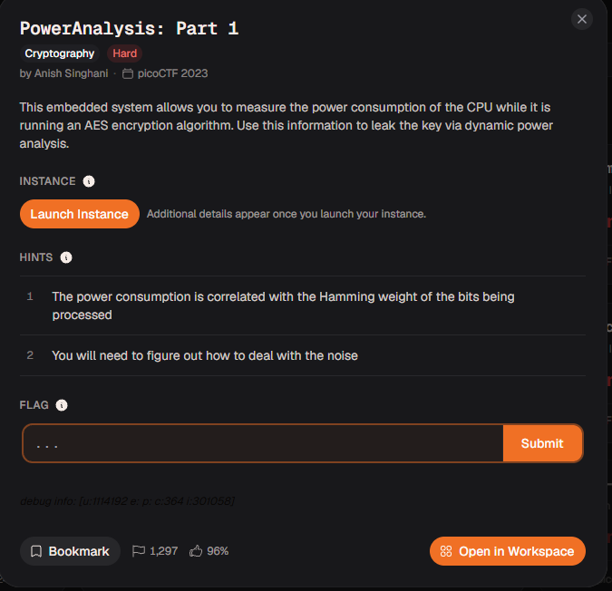

# PowerAnalysis: Part 1

#### Category: Cryptography - Difficulty: Hard - Ngày viết: 11/16/2026

#### 1. Overview

* 
* Sau bài Warmup với mô hình rò rỉ bit đơn giản, Part 1 đưa chúng ta vào kịch bản tấn công kênh kề (Side-Channel Attack - SCA) thực tế hơn: server thực hiện mã hóa AES-128 và phản hồi lại các vết sóng tiêu thụ năng lượng (power consumption traces) theo thời gian.
* `Mục tiêu`: Thu thập các vết năng lượng cùng các bản rõ ngẫu nhiên tương ứng từ server, sau đó phân tích tương quan để khôi phục toàn bộ 16 byte của khóa bí mật AES-128.
* `Lỗ hổng`: Năng lượng tiêu thụ của phần cứng phụ thuộc trực tiếp vào dữ liệu trung gian (Data-dependent power leakage) tại đầu ra tầng thế `SubBytes` của vòng 1.
* `Kỹ thuật`: Phân tích năng lượng tương quan bậc 1 (First-order Correlation Power Analysis - CPA) dựa trên mô hình trọng số Hamming (Hamming Weight Model).

#### 2. Nền tảng cốt lõi

* Như gợi ý của bài, ta có 1 số khái niệm mới sau:
* **Mô hình tiêu thụ năng lượng (Hamming Weight Model)**:
  Trong các mạch tích hợp số công nghệ CMOS, mức tiêu thụ năng lượng khi nạp trạng thái vào thanh ghi hoặc bus dữ liệu tỉ lệ thuận với số lượng bit $1$ được kích hoạt. Năng lượng tiêu thụ thực tế $P$ tại thời điểm xử lý byte trung gian $V$ được xấp xỉ qua mô hình:

$$
P \approx a \cdot \text{HW}(V) + b + \text{Noise}
$$

  trong đó $\text{HW}(V)$ là trọng số Hamming (Hamming Weight - số bit 1 trong biểu diễn nhị phân của $V$).
* **Hệ số tương quan Pearson (Pearson Correlation)**:
  Đây là 1 khái niệm mới và được ứng dụng rất nhiều trong tấn công SCA.
  Để đo lường mức độ tương quan tuyến tính giữa mô hình dự đoán lý thuyết $H$ và giá trị đo thực tế trên vết sóng $T$ tại điểm mẫu thời gian (sample) $j$:

$$
r(H, T_j) = \frac{\sum_{i=1}^{N} (H_i - \bar{H})(T_{i, j} - \bar{T}_j)}{\sqrt{\sum_{i=1}^{N} (H_i - \bar{H})^2 \sum_{i=1}^{N} (T_{i, j} - \bar{T}_j)^2}}
$$

  Khi phỏng đoán đúng byte khóa $K_i$, giá trị $H_i = \text{HW}(\text{Sbox}[P_i \oplus K_i])$ sẽ khớp với thời điểm mạch phần cứng tính toán giá trị này, tạo nên một đỉnh tương quan cực đại ($r \gg 0$). Các phỏng đoán sai sẽ có tương quan tiệm cận 0 do tính phi tuyến của S-box.

#### 3. Phân tích lỗ hổng

* Trong kiến trúc AES-128, tại vòng đầu tiên:
  1. Từng byte bản rõ $P_i$ được XOR với byte khóa $K_i$ tương ứng: $S_i = P_i \oplus K_i$.
  2. Giá trị $S_i$ được thế phi tuyến qua bảng S-box: $V_i = \text{Sbox}[P_i \oplus K_i]$.
* **Điểm yếu khai thác**:
  * **Tính độc lập của từng byte (Divide and Conquer)**: Ở vòng 1, phép toán `AddRoundKey` và `SubBytes` hoạt động hoàn toàn độc lập trên từng byte riêng biệt (chưa có sự xáo trộn hay khuếch tán giữa các byte của `ShiftRows` và `MixColumns`). Do đó, không gian tìm kiếm khóa $2^{128}$ được phân rã thành 16 bài toán độc lập, mỗi bài toán chỉ cần vét cạn 256 khả năng ($2^8$) của từng byte khóa.
  * **Tính phi tuyến của S-box**: Khi đoán sai khóa, giá trị đầu ra của S-box bị xáo trộn ngẫu nhiên và không có tương quan tuyến tính với dữ liệu thực tế. Chỉ có giả thuyết đúng mới tạo ra độ tương quan vượt trội so với mức nhiễu nền.

#### 4. Ý tưởng khai thác

1. **Thu thập vết sóng (Data Collection)**: Gửi $N = 300$ bản rõ ngẫu nhiên lên server, nhận lại vết năng lượng tương ứng và lưu trữ dưới dạng mảng NumPy (`plaintexts.npy` và `traces.npy`).
2. **Lập ma trận giả thuyết năng lượng**:
   Với mỗi vị trí byte $i \in [0, 15]$:
   * Duyệt qua toàn bộ $256$ ứng viên $k \in [0, 255]$.
   * Tính vector giả thuyết Hamming Weight cho $N$ mẫu: $H = [\text{HW}(\text{Sbox}[P_{1, i} \oplus k]), \dots, \text{HW}(\text{Sbox}[P_{N, i} \oplus k])]$.
3. **Tính tương quan Pearson và tìm đỉnh**:
   * Tính hệ số tương quan Pearson giữa vector $H$ và từng cột thời gian trong ma trận `traces`.
   * Chọn ứng viên $k$ có hệ số tương quan lớn nhất làm byte khóa thứ $i$.

#### 5. Exploit chain

* Quy trình:
  * Kết nối tới server , gửi 300 bản rõ ngẫu nhiên 16 bytes và lưu vết đo năng lượng
  * Tạo 1 file mới để bắt đầu quá trình phân tích vết đo năng lượng.
  * Ta lập ma trận giả thuyết năng lượng tại mỗi byte khóa, với 256 ứng viên $k$ khác nhau ra 256 vector giả thuyết Hamming Weight cho $N$ mẫu $H$ khác nhau
  * Chạy ra từng cột ma trận thời gian $t$ trong ma trận đã thu được ở bước đầu tiên. Chọn ứng viện $k$ làm key byte thứ $i$ khi có hệ số tương quan lớn nhất với 1 cột thời gian $t$
  * Lặp lại với 16 byte khóa và ta có được cờ
* Script: [Đọc](solve.py)
* Khóa AES khôi phục: `b13adff8b4d1a89da8ba668043276276`
* ```
  academy{b13adff8b4d1a89da8ba668043276276}
  ```
