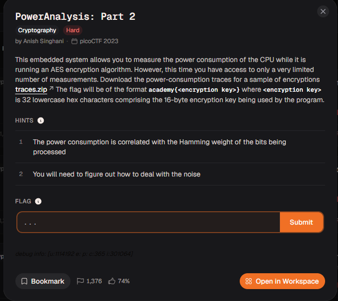

# PowerAnalysis: Part 2

#### Category: Cryptography - Difficulty: Hard - Ngày viết: 11/16/2026

#### 1. Overview

* 
* Cách giải bài này đã được mình giải thích chi tiết ở `part 1`. Thay vì tự thu thập các bước sóng và đưa vào ma trận numpy, ở bài này chúng ta được cung cấp sẵn 100 bước sóng để phân tích. Các bạn qua đây để xem cách giải nhé :v
* Write-up part 1: [Đọc](../PowerAnalysis_Part_1/write-up.md)
* Script: [Đọc](solve.py)
* ```
  academy{93809b4015f1090b2437bd9248e7e282}
  ```
