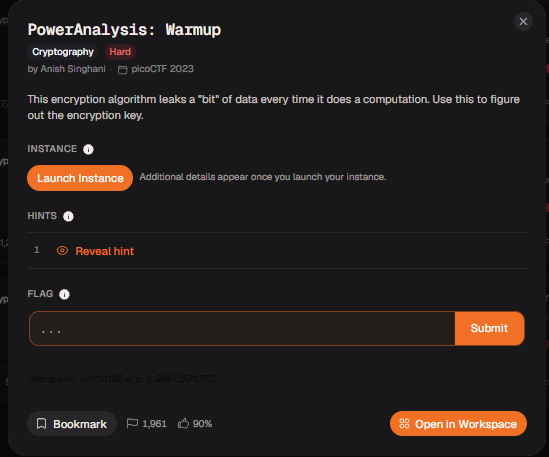
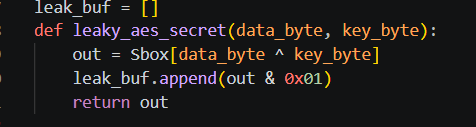

# PowerAnalysis: Warmup

#### Category: Cryptography - Difficulty: Hard - Ngày viết: 11/14/2026

#### 1. Overview

* 
* Đây là bài đầu tiên mình nhập môn vào chuyên đề không phải toán của Crypto =)). Đó chính là tấn công kênh đề - Side Channel Attack - SCA.
* `Mục tiêu`: Dựa vào rò rỉ tổng bit của khóa sau vòng đầu tiên của AES để khôi phục khóa bí mật.
* `Lỗ hỗng`: Rò rỉ bit của khóa
* `Kỹ thuật`: Tấn công kênh kề chọn bản rõ vi sai (Chosen-Plaintext Differential Side-Channel Attack)

#### 2. Nền tảng cốt lõi

* Các bạn cần hiểu phương pháp brute force dò tìm là được

#### 3. Ý tưởng khai thác / Exploit chain

* 
* **Bản chất rò rỉ:** Sau tầng `SubBytes` ở vòng 1 của AES, server lấy bit có trọng số thấp nhất (`& 0x01`) của cả 16 byte đầu ra rồi trả về tổng của chúng:$`L(P) = \sum_{j=0}^{15} (\text{Sbox}[P_j \oplus K_j] \ \& \ 1)`$
* **Chiến lược tấn công (Chosen-Plaintext Differential Attack):**

  1. **Chia để trị (Divide & Conquer):** Vì `AddRoundKey` và `SubBytes` ở vòng đầu hoạt động độc lập trên từng byte (chưa có khuếch tán giữa các byte), ta có thể khôi phục lần lượt từng byte khóa $K_i$ ($i = 0 \dots 15$) với không gian tìm kiếm chỉ là 256 giá trị.
  2. **Đo vi sai để khử nhiễu từ 15 byte còn lại:** Để dò byte khóa thứ $i$, ta giữ cố định toàn bộ 15 byte khác và lấy một mốc chuẩn `leak_base` khi byte $i$ có giá trị `0x00`. Sau đó, lần lượt gửi các bản rõ thăm dò với byte $i$ thay đổi thành $p \in [1, 255]$ để thu về `leak`. Hiệu số $'\Delta L = \text{leak} - \text{leak\_base}'$ sẽ triệt tiêu hoàn toàn đóng góp của 15 byte cố định, chỉ phản ánh sự thay đổi bit LSB tại đúng byte thứ $i$:

```math
\Delta L = (\text{Sbox}[p \oplus K_i] \ \& \ 1) - (\text{Sbox}[K_i] \ \& \ 1)
```

3. **Lọc loại trừ ứng viên (Candidate Elimination):** Khởi tạo danh sách 256 ứng viên cho $K_i$. Qua mỗi lần gửi $p$, ta loại bỏ mọi ứng viên $k$ không thỏa mãn phương trình $\Delta L$ ở trên. Nhờ tính phi tuyến cao của bảng S-box, danh sách ứng viên thu hẹp rất nhanh và hội tụ về duy nhất giá trị $K_i$ đúng chỉ sau vài truy vấn.

* Script: [Đọc](solve.py)
* ```
  ```
