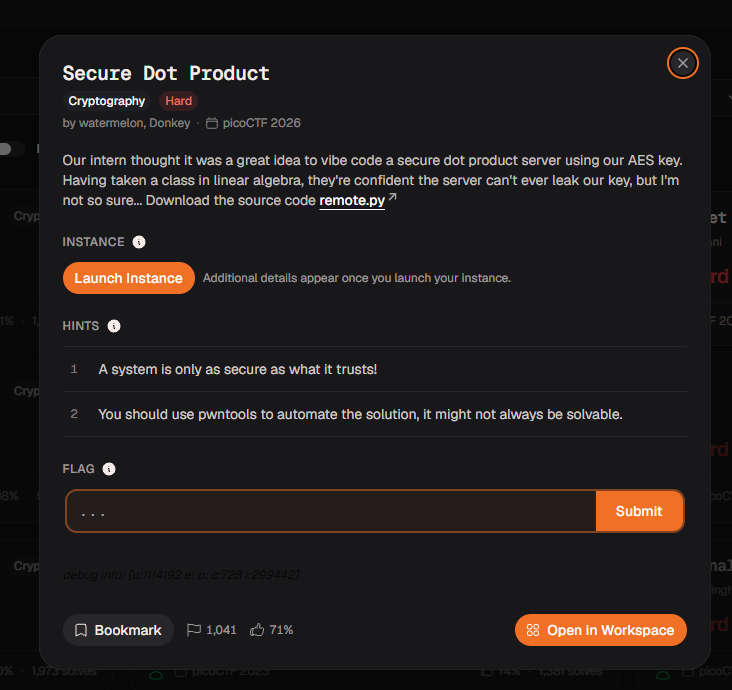
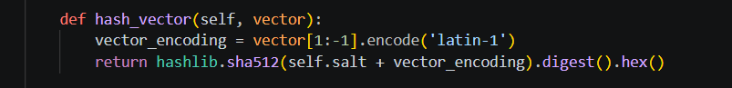
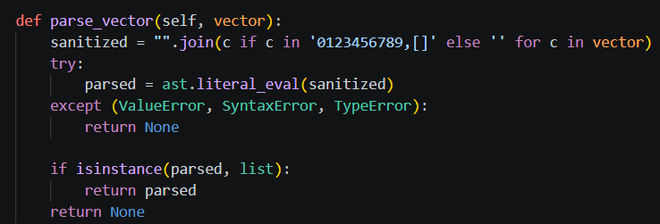

# Secure Dot Product

#### Category: Cryptography - Difficulty: Hard - Ngày viết: 11/19/2026

#### 1. Overview

* 
* Đây là bài mà mình đã phải dành gần 5 tiếng đồng hồ thì mới solve thành công, hầu hết quá trình là debug, vượt qua lớp kiểm tra cú pháp của server :v
* `Mục tiêu`: Khai thác kênh đề của server, khôi phục khóa bí mật AES 32 bytes của server
* `Lỗ hỗng`: Kênh đề trả tích vô hướng giữa trusted_vector và các bytes của khóa bí mật, length extension attack trên sha512

#### 2. Nền tảng cốt lõi

* Cần có mã nguồn hỗ trợ length extension attack trên sha512, hiểu cách hoạt động, lỗ hỗng và cách khai thác length extension trên các hàm băm họ sha
* Đọc hiểu luồng python của server
* Cơ chế truyền byte nhị phân qua kênh văn bản trong bài này:

  * **Vấn đề khi gửi dữ liệu thô:** Khối padding của SHA-512 chứa các byte nằm ngoài bảng mã ASCII như `\x80` (`128`), `\x00` (`0`), hoặc vô tình trùng byte xuống dòng `\x0a` (`10`). Nếu gửi thẳng các byte này qua socket, hàm `input()` phía server (mặc định giải mã theo `utf-8` và ngắt dòng tại `\x0a`) sẽ văng lỗi `UnicodeDecodeError` hoặc cắt ngang payload.
  * **Chiều gửi — Đóng gói thành chuỗi thoát (Escape sequence):** Ở client, `str(new_vector)[2:-1]` biến mỗi byte không in được thành cụm **4 ký tự ASCII rời rạc** (ví dụ 1 byte `0x80` trở thành 4 ký tự `'\\'`, `'x'`, `'8'`, `'0'`). Toàn bộ chuỗi gửi đi lúc này chỉ gồm ký tự bàn phím thông thường nên đi qua `input()` an toàn.
  * **Chiều nhận — `.decode('unicode_escape')`:** Trên server, hàm này quét chuỗi nhận được và **gom ngược mỗi cụm 4 ký tự thoát `\xHH` thành 1 ký tự `str` duy nhất** có mã số `ord(c) = 0xHH` (nằm trong dải `0`–`255`).
  * **Chuyển về `bytes` — `.encode('latin-1')`:** Hàm `hashlib.sha512()` chỉ nhận kiểu `bytes`. Nếu dùng `.encode('utf-8')`, các ký tự có mã $\ge 128$ (như `'\x80'`) sẽ bị tách thành 2 byte (`b'\xc2\x80'`), làm hỏng khối padding. Ngược lại, bảng mã **`latin-1` (ISO-8859-1)** ánh xạ trực tiếp **1–1** toàn bộ 256 giá trị `0x00`–`0xFF` sang đúng 1 byte tương ứng (`'\x80'` $\to$ `b'\x80'`), khôi phục nguyên vẹn từng bit padding trước khi đưa vào hàm băm.

#### 3. Phân tích lỗ hổng

* Mã nguồn server: [Đọc](remote.py)
* 
* Mã xác thực được tính bằng cách ghép thẳng `salt` ngẫu nhiên dài 256 bytes vào trước chuỗi biểu diễn vector (đã cắt bỏ hai dấu ngoặc vuông `[` và `]`):

$$
`\text{Hash} = \text{SHA512}(\text{salt} \parallel \text{vector\_encoding})`
$$

* Vì sử dụng SHA-512 thô theo cấu trúc Merkle–Damgård thay vì HMAC, ta có thể thực hiện **Hash Length Extension Attack** từ một `trusted_vector` có sẵn để tạo chữ ký hợp lệ cho dữ liệu mở rộng có cấu trúc đầu vào băm là:

$$
`\text{salt} \parallel \text{old\_data} \parallel \text{padding} \parallel \text{append\_data}`
$$

* 
* Khi gửi payload dạng ký tự thoát ASCII (`[\x80\x00..., 1]`), server giải mã qua `.decode('unicode_escape')` và `.encode('latin-1')` để khôi phục nguyên vẹn các byte padding nhị phân cho hàm băm; đồng thời hàm `parse_vector` chỉ giữ lại các ký tự trong whitelist `'0123456789,[]'` trước khi gọi `ast.literal_eval()`, giúp loại bỏ hoàn toàn các byte padding khỏi danh sách số nguyên đem đi tính tích vô hướng.

#### 4. Ý tưởng khai thác / Exploit Chain

* Ta thực hiện `reconnect` tới server cho đến khi gặp một phiên kết nối thỏa mãn 2 điều kiện:
  1. Tồn tại ít nhất một `trusted_vector` có độ dài bằng `1`.
  2. Khi sắp xếp 5 `trusted_vector` theo độ dài tăng dần, khoảng cách độ dài giữa hai vector liền kề không vượt quá `8` (và vector dài nhất đủ gần `32`).
* **Bước 1 — Tìm byte khóa đầu tiên `key[0]`:** Với `trusted_vector` có độ dài bằng `1`, tích vô hướng trả về là $\text{dot} = \text{key}[0] \cdot \text{vector}[0]$. Ta tính trực tiếp $\text{key}[0] = \text{dot} // \text{vector}[0]$.
* **Bước 2 — Mở rộng từng phần tử để bóc tiếp các byte khóa:** Áp dụng Length Extension nối thêm `, 1` vào cuối vector hiện tại. Độ chênh lệch tích vô hướng giữa trước và sau khi nối chính là byte khóa kế tiếp:

$$
\text{diff} = \text{dot}_{\text{new}} - \text{dot}_{\text{old}} = (\text{dot}_{\text{old}} + \text{key}[i] \cdot 1) - \text{dot}_{\text{old}} = \text{key}[i]
$$

* **Bước 3 — Chia nhỏ khoảng khôi phục qua nhiều vector:** Mỗi lần mở rộng SHA-512 chèn thêm tối đa 128 bytes padding. Nếu mở rộng liên tục 31 lần trên một vector duy nhất, chuỗi gửi lên sẽ phình tới ~4 KB dễ vượt giới hạn bộ đệm nhập (`input` buffer) của server và tăng rủi ro byte độ dài padding trùng với ký tự số `'0'`–`'9'`. Do đó, ta dùng mỗi `trusted_vector` để mở rộng tối đa 8 bước, sau đó chuyển sang dùng `trusted_vector` dài hơn kế tiếp làm mốc `base_dot` mới để nối liền mạch cho đến khi đủ 32 bytes khóa AES và giải mã cờ.
* Script: [Đọc](solve.py)
* ```
  academy{n0t_so_s3cure_.x_w1th_sh@512_10d274d2}
  ```
