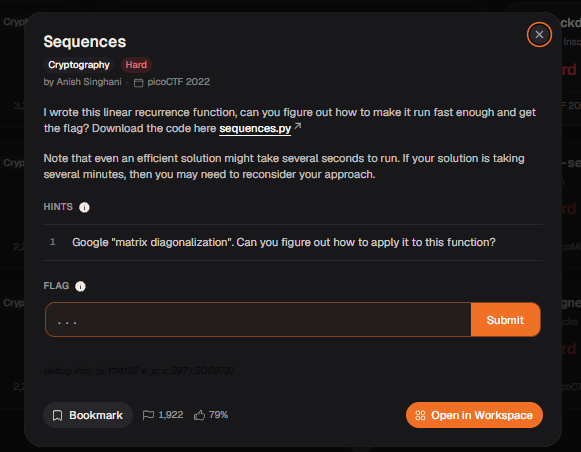
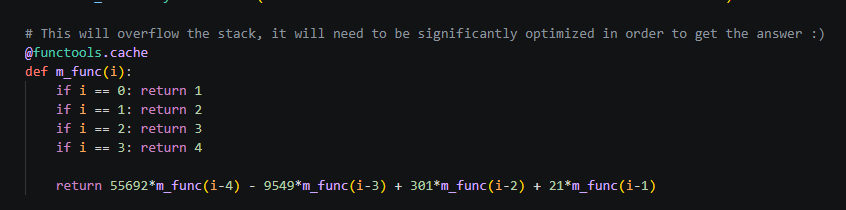

# Sequences

#### Category: Cryptography - Difficulty: Hard - Ngày viết: 11/18/2026

#### 1. Overview

* 
* Một bài hay về đại số tuyến tính =))))
* `Mục tiêu`: Tối ưu hóa tốc độ tính toán và bộ nhớ
* `Kỹ thuật`: Sử dụng ma trận chuyển vị để biểu diễn công thức truy hồi.

#### 2. Nền tảng cốt lõi

* Ma trận chuyển trạng thái - xích markov : [Đọc](https://vi.wikipedia.org/wiki/X%C3%ADch_Markov)
* Chéo hóa ma trận: [Đọc](https://vi.wikipedia.org/wiki/Ma_tr%E1%BA%ADn_ch%C3%A9o_h%C3%B3a_%C4%91%C6%B0%E1%BB%A3c)

#### 3. Phân tích lỗ hỗng

* Mã nguồn server: [Đọc](sequences.py)
* []()
* Như tiêu đề của hàm `m_func`, thì hàm này sẽ khiến máy tính của bạn pay màu bởi vì tràn stack bộ nhớ khi gọi đệ quy quá sâu
* Biểu diễn hàm `m_func` dưới dạng công thức truy hồi tuyến tính bậc 4:

$$
f(i) = 21 \cdot f(i - 1) + 301 \cdot f(i-2) - 9549  \cdot f(i - 3) + 55692 \cdot f(i-4)
$$

* Trường hợp cơ sở:

$$
f(0) = 1 \\
f(1) = 2 \\
f(2) = 3 \\
f(3) = 4
$$

#### 4. Ý tưởng khai thác

* Đây là 1 bài cơ bản về việc áp dụng ma trận chuyển chuyển trạng thái trên công thức truy hồi tuyến tính `(bạn nào học xích markov hồi cấp 3 thì sẽ có dễ hiểu hơn phương pháp giải của mình)`
* Ta đặt vector $S_i$ là trạng thái tại nhịp thứ $i$: $`S_i = \begin{bmatrix} f(i) \\ f(i - 1)\\ f(i - 2)\\ f(i - 3)\\\end{bmatrix}`$
* Ta lập ma trận chuyển trạng thái $M$ sao cho:

$$
M \cdot S_{i - 1} = S_{i}
$$

* $`S_{i - 1} = \begin{bmatrix} f(i - 1) \\ f(i - 2)\\ f(i - 3)\\ f(i - 4)\\\end{bmatrix}`$
* Khi đó, ma trận $M$ sẽ có dạng:

$$
`M = \begin{bmatrix} 21 & 301 & -9549 & 55692 \\ 1 & 0 & 0 & 0 \\ 0 & 1 & 0 & 0\\ 0 & 0 & 1 & 0\\ \end{bmatrix}`
$$

* Vector trạng thái ban đầu $`S_3 = \begin{bmatrix} f(3) \\ f(2)\\ f(1)\\ f(0) \\\end{bmatrix} = \begin{bmatrix} 4 \\ 3 \\ 2 \\ 1 \end{bmatrix}`$
* Khi đó: $S_i = M^{i - 3} \cdot S_3$

> [!TIP]
> Nếu $S_{base} = S_0$, khi đó, công thức tổng quát để tìm vector $S$ thứ $n$ khi biết biết ma trận cơ sở: $S_n = M^n \cdot S_0$

#### 5. Exploit chain

* Quy trình:
  * Lập vector cơ sở $`S_{base} = S_3 = \begin{bmatrix} 4 \\ 3 \\ 2 \\ 1 \end{bmatrix}`$
  * Lập ma trận chuyển trạng thái $M$
  * Tính vector $S_i = M^{i - 3} \cdot S_3$
  * Chạy chương trình để giải mã cờ
* Script: [Đọc](solve.py)
* ```
  academy{b1g_numb3rs_56b2970a}
  ```

#### 6. Ngoài lề

* Nếu code sagemath thì việc tính ma trận $M^{i - 3} = M^{1999997}$ cũng khá là nhanh, khoảng `~26`.
* Nếu ta chéo hóa ma trận `(hint bài)` trước khi tính toán thì thời gian giải giảm xuống chỉ còn cỡ `~2s`
* Ta chéo hóa ma trận $M$ bằng method của object Sagemath Matrix là `.eigenmatrix_right()`để tìm ra được ma trận $D$ và $P$
* $M^{i -3} = P^{-1} \cdot D^{i - 3} \cdot P$
