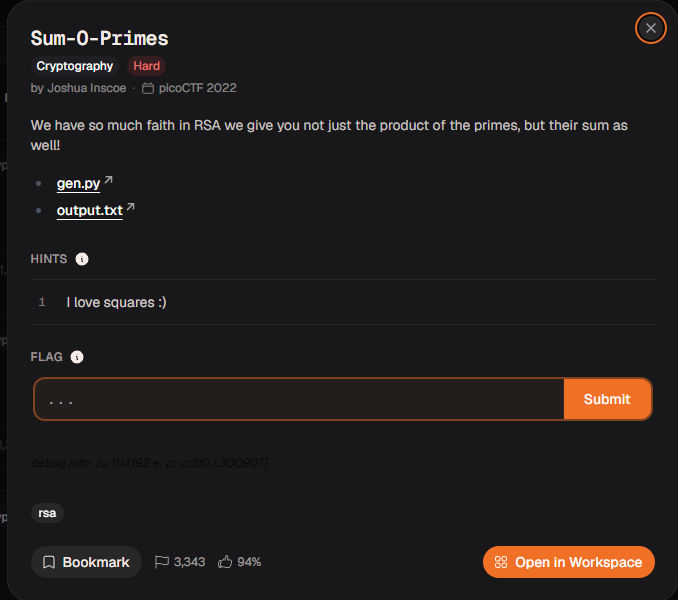

# Sum-O-Primes

#### Category: Cryptography - Difficulty: Hard - Ngày viết: 11/16/2026

#### 1. Overview

* 
* Đây là 1 bài khá là đơn giải khi mà bài này chỉ cần áp dụng định lý Viet đảo đã được học ở cấp 2 để tìm ra $q$, $p$ và giải mã ciphertext :v
* `Mục tiêu`: Dựa vào leak $x$, phân tích thừa số nguyên tố $N$ và giải mã ciphertext
* `Kỹ thuật`: Định lý viet đảo . [Đọc](<https://vieclam123.vn/dinh-ly-viet-b152.html#:~:text=l%C3%BD%20viet%20thu%E1%BA%ADn-,1.3.%20%C4%90%E1%BB%8Bnh%20l%C3%BD%20Vi%2Det%20%C4%91%E1%BA%A3o%3A,-%C4%90%E1%BB%8Bnh%20l%C3%BD%20Viet>)

#### 2. Exploit chain

* Ta đang có 2 mẫu dữ liệu cần thiết để tìm ra $p$ và $q$ đó là $x = q + p$ và $N = q * p$
* Ta áp dụng viet đảo, để lập phương trình bậc 2: $y^2 + xy + N = 0$ và nghiệm của phương trình này chắc chắn là $q$ và $p$
* Sau đó, ta giải mã ciphertext và lấy được cờ !
* Script: [Đọc](solve.py)
* ```
  academy{pl33z_n0_g1v3_c0ngru3nc3_0f_5qu4r35_2a4c68a9}
  ```
