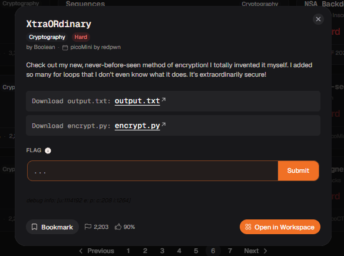
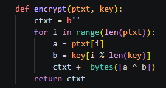
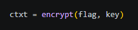
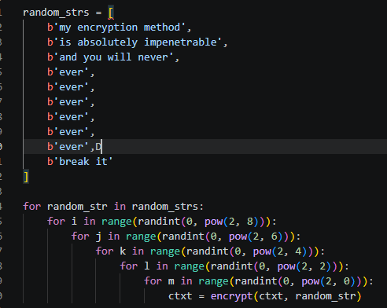
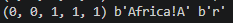

# XtraORdinary

#### Category: Cryptography - Difficulty: Hard - Ngày viết: 11/18/2026

#### 1. Overview

* 
* Đây là 1 bài khá là hay =))))
* `Mục tiêu`: Phá mã bộ mã hóa tự chế, giải mã ciphertext
* `Lỗ hỗng`: Tính nghịch đảo của phép `xor`
* `Kỹ thuật`: Mask + Biết trước bản rõ một phần

#### 2. Nền tảng cốt lõi

* Các bạn cần hiểu được tính chất cốt lõi của phép `xor`

#### 3. Phân tích lỗ hỗng/ Ý tưởng khai thác

* Mã nguồn server: [Đọc](encrypt.py)
* 
* 
* Flag được encrypt với key.
* 
* Ta gọi str là phần tử trong list random_strs, sau đó là 1 chuỗi liên hoàn encrypt flag với các str trong list
* Và ta dễ dàng nhận thấy rằng, hàm encrypt chỉ đơn giản là bộ mã hóa **Repeating-Key XOR**
* Khi encrypt 2 lần liên tiếp cùng 1 key, flag sẽ được khôi phục lại trạng thái như cũ.
* Với mỗi str trong list, sẽ có 2 trạng thái đối với ciphertext là đã xor và chưa xor với str. Ta rút gọn list `random_strs` xuống còn 5 phần tử (`ever`bị lặp và mỗi str chỉ có 2 trạng thái)
* Khi đó, sẽ có $2^5 = 32$ ciphertext khác nhau, trong đó sẽ có 1 ciphertext chính là kết quả của encrypt flag với key ở đầu source code: $C = flag \oplus key$
* Ta biết 1 phần bản rõ là `academy{` hoặc là `picoCTF{`. Ta chỉ cần xor ciphertext với 1 phần bản rõ để khôi phục lại 1 phần khóa.
* Nếu key dài hơn đoạn bản rõ đã biết quá nhiều (trên 4 byte)  **trong khi ciphertext quá ngắn để phân tích thống kê** , ta gần như không thể brute-force phần khóa còn lại
* Tuy nhiên, nếu key dài hơn bản rõ đã biết và dài hơn cỡ 4 ký tự thôi thì ta gần như không thể brute force phần còn lại của key và không thể giải được bài này.

#### 4. Exploit chain

* Bước đầu tiên là ta cần khôi phục lại toàn bộ 32 ciphertext khả dĩ. Sau đó xor với phần bản rõ đã biết là `picoCTF{`- (mình đã có thử `academy{`nhưng bài này format flag không phải là nó :b)
* Mình nhận thấy rằng có nhiều phần key đã lộ ra và hầu hết là bytes rác, trong đó có 1 key khá là đặc biệt bởi vì nó là 1 từ tiếng anh.
* 
* `Africa!`
* Xác suất để xor ngẫu nhiên mà ra chữ cái tiếng anh này rất là thấp, hoặc nó là secret key, chứ không thể nào mà nó sai được :v
* Chữ `r`bên cạnh là phép encrypt ở kí tự cuối cùng của ciphertext với `}`. Chữ `r`nằm trong `Africa!`nên khả năng đây là key rất cao bởi vì hàm encrypt tuần hoàn key
* Lấy secret key là `Africa!`, và mask để khôi phục lại ciphertext trước khi encrypt liên hoàn là `(0, 0, 1, 1, 1)`- `(Nếu đối chiếu source của mình, ciphertext đã được xor với b'and you will never',b'ever', b'break it' sau đó được lưu vào file output.txt)`
* Giải mã và thu được cờ
* Script: [Đọc](solve.py)
* ```
  picoCTF{w41t_s0_1_d1dnt_1nv3nt_x0r???}
  ```
