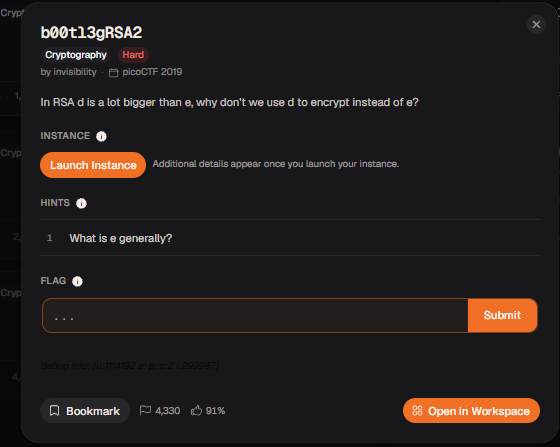

# b00tl3gRSA2

#### Category: Cryptography - Difficulty: Hard - Ngày viết: 11/16/2026

#### 1. Overview

* 
* Đây là 1 bài tấn công wiener đơn giản :v.
* `Mục tiêu`: Khôi phục khóa bí mật $d$, giải mã ciphertext
* `Lỗ hỗng`: Khóa bí mật nhỏ
* `Kỹ thuật`: Wiener's attack

#### 2. Exploit chain

* Mình có hướng dẫn chi tiết về wiener's attack ở bài `Small Trouble`: [Đọc](../../Medium/Small_Trouble/write-up.md)
* Script: [Đọc](solve.py)
* ```
  academy{bad_1d3a5_8722867}
  ```
