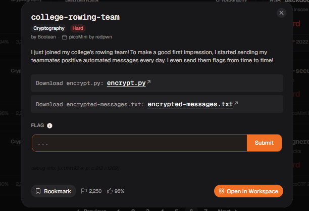
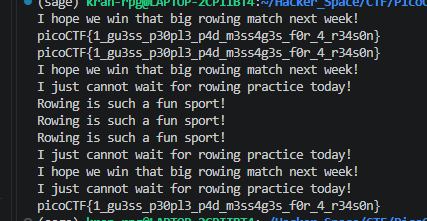

# college-rowing-team

#### Category: Cryptography - Difficulty: Hard - Ngày viết: 11/18/2026

#### 1. Overview

* 
* `Mục tiêu`: Giải mã ciphertext
* `Lỗ hỗng`: e = 3, msg không được pad
* `Kỹ thuật`: căn bậc 3

#### 2. Exploit chain

* Lúc đầu mình tưởng đây là 1 bài sử dụng hastad's broadcast attack để giải. Nhưng lỗ hỗng chính ở bài này chính là e =3 và msg không được pad.
* Điều này dẫn đến bản rõ $M$ khi mã hóa sẽ $M^3 < N$. Và phép modulus không xảy ra!
* Ta chỉ cần tính căn bậc 3 cho tất cả `ciphertext`là thu được cờ
* 
* Script: [Đọc](solve.py)
* ```
  picoCTF{1_gu3ss_p30pl3_p4d_m3ss4g3s_f0r_4_r34s0n}
  ```
