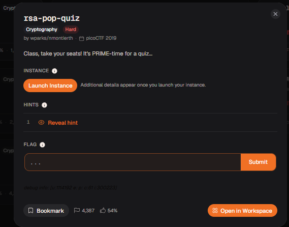
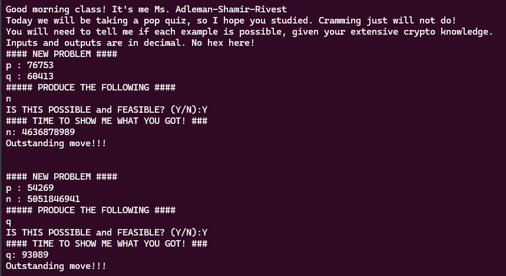
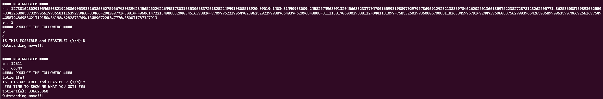
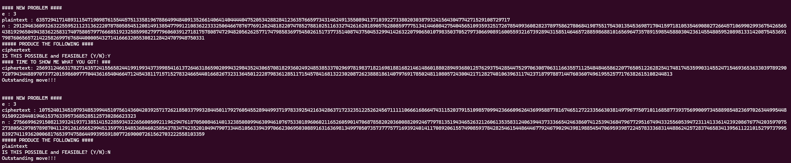
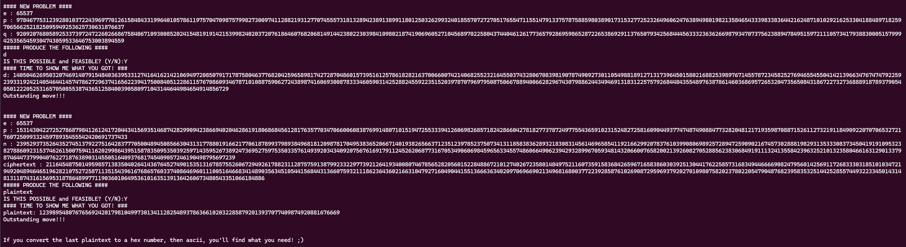

# rsa-pop-quiz

#### Category: Cryptography - Difficulty: Hard - Ngày viết: 11/16/2026

#### 1. Overview

* 
* Bài này làm khá là giải trí =))))
* `Mục tiêu`: Hoàn thành bài quiz kiểm tra kiến thức về RSA

#### 2. Exploit chain

* Các bạn chỉ cần trả lời câu hỏi mà thôi :v
* 2 câu hỏi đầu tiên:
* 
* 2 câu hỏi tiếp theo:
* 
* 2 câu hỏi tiếp theo nữa:
* 
* 2 câu hỏi cuối cùng:
* 
* Script: [Đọc](solve.py)
* ```
  academy{wA8_th4t$_ill3aGal..oCFc4DC2a}
  ```
