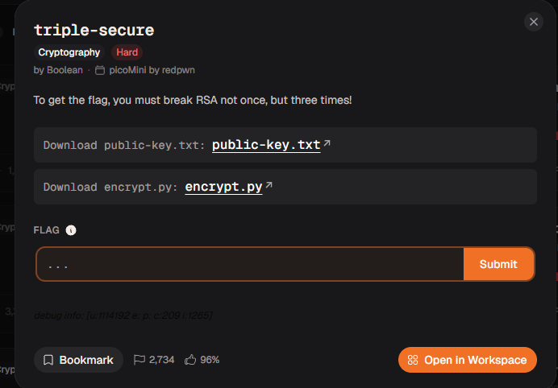

# triple-secure

#### Category: Cryptography - Difficulty: Hard - Ngày viết: 11/16/2026

#### 1. Overview

* 
* Mình không hiểu lắm khi mà bài này được xếp vào mức hard :v
* `Mục tiêu`: Giải mã ciphertext
* `Lỗ hỗng`: Các modulus $N$ chia sẻ chung thừa số nguyên tố với nhau

#### 2. Exploit chain

* Mã nguồn server: [Đọc](encrypt.py)
* Chúng ta chỉ cần phân tích $q, p ,r$, rồi tính giải mã từng lớp mã hóa là được. :v
* Script: [Đọc](solve.py)
* ```
  picoCTF{1_gu3ss_tr1pl3_rs4_1snt_tr1pl3_s3cur3!!!!!!}
  ```
